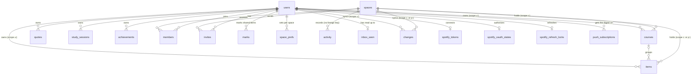

# Term — data model

Term's internal name is `rounds` (the Worker, the D1 databases, cookies and IndexedDB).
Cloudflare D1 (SQLite), several users, every row stamped with its owner: a `scope` on
courses and items (`u:<user id>` for a person's own; `c:<space id>` for a shared class,
`p:<space id>` for a team project), a `user_id` on the rest. Shared classes are live
for everyone (collaboration Stages 1–7). Team projects (Stage 8, in the views since
Stage 9) are open to everyone and in the calendar feed since Stage 10.
The browser never talks to the database. A Worker reads the session cookie, resolves
the user, and every query it runs has `user_id = ?` (or the user's scope) in it.

```
users            one row per account: username, password hash, profile, coat, theme, background
courses          a course + its weekly class meetings, as a JSON column
items            exams, quizzes, assignments, labs, tutorials, office hours, tasks, projects
quotes           the quote tile's list
study_sessions   study time: timer runs and time logged by hand, by course and item
achievements     your own achievements: an uploaded sticker and what earns it
spaces, members  shared classes and team projects, and who is in each
invites          invitations to a space by username
marks            your layer on a shared item: status, grade, notes, hidden
space_prefs      your colour, target, term and archive for a space
activity         what members did in a space: the inbox and each class's Activity tab
inbox_seen       the last activity row each person has read
push_subscriptions  each device that turned on the morning digest
```

The schema is [`migrations/0001_schema.sql`](../migrations/0001_schema.sql), in one
piece. Six times between September and 5 October 2026 the live data moved into a fresh database built from it
(`node scripts/move-db.mjs --from <old> --to <new> --remote`): first `rounds` into
`rounds-v2`, replacing ten migrations of patches, then `rounds-v2` into `rounds-v3`,
folding in the study timer, quizzes, grade targets and the calendar feed, then
`rounds-v3` into `rounds-v4`, folding in study history, achievements, the school
calendar and the leaderboard, then `rounds-v4` into `rounds-v5`, widening the theme to
six, then `rounds-v5` into `rounds-v6`, adding the Admin page (`users.is_admin`,
`users.last_seen_day`, `error_log`, `admin_log`, `app_meta`), then `rounds-v6` into
`rounds-v7`, giving courses, items and the change feed a scope. `rounds-v7` is the live
database. The schema the last move copied from is kept as a test
fixture in `test/fixtures/legacy-migrations/`. Later changes are new numbered files:
`0002_spaces.sql` (`spaces`, `members`), `0003_invites.sql` (`invites`),
`0004_marks.sql` (`marks`, `space_prefs`) and `0005_activity.sql` (`activity`,
`inbox_seen` and the triggers that fill `activity`), `0006_push.sql`
(`push_subscriptions`) and `0007_grades.sql` (`courses.credits`,
`courses.grade_categories`, `items.category`, `users.grading`, and the course and item
change triggers made again to carry them). The next one is `0008`.

## Structure at a glance

| Area | Tables | Responsibility |
| --- | --- | --- |
| Account and tracker data | `users`, `courses`, `items`, `quotes`, `study_sessions`, `achievements` | Profiles and the records users edit |
| Shared classes and projects | `spaces`, `members`, `invites` | Who is in which space, join codes and invitations |
| Your layer on shared rows | `marks`, `space_prefs` | Your status, grade and notes on a shared item; your settings for a space |
| Activity and the inbox | `activity`, `inbox_seen` | What members did in each space (90 days), and how far each person has read |
| Synchronization | `changes`, `sync_state` | Latest record changes, ordered cursors per scope, and the retention floor |
| Authentication and request control | `login_throttle`, `request_limits` | Temporary attempt counts and cooldowns |
| Spotify connection | `spotify_tokens`, `spotify_oauth_states`, `spotify_refresh_locks` | Credentials, one-use consent attempts, and refresh leases |
| Push reminders | `push_subscriptions` | The devices that get the morning digest |
| Admin page | `error_log`, `admin_log`, `app_meta` | Caught failures (30 days), what admins did (90 days), app-wide values (announcement, maintenance, last cron run) |
| Read-only inspection | `active_items`, `account_summary` | Views over existing records, with no duplicate stored data |



An item's optional course relationship is `(scope, course_id)` to
`courses(scope, id)`, so ownership cannot cross scope boundaries. Direct hard
deletion of a referenced course is restricted. The application's soft-delete
transaction clears only `course_id`, increments affected item revisions, and
records the resulting changes before a later purge can remove the course.
Account removal remains an explicit operation that deletes dependent records first.

Conventions used throughout:

- **Ids** are client-generated strings, up to 24 chars (the prototype's are 7). The
  primary key is `(scope, id)` for courses and items, `(user_id, id)` for the others, so
  two people can hold the same id without colliding and ownership is part of the key, not a filter you might
  forget.
- **Dates** are `YYYY-MM-DD` strings in *your* local calendar, never a timestamp.
  A deadline of "Friday 23:59" must not shift because you opened the app in another
  timezone, and ISO strings sort chronologically, so `date >= ?` works.
- **Times** are `HH:MM` 24-hour strings, or `''` for none. Displayed as `0800`.
- **Weekdays** are `0`–`6`, Sunday = 0, matching `Date.prototype.getDay()`.
- **Timestamps** (`created_at`, `updated_at`, `deleted_at`, `completed_at`)
  are integers, milliseconds since the epoch, the same unit as
  `Date.now()`. The server sets `updated_at` on every write.
- **Deletes are soft.** `deleted_at` is set, the row stays, and the next `sync` pull
  tells other devices to drop it. A daily cron hard-deletes tombstones after 30 days.
- Small, always-read-together lists (class meetings, checklists, links) are **JSON
  columns**, not tables. They are read with their parent every time and never queried
  on their own. The schema checks they are valid JSON arrays and caps their length;
  the Worker validates each entry.

---

## `users`

| Column | Type | Rules | Notes |
| --- | --- | --- | --- |
| `id` | text, PK | random | Never the username, so a rename is one `UPDATE`. |
| `username` | text, unique | 3–32, `[a-z0-9._-]`, lower-cased | What you sign in with. |
| `password_hash` | text | | `pbkdf2$iterations$salt$hash`, see `worker/password.js`. Never leaves the Worker. |
| `display_name` | text | ≤ 60 | Editable. |
| `coat_name` | text | ≤ 28 | Your name, shown on the theme's sidebar picture (lab coat, ID badge, suit, flight jacket, jersey, vest). |
| `coat_role` | text | ≤ 34 | Your goal, the line "Headed for …" on the picture, e.g. `Headed for MS II`. |
| `coat_color` | text | one of the five | Tints the Medicine coat (the only theme where it is chosen), the Spotify clip and your own achievements. |
| `theme` | text | `light` \| `dark` \| `system` | |
| `bg` | text | `med` \| `cs` \| `law` \| `pilot` \| `sports` \| `eng`, default `med` | The theme (Medicine, Computer Science, Law, Aviation, Sports, Engineering), independent of `theme` (the appearance). |
| `term_start` | text \| null | `YYYY-MM-DD` | The week board's default start. Null means today. With a school calendar, its current semester's first day counts instead. |
| `school_calendar` | JSON object | `{}` = none | The school's academic calendar, below. |
| `types` | JSON array | ≤ 20 | Your item types: overrides for the built-ins (label, colour, hidden, order) and up to 12 of your own, ids `c-` plus 1–12 of `[a-z0-9]`. |
| `study_flow` | JSON object | | The study timer's steps and rounds, below. |
| `study_prefs` | JSON object | `{}` = defaults | Daily goal, streak rules, celebrations, feed alarms, lecture reviews and the first-run setup, below. |
| `grading` | JSON object | `{}` = defaults | Your grading scale and pass marks, below (`0007_grades.sql`). |
| `feed_gen` | int \| null | > 0 | The calendar feed: a number while it is on, null when off. The feed URL carries an HMAC of the user id and this number, so bumping it retires every old link. |
| `leaderboard` | int 0/1 | default 0 | Joined the study leaderboard (opt-in; only those who joined see it or are listed). |
| `is_admin` | int 0/1 | default 0 | May open the Admin page. The first admin is made with `npm run user:add -- <name> --admin --remote`. |
| `last_seen_day` | text \| null | `YYYY-MM-DD` | Last UTC day the person opened the app; written by `GET /api/me` at most once a day. |
| `hidden_sources` | JSON array | ≤ 40 | What you have hidden from your views, below. |
| `created_at`, `updated_at` | int | | |
| `revision` | int | starts at 1 | Optimistic concurrency for profile edits. |
| `pw_gen` | int | starts at 0 | Password/session generation; changing it revokes existing sessions. |

A row is created by `npm run user:add`, or from the Admin page, with the defaults. The API
exposes it as the **profile**, with the coat fields nested: `{coat: {name, role,
color}, theme, bg, types, studyFlow, studyPrefs, schoolCalendar, hiddenSources, grading,
termStart, isAdmin, ...}`. `feed_gen`, `leaderboard` and `last_seen_day` are not in it.

`hidden_sources`: what you have hidden from your Week, your Month and your calendar feed: `course:<id>`, `space:<sid>`, `personal`; at most 40. All items, grades and stats still count them. (Until Stage 6 the Week and Month applied them for admins only.) Sent and received as the profile's `hiddenSources`; a `PUT /api/me` without it keeps it.

`grading`: `{scale: [{letter, min, points}], pass: [marks]}`, each part optional. `scale`
is up to 20 steps, each a letter (1–4 characters) from a percentage `min` (0–100, no two
the same) worth `points` (0–10); left out, a 4.0 scale (A from 93 worth 4.0 down to F).
`pass` is up to 5 whole marks 1–100 that replace 50, 60 and 70 as the grade panel's
targets. `normalizeGrading` in `src/core/grades.ts` fills the defaults; the sidebar's GPA
reads letters off this scale. A `PUT /api/me` without it keeps it; `{}` is the defaults.

The twelve course colours; the first five are also the coat colours:

| Name | Hex |
| --- | --- |
| Pink | `#E4749B` |
| Purple | `#8B5CC7` |
| Turquoise | `#17B3AE` |
| Baby blue | `#79B6EA` |
| Little lilac | `#BCA6E6` |
| Coral | `#F08A6C` |
| Sunflower | `#E8B33A` |
| Mint | `#4FBF8B` |
| Sage | `#8FAE86` |
| Royal blue | `#4F74D9` |
| Berry | `#B8457E` |
| Slate | `#7D8A99` |

---

## `courses`

| Column | Type | Rules | Notes |
| --- | --- | --- | --- |
| `scope`, `id` | text, PK | | `u:<user id>` (personal), `c:<space id>` (class), `p:<space id>` (project; items only). |
| `code` | text | 1–8 | `CVS`, `ANAT`. Shown in the table and month chips. |
| `name` | text | 1–80 | `Cardiovascular Block`. |
| `color` | text | one of the twelve | Drives every chip, pip and card for this course. |
| `instructor` | text | ≤ 60 | `Dr. Alvarez`. |
| `term` | text | ≤ 40 | The school calendar semester the course runs in, by name (`Winter 2027`); its classes show only between that semester's first and last day. `''`, or a name no semester has, means all year. |
| `archived` | int 0/1 | | Hidden from the sidebar, kept for the record. |
| `meetings` | JSON array | ≤ 12 | The class timetable. |
| `target` | int \| null | 1–100 | The final grade you are aiming for. Personal courses only; a class keeps each member's in `space_prefs`. |
| `credits` | real \| null | 0–30 | For the GPA; null counts as 3 (`DEFAULT_CREDITS`), 0 leaves the course out. |
| `grade_categories` | JSON array | ≤ 12, default `[]` | `gradeCategories`: `{id ≤24, name 1–40, weight 0–100, drop 0–20}`, ids unique. A category's weight is shared equally by the items in it that count, after dropping its `drop` lowest scores (real or what-if; one scored item always stays). |
| `updated_by` | text \| null | | The member who last wrote a class's course; null on your own. |
| `created_at`, `updated_at`, `deleted_at` | int | | |
| `revision` | int | starts at 1 | Optimistic concurrency, as on every synced row. |

A class's course (`c:` scope) holds the class's facts only: `target` is null and
`archived` 0; its colour and term are the class defaults that members' prefs start from.
Its credits and grade categories are class facts too, set by owners and editors, and
merge field by field like the rest (`SHARED_FIELDS` in `src/core/shared.ts`). Leaving or
detaching a class, converting a course and sharing an item copy them.

A write from an older client leaves `credits`, `gradeCategories` and an item's `category`
out; the Worker then keeps the stored values (`GRADE_FIELDS` in `worker/db.js`), and a new
row starts with the column's default.

### `meetings[]` — one weekly class

| Field | Type | Rules | Notes |
| --- | --- | --- | --- |
| `id` | string | ≤ 24 | Client-generated, stable across edits. |
| `kind` | string | `Lecture` \| `Lab` \| `Seminar` \| `Tutorial` \| `PBL` \| `Clinical` | |
| `weekday` | number | 0–6 | |
| `start`, `end` | string | `HH:MM` | `end` after `start`. |
| `room` | string | ≤ 40 | `Hall A`, `Lab 3B · table 7`. |

These are what the **month view** shows, and only these. They are not `items` — a class
that meets every Monday all term is one array entry, expanded onto the calendar in the
client.

---

## `items`

One table for all eight built-in types and your own (`c-…`, see `users.types`). They share every column, differ only in which `status`
values apply, and the week board and table need them interleaved by date.

| Column | API field | Type | Rules | Notes |
| --- | --- | --- | --- | --- |
| `scope`, `id` | `id` | text, PK | | `u:<user id>` (personal), `c:<space id>` (class), `p:<space id>` (project; items only). |
| `type` | | text | see below | Fixed at creation, editable in the drawer. |
| `title` | | text | 1–140 | |
| `course_id` | `courseId` | text \| null | FK to `courses` | Cleared on every matching item when a course is deleted. The FK is composite, so it cannot point at another user's course. |
| `date` | | text | `YYYY-MM-DD` | For a deadline, the day it's due. For a recurring slot, the first occurrence. |
| `start`, `end` | | text | `HH:MM` or `''` | A deadline usually has `end` only (`23:59`). |
| `location` | `where` | text | ≤ 80 | Room, lab, platform. `where` is a SQL keyword, hence the rename. |
| `status` | | text | see below | |
| `grade` | | real \| null | 0–100 | Only meaningful when `status == 'graded'`. |
| `weight` | | real \| null | 0–100 | The share of the course grade the item carries; a missed item with a weight counts as 0 (`src/core/grades.ts`). Left aside when the item counts in a category. |
| `category` | | text \| null | ≤ 24 | The id of one of its course's `grade_categories`; an id the course no longer has reads as none, and `weight` counts again. Not on a project task (`400 {field:'category'}`). |
| `notes` | | text | ≤ 5000 | The item's page. |
| `checklist` | | JSON array | ≤ 50 | `{id, text ≤140, done}`. Drives the pink progress bars. |
| `links` | | JSON array | ≤ 20 | `{label ≤60, url ≤500}`. |
| `recur` | | text \| null | `weekly` \| null | Office hours and standing tutorials. |
| `weekday` | | int \| null | 0–6 | Required when `recur == 'weekly'`, enforced by a table-level `CHECK`. |
| `recur_until` | `recurUntil` | text \| null | `YYYY-MM-DD` | End of term; null means open-ended. |
| `dept` | | text | ≤ 40 | Office hours only: the faculty's department, shown greyed. |
| `completed_at` | `completedAt` | int \| null | | Stamped when status leaves `todo`. |
| `updated_by` | `updatedBy` | text \| null | | The member who last wrote a shared row; null on your own. |
| `class_id` | `classId` | text \| null | ≤ 24 | A personal item filed under a shared class (the class's space id): an extra quiz, a lecture review. A label only; it never grants access. Not with `course_id`. |
| `assignees` | | JSON array | ≤ 30 | Project tasks only: user ids, or `["*"]` for everyone. |
| `completed_by` | `completedBy` | text \| null | | Project tasks only: who finished it. |
| `created_at`, `updated_at`, `deleted_at` | camelCase | int | | |
| `revision` | | int | starts at 1 | Optimistic concurrency. |

A `CHECK` limits what each scope may hold. A class item (`c:`) hangs off the class's
course and carries only the class's facts: `status` stays `todo`, with no grade,
checklist or completion; each member's live in their `marks`. A project row (`p:`) is a
`project` or `task`, with the team's status, checklist and completion, and never a
grade, weight or course.

The Worker converts between `snake_case` columns and the camelCase the prototype
already uses, so the front end's field names do not change.

### `type` and its `status` set

| `type` | Statuses | Counts as complete (pink row) |
| --- | --- | --- |
| `exam` | `todo` Upcoming · `done` Taken · `graded` Graded | `done`, `graded` |
| `quiz` | `todo` Upcoming · `done` Taken · `graded` Graded | `done`, `graded` |
| `assignment` | `todo` Open · `submitted` Submitted · `graded` Graded | `submitted`, `graded` |
| `lab` | `todo` Scheduled · `done` Attended · `missed` Missed | `done` |
| `tutoring` (shown as Tutorial) | `todo` Scheduled · `done` Attended · `missed` Cancelled | `done` |
| `office` | `todo` Planned · `done` Went · `missed` Skipped | `done` |
| `task` | `todo` To do · `done` Done | `done` |
| `project` | `todo` In progress · `done` Shipped · `missed` Dropped; milestones are the checklist | `done` |
| `c-…` (your own) | those of its kind: To-do as `task`, Event as `lab`, Graded as `assignment` | as that type |

The schema validates `status` against the whole set (`todo`, `submitted`, `graded`,
`done`, `missed`); the per-type restriction is the client's job, since it's a UI
affordance rather than a data guarantee.

### Derived, never stored

| Value | How |
| --- | --- |
| Overdue | `status` is open, not recurring, and `date < today` |
| Due soon | open and `0 ≤ date − today ≤ 2` |
| Next exam countdown | earliest open `exam` with `date ≥ today` |
| Class hours / week | sum of `meetings[]` durations across courses |
| Lab hours | `lab` durations, closed vs all |
| Checklist progress | `checklist` done / total |

Storing any of these would mean a write every midnight. They cost nothing to compute.

---

## `quotes`

| Column | Type | Rules |
| --- | --- | --- |
| `user_id`, `id` | text, PK | |
| `text` | text | 1–300 |
| `source` | text | ≤ 80, may be empty |
| `created_at`, `updated_at`, `deleted_at` | int | |

---

## `study_sessions`

One row per finished study-timer run, or per stretch logged by hand from Log study
(`note` and `manual`). Only study time is logged,
never breaks; a run with under a minute of study saves nothing. The run in
progress lives in the browser's IndexedDB on that device and does not sync.

| Column | Type | Rules |
| --- | --- | --- |
| `user_id`, `id` | text, PK | |
| `course_id` | text, nullable | cleared when the course is deleted; the session stays |
| `item_id` | text, nullable | cleared when the item is deleted; the session stays |
| `started_at` | int | ms since the epoch |
| `study_minutes` | int | 1–1440, whole minutes |
| `rounds_done` | int | 0–12, rounds whose every step finished |
| `note` | text | up to 200 characters: what was covered |
| `manual` | int | 1 when logged by hand, 0 when the timer recorded it |
| `space_id` | text, nullable | the shared space `course_id` or `item_id` belongs to, when it is a class's or a project's (a session on a team project has `course_id` `project`, the project's own item, and `item_id` the task, when one is picked) |
| `created_at`, `updated_at`, `deleted_at` | int | |

The flow itself is `users.study_flow`, JSON `{"steps":[["study",25],["break",5]],"rounds":4}`:
1–12 steps of 1–180 minutes with at least one Study step, 1–12 rounds.

The school's academic calendar is `users.school_calendar`, JSON
`{"name":"Vanier College 2026–27","terms":[{"name":"Autumn 2026","start":"2026-08-24","end":"2026-12-10"}],"days":[{"from":"2026-10-06","to":"2026-10-06","kind":"swap","label":"Monday schedule","follows":1}]}`:
1–4 semesters (first and last day of classes) and up to 80 special days, each `off`
(no classes), `break` (study break, left out of week numbers), `exams`, `swap` (runs the
`follows` weekday's timetable) or `note` (a marker). Read from a PDF by
`POST /api/school-calendar` and checked by the person before it is saved;
`src/core/school.ts` works out each day for the views, the lecture reviews and the
calendar feed. A class keeps a copy of its owner's in `spaces.school_calendar`, offered
to people who join without one of their own.

The goal and streak rules are `users.study_prefs`, JSON `{"goal":120,"dayMin":15,"rest":[0],"celebrate":true,"alarms":true,"reviews":"2026-09-01","setupDone":true}`:
a daily goal of 0–720 minutes (0 = none), 1–240 minutes to make a day count, up to six
rest days (0 = Sunday) that never break the streak, and fireworks on or off. Streaks,
weeks, months and the heatmap are worked out on the device (`src/core/history.ts`).
Three more fields are each optional:

- `alarms`: whether the calendar feed carries alerts (a day and an hour before each open
  exam, quiz, assignment, lab and team project; 09:00 the day before an all-day one).
  Missing is on.
- `reviews`: the day spaced lecture reviews were turned on, or `null` for off. Missing
  means unknown: a profile from before reviews were synced, when the browser's own
  setting (`localStorage`, per account) still counts and is moved up once. Each browser
  keeps its own watermark, the last lecture day handled, never earlier than this day.
- `setupDone`: `true` once the first-run setup was finished or skipped, so no device
  offers it again; never stored as `false`.

A `PUT /api/me` whose prefs leave out `reviews`, `alarms` or `setupDone` (a tab opened
before them) keeps the stored value of each (`PREFS_SQL` in `worker/db.js`); the other
fields are replaced.

---

## `achievements`

Your own achievements. The built-in ones (study hours,
streaks, big days, tasks, exams, grades) are never stored: they are worked out on the
device from sessions and items, as is whether one of these is earned
(`src/core/achievements.ts`). At most 30 live rows per account; `PUT` a 31st is
`400 too_many`.

| Column | Type | Rules |
| --- | --- | --- |
| `user_id`, `id` | text, PK | |
| `name` | text | 1–40 |
| `sticker` | text | the picture itself: a `data:image/{webp,png,jpeg};base64,` URL, at most 90,000 characters. Cut to a circle and shrunk to 256px or less in the browser (`src/core/sticker.ts`). Served only through the API, to its owner. |
| `rule` | text | `hours` \| `grade` |
| `course_id` | text | `hours` only: the course whose study time counts. A plain reference; a deleted course leaves it locked. |
| `item_id` | text | `grade` only: the exam or quiz. A deleted one leaves it locked. |
| `target` | int | hours 1–1000, or the least grade, 1–100 |
| `space_id` | text | the shared space `course_id` or `item_id` belongs to, when it is a class's or a project's |
| `created_at`, `updated_at`, `deleted_at` | int | |

---

## `spotify_tokens`

One row per user who has connected Spotify. Not synced to the browser; the Worker
reads it to call Spotify on the user's behalf.

| Column | Type | Rules |
| --- | --- | --- |
| `user_id` | text, PK | |
| `refresh_token` | text | Versioned AES-GCM ciphertext: `keyId.ciphertext`, encrypted using independent `SPOTIFY_TOKEN_KEYS`. Legacy unversioned tokens are migrated when refreshed; see [DEPLOYING.md](DEPLOYING.md#spotify) for the keyring and rotation. |
| `access_token` | text | lives an hour, kept in clear |
| `expires_at`, `updated_at` | int | ms since the epoch |

---

## `push_subscriptions`

One row per device that turned on the morning digest (`0006_push.sql`, `worker/push.js`).
Not synced to the browser. The push carries no payload, so no keys are kept: the service
worker fetches `GET /api/digest` itself when the push arrives.

| Column | Type | Rules | Notes |
| --- | --- | --- | --- |
| `endpoint` | text, PK | `https://`, 20–1000 | Only the browsers' push services' hosts are accepted (`PUSH_HOSTS`). |
| `user_id` | text | FK `users`, `ON DELETE CASCADE` | At most 5 per person: a sixth replaces the oldest. |
| `tz` | text | 1–64, default `UTC` | The device's IANA time zone, so the digest comes in its morning. |
| `created_at`, `last_ok_at` | int \| null | | |
| `last_sent_day` | text \| null | `YYYY-MM-DD` | The local day the digest last went, so the hourly cron sends once a day. |
| `failures` | int | 0–100 | In a row; the row goes at 5, or at once when the push service answers 404 or 410. |

A device also goes when its owner signs out on it or turns the digest off there.

---

## `spaces`

A shared class (`kind = 'class'`, its rows in scope `c:<id>`) or team project (`'project'`, scope `p:<id>`). The id is 12 characters of `[a-z0-9]`, made by the Worker. A space has no name of its own: a class is named by its one course, a project by its `project` item. `archived` makes it read-only for everyone. `school_calendar` (class) is a snapshot of the owner's school calendar, offered to joiners who have none: copied when the class is made (only a calendar with at least one semester; else NULL), refreshed by the owner's `POST /api/spaces/:sid/school` (an owner with no usable calendar leaves the old snapshot as it was), and returned by `GET /api/spaces/:sid` as `schoolCalendar`. Taking it saves it as your own profile's calendar, and never over one you already have (`adoptSchool` in `src/data/school-edit.ts`); `parent_space`/`parent_item` (project) link it to a class assignment. `code_hash`/`code_expires`/`code_uses_left` hold the join code (Stage 3). `revision` moves on with every change to the space **or its members** (`worker/spaces.js`: above the change feed's head and above every other space's revision), so sync sends a member list only when it moved.

## `members`

`(space_id, user_id)`, `role` `owner`|`editor`|`member`, `joined_at`, `deleted_at` (left or removed; a rejoin revives the row). Leaving or being removed runs one set-based batch in `worker/leaving.js` (*detach*) that ends the membership last, so a retry does nothing twice: with a copy, the class course and items are upserted into your own scope (reviving the tombstones a convert or merge left under the same ids; an id a live row of yours already holds becomes `'k' + id`, or `k1…`, `k2…`), each item taking your mark, your notes followed by `Class notes:` and the class's; your filed items, sessions and achievements move onto the copy (a copy for someone no longer in the class is filed under no class); your marks and prefs there are soft-deleted. Without a copy only your layer goes; sessions keep their minutes and the app labels them *A class you left*. Deleting an account hands each class it owns to its longest-standing editor, else its longest-standing member (`HAND_ON` in `worker/accounts.js`, also used by `scripts/add-user.mjs --delete`), and soft-deletes one with nobody else in it (each hand-on also writes a `space.transferred` activity row); memberships, invites, marks, prefs and `inbox_seen` go by cascade, and the activity rows about the account are deleted. Before any of that, `HAND_ON` takes the account off the `assignees` of every task in the live projects it is in (a task left with nobody becomes unassigned). Leaving or being removed from a **project** is not a detach: nothing is copied (see Team projects). A partial unique index keeps exactly one live owner per space. Every shared read and write checks live membership of a live space inside its own statement (`worker/access.js`).

## `invites`

`(space_id, user_id)`: an invitation to a space by username (spec §11). `invited_by` (NULL once that account is gone), `role` given on accepting (`editor` or `member`; never `owner`, which moves only by a transfer), `status` `pending` | `accepted` | `declined`, `created_at`, `expires_at` (30 days on). A repeat invite refreshes the one row; accepting makes or revives the membership and marks the row `accepted`. Deleted with its space or the invited account, and by the nightly purge 90 days after `created_at`.

## `marks`

`(user_id, id)`, `id = '<space id>:<item id>'`, unique `(user_id, space_id, item_id)`: your layer on one shared item (spec §4). `status`, `grade`, `weight` (an override; NULL uses the class's), `notes`, `checklist` (exam prep's topics), `completed_at`, `hidden` ("not mine": out of your views, grades and stats), timestamps, `deleted_at`, `revision`. Same `CHECK`s as the matching `items` columns. On a project's item only `notes` and `hidden` are used. Its changes go into your own feed (`'u:' || user_id`). Written through `/api/marks/:sid/:itemId` with a field-level merge, and by the convert and absorb batches; detach (leaving, removal, deleting a class) and **Keep as mine** soft-delete yours as they copy, sharing an item writes your part of it into one, and the nightly purge soft-deletes the bare ones on expiring shared items. Deleted with the account.

## `space_prefs`

`(user_id, id)`, `id = space_id`: your settings for one space: `color` (one of the twelve), `target`, `term` (your semester for a class; `''` is every semester), `archived` (in your sidebar), timestamps, `deleted_at`, `revision`. Written by the Worker when you make, convert, accept or join (the class's colour unless you use it, else the first free; its term; for a project, which has no course, the first free colour and no term), then through `/api/space_prefs/:sid` with whole-row `If-Match`. Its changes go into your own feed. Deleted with the account.

## `activity`

`seq` (autoincrement), `space_id` (12 characters; no foreign key, so rows about a person outlive the space), `actor_id` (who acted, `''` when unknown; no foreign key, so a row outlives the account), `verb`, `subject` (the item or course id; `''` for creations and member or space events), `subject_user` (whom it is about: an assignee, a removed member, a new owner; `''` for everyone, never NULL), `old_value`, `new_value`, `detail` (a JSON object: `by`, `title` or `titles`, `whom`, `space`, `assignees`, the names as they were, so a row still reads once the item, the account or the space is gone), `n` (how many changes it stands for), `bucket` (`at / 600000`, ten minutes), `at`. What members did in a space (spec §12), read by the inbox and each class's Activity tab; separate from `changes`, which keeps only a row's latest state for sync. **Kept 90 days.**

The `verb` CHECK lists all eighteen verbs, so Stages 8–10 need no migration: `item.created`, `item.deleted` (`'0'`/`'1'`, so a restore reads "restored"), `item.date` (`date|start|end`), `item.weight`, `item.title`, `course.meetings`, `course.instructor`, `task.assigned` (one row per newly added assignee, `subject_user` the assignee or `''` for `*`), `task.unassigned` (a task left with nobody), `task.status` (`todo`/`done`, project tasks, `detail.assignees`), `member.joined`, `member.left`, `member.removed`, `member.role`, `space.archived`, `space.transferred`, and Stage 8's `space.linked` and `space.deleted`.

Rows coalesce on the unique key `(space_id, actor_id, verb, subject, subject_user, bucket)`: a later change by the same person to the same thing in the same ten minutes updates the row in place (its `new_value`, `n`, `at`, `detail`), keeping the first row's `seq` and "from", so a row already read does not come back as unread. A change that returns to where it started deletes its row. Indexes: `activity_space (space_id, seq)` (a space's activity; the inbox per space you are in), `activity_about (subject_user, seq) WHERE subject_user != ''` (rows about a person), `activity_at (at)` (the purge).

**Triggers** write the rows about shared items and courses (`activity_items_insert`, `activity_items_update`, `activity_courses_update`, in `migrations/0005_activity.sql`). They see `OLD` and `NEW`, so "from → to" is the real previous value, and the actor is `NEW.updated_by`. An insert writes one `item.created` per actor and bucket holding up to ten titles (an import is one row; the project's own `project` item is not news) and a `task.assigned` per starting assignee; an update writes one row per kind of change it makes, then deletes the rows it brought back to their start (and an assignee added and taken off again in the bucket); a class course's update writes `course.meetings` and `course.instructor`. Personal rows (`u:` scope) never write activity. Because of the triggers, `meta.changes` on a shared `items` or `courses` write counts their rows too: count your own with `SELECT changes()`.

**Routes** write the member and space rows with `noteStmt` (`worker/activity.js`) inside their own batch, each with a condition that the act happened in that batch (a membership whose `joined_at` or `deleted_at` is now, a role whose `updated_at` is now, `changes() > 0` after the archive's update), so a retried request that changed nothing writes nothing: `member.joined` (accept, join by code), `member.left`, `member.removed`, `member.role`, `space.archived`, `space.transferred`. Their bucket is `CAST(now AS INTEGER) / 600000` (`BUCKET` in `worker/accounts.js`): D1 binds a JavaScript number as a REAL, and without the cast the division keeps its fraction and nothing coalesces. A role changed back, or a class unarchived, within the bucket leaves no row (`undoneStmt`). Deleting an account appends a set-based `space.transferred` statement to `HAND_ON` (`worker/accounts.js`): one row in each class just handed on, the deleted account as actor and the heir as `subject_user`, written before the user row goes so the names still read. `ACCOUNT_TABLES` deletes the rows about the account (`subject_user`); rows it acted in stay, with its name in `detail.by`.

## `inbox_seen`

`user_id` (primary key, `ON DELETE CASCADE`), `seq`: the last activity row you have read. Kept off `users`, so reading never moves the profile's revision. `PUT /api/inbox/seen` moves it forward only, and never past the newest activity row there is.

## Indexes

| Index | Serves |
| --- | --- |
| `study_sessions (user_id, started_at)` | the week's study log |
| `study_sessions (user_id, course_id)`, `(user_id, item_id)` | unlinking a deleted course or item |
| `items (scope, date)` | any future "this term only" query |
| `items (scope, course_id)` | course detachment and composite foreign-key lookups, including tombstones |
| `*_deleted (deleted_at)` | the nightly tombstone purge |
| `changes (scope, seq)` | current paginated sync protocol |
| `changes (deleted_at)` | expired deletion-history cleanup |
| `login_throttle (updated_at, locked_until)` | expired login-attempt cleanup |
| `request_limits (reset_at)` | expired request-window cleanup |
| `spotify_oauth_states (expires_at)` | expired consent-attempt cleanup |
| `spotify_refresh_locks (expires_at)` | expired refresh-lease cleanup |
| `spaces (revision)` | which spaces' member lists moved, on sync |
| `spaces (code_hash)` | looking up a join code |
| `members (space_id)` unique, live owners only | exactly one live owner per space |
| `members (user_id)`, live only | my spaces, on every sync |
| `invites (user_id)`, pending only | my invites |
| `invites (created_at)` | the planned invite purge |
| `activity (space_id, seq)` | a space's Activity tab; the inbox per space you are in |
| `activity (subject_user, seq)`, rows about someone only | the inbox's rows about you, even after you left the space |
| `activity (at)` | the nightly purge of activity over 90 days |
| `push_subscriptions (user_id)` | a person's devices, when subscribing and on the digest |
| `error_log (at)`, `admin_log (at)` | the Admin page's lists and their nightly cleanup |

Primary keys and unique constraints also provide indexes. Clients page through
`changes`; no route reads rows by timestamp.
Filters, search, and view switches use the browser's local data after sync.
The added indexes cover existing relationship and maintenance queries; tests check
their query plans. See [D1 index guidance](https://developers.cloudflare.com/d1/best-practices/use-indexes/).

## Inspection and maintenance

`active_items` shows live items with their course code and name. `account_summary`
shows each account's live course, item, and quote counts. Neither view contains
password hashes or Spotify credentials. They are administrative SQL conveniences,
not permission boundaries: queries for an account must still filter `user_id`.

```sql
SELECT * FROM active_items WHERE user_id = ? ORDER BY date, id;
SELECT * FROM account_summary WHERE user_id = ?;
```

The health command checks SQLite integrity, foreign keys, revision values, live
course references, and change-feed coverage/orphans. It prints aggregate counts,
exits nonzero on problems or incomplete results, and changes no records.

```sh
npm run db:local                 # apply pending migrations to local development
npm run db:check                 # inspect local data, read-only
npm run db:check -- --json        # machine-readable report
npm run db:check -- --remote      # explicitly inspect production, read-only
```

A change that would rebuild a table goes into a fresh database instead:
`scripts/move-db.mjs` builds the new database from the squashed schema and copies the
rows across with their revisions, tombstones and change feed, so cursors keep working.
`activity` and `changes` are rebuilt (`REBUILT` in `scripts/lib/move-db.js`): the
triggers write rows of their own as the shared items and courses go in, so each table is
emptied and refilled from the source with its sequence numbers, and its counter is put
back to the source's head (for `activity`, at least every `inbox_seen.seq`), so no row
written after the move reuses a number someone has already read past. The comparison
(`differences`) lets the activity counter end higher than the source's.
Resolve reported data problems explicitly instead of deleting records to make a move
pass. The previous database is kept as a backup.

Meetings, checklists, and links remain bounded JSON arrays because they are loaded
and edited with their parent. There is no second source of truth for these lists.
Foreign-key behavior follows [D1's enforced relationship rules](https://developers.cloudflare.com/d1/sql-api/foreign-keys/).

---

## API

All routes are under `/api`, speak JSON, and require the session cookie except
`POST /api/login`. Rows are camelCase on the wire.

| Route | Body → Response |
| --- | --- |
| `POST /api/login` | `{username, password}` → `{profile}` and `Set-Cookie`. `401 bad_login` for a wrong password or an unknown user alike. |
| `DELETE /api/session` | → clears the cookie. |
| `POST /api/session/revoke-all` | → `204`, clears the cookie and invalidates every other session of this user. |
| `GET /api/me` | → `{profile}`, with `announcement` and `maintenance` (see Maintenance mode) |
| `PUT /api/me` | `{coat, theme, bg, termStart, displayName, types, studyFlow, studyPrefs, schoolCalendar, hiddenSources, grading}` (`bg` optional, default `med`; `types`, `studyFlow`, `studyPrefs`, `schoolCalendar`, `hiddenSources` and `grading` optional, kept when left out; `schoolCalendar: {}` removes it; prefs without `reviews`, `alarms` or `setupDone` keep the stored ones) → `{profile}` |
| `POST /api/outline` · `POST /api/school-calendar` · `POST /api/ai/schedule` | the file (or a PDF's text; a timetable PDF's starts with one line per class read from its grid, `Mon 08:30-10:00 \| title \| code \| room`) as the body, `?name=&today=` (and `terms`, `codes`) → what Workers AI read: an outline, a school calendar `{name, terms, days, truncated}`, or a timetable. Nothing is saved. The three share ten reads a day per person (`429 outline_limit`); a failed read is `503 outline_unavailable`. |
| `GET /api/ai/reads` | → `{left, limit}`: the AI reads left today. |
| `GET /api/sync?v=3&cursors=<scope>:<seq>,…&sv=<n>` | the current protocol: a cursor per scope, your own rows (including `marks` and `space_prefs`) and those of your live spaces; the last page of a pull (`more: false`) also carries `unread`, the inbox's count. See Sync v3 below. |
| `GET /api/sync?v=2&cursor=<seq>` | kept only for tabs on the old client: `{changes: [{kind, row}], cursor, more, reset}`, at most 100 changes of your own `courses`, `items`, `quotes`, `study_sessions`, `achievements` after `cursor`. |
| `GET /api/{courses,items,quotes,study_sessions,achievements}/:id` | one live row of yours, or `404`. The client uses it to undo a rejected save. |
| `PUT /api/courses/:id` | a course (with an optional `target`, a whole-number grade goal 1–100) → the stored course, with server `updatedAt`. Upsert. |
| `DELETE /api/courses/:id` | → `204`. Soft-deletes and nulls `courseId` on the user's items and study sessions. |
| `PUT /api/items/:id` · `DELETE /api/items/:id` | as above; deleting nulls `itemId` on the user's study sessions |
| `PUT /api/quotes/:id` · `DELETE /api/quotes/:id` | as above |
| `PUT /api/study_sessions/:id` · `DELETE /api/study_sessions/:id` | `{courseId, itemId, startedAt, studyMinutes, roundsDone, note, manual}`, as above |
| `PUT /api/achievements/:id` · `DELETE /api/achievements/:id` | `{name, sticker, rule, courseId, itemId, target}`, as above; `400 too_many` past 30. `classId` (items), `spaceId` (sessions, achievements) and `hiddenSources` (profile) left out of a body keep their stored values. |
| `GET /api/calendar` · `POST /api/calendar` · `DELETE /api/calendar` | the calendar feed: → `{on, url}`; POST turns it on or makes a new link (the old one stops working); DELETE turns it off. See `worker/calendar.js`. |
| `GET /api/calendar/:userId/:token.ics?tz=` | no session: the feed itself, `text/calendar`. The token is an HMAC of the user id and `users.feed_gen`; a wrong one is `404`. At most 60 fetches an hour per link. Carries your classes and team projects too: see The calendar feed below. |
| `POST /api/spaces` | `{kind:'class', course}` (blank) or `{kind:'class', convertCourseId, items:[id]}` → `201 {space}`; you become the owner, with prefs from the course, and the class takes a copy of your school calendar (see `spaces`). Anyone signed in; a `kind` other than `'class'` or `'project'` is `400`. There is no hourly limit on making classes, only the 20 live spaces. A convert **moves** your course and the items named into the class in class shape: your status, grade, checklist, notes and completion into marks, your colour, target, term and archive into prefs; your course and those items are soft-deleted, the course's other items filed under the class (`classId`), your sessions and achievements on them labelled with the space. Converting the same course again answers the class it made (`200`). `409 limit` past 20 spaces. |
| `POST /api/spaces` (project) | `{kind:'project', title, date?, parent?: {space, item}}` → `201 {space}`: a team project with you as its owner, its `project` item (the title, trimmed, 1–140 characters, no NUL; the date given, else the parent's) and your prefs, in one batch. Anyone signed in. `parent` is any live item of a class you are a live member of (`400 {field:'parent'}` otherwise); with no `parent`, `date` is required (`400 {field:'date'}`). `409 limit` past 20 spaces. See Team projects. |
| `POST /api/spaces/:sid/link` | the owner of an unarchived project: `{parent: {space, item}}` links it to that class item and sets the project's date to the item's; `{parent: null}`, or no `parent` at all, unlinks it and keeps the date → `204`. `400 {field:'parent'}` for an item you can't see, `404` on a class. Writes `space.linked`. (The spec's `PATCH`.) |
| `GET /api/spaces/:sid` | → `{id, scope, kind, role, archived, members, invites, code, schoolCalendar}`: the members and the class's school-calendar snapshot (or `null`) for everyone in the space, its invites for the owner and editors, the join code's expiry and uses left for the owner. `404` outside it. |
| `POST /api/spaces/:sid/school` | the owner, archived or not: copy your school calendar into the class again → `{schoolCalendar}` (what the class now holds). With no calendar of yours that has a semester, the old snapshot stays. Classes only (`404` otherwise). The app syncs first and says so when your calendar has not reached the server yet. |
| `POST /api/spaces/:sid/invites` · `DELETE /api/spaces/:sid/invites/:userId` | `{username, role?}` → `201` the invite (30 days; a repeat refreshes it). The owner or an editor; only the owner gives a role other than the default. `404 no_user`, `409 member`; 20 an hour. So anyone in a class can learn whether a username exists by inviting it, at most 20 names an hour. DELETE withdraws it: whoever sent it, or the owner. |
| `GET /api/inbox` | → `{invites, items, seen}`: your invites (as `GET /api/invites`), the inbox's newest 50 rows within the 90 days, newest first, and your `inbox_seen.seq` (0 for none). Each row: `{seq, spaceId, space, kind, verb, subject, actor, subjectUser, about, old, new, detail, n, at}`, `space` the space's name now (or as it was, once gone), `about` whether it is about you. See The inbox and activity below. |
| `PUT /api/inbox/seen` | `{seq}` → `204`: you have read up to `seq` (forward only, never past the newest row). `400 {field:'seq'}` for anything but a whole number ≥ 0. |
| `GET /api/spaces/:sid/activity?before=<seq>` | → `{items, more}`: a space's Activity tab, 30 rows below `before` (the newest when left out) within the 90 days, newest first, in the inbox's row shape. Any live member, archived or not; `404` outside it; `400 {field:'before'}` for a bad `before`. |
| `GET /api/invites` · `POST /api/invites/:sid/accept` · `POST /api/invites/:sid/decline` | your invites, expired ones marked (the list is for old clients only: the app reads invites from `GET /api/inbox`); accept → `{space}` (`404` once withdrawn, `410 expired`, `403 archived` while the class is archived, `409 limit`/`full`; the invite stays pending); decline → `204`. |
| `POST /api/spaces/:sid/code` · `DELETE /api/spaces/:sid/code` | the owner: a new 8-character code → `201 {code, expires, usesLeft}` (7 days, 10 uses; only its SHA-256 is kept; a new one retires the old) · turn it off. |
| `POST /api/join` | `{code}` → `{space}`. 10 tries an hour; `404` unknown, `410 expired`, `403 archived` while the class is archived (no use spent), `409 limit`/`full`; a space you are already in answers with it. A pending invite to that class is accepted with it, with its role. |
| `PUT /api/spaces/:sid/members/:userId` · `POST /api/spaces/:sid/transfer` | the owner, archived or not: `{role: 'editor'\|'member'}` → `{userId, role}`; `{userId}` makes that member the owner and you an editor → `204`. |
| `POST /api/spaces/:sid/leave` | `{keepCopy}` (true when left out, or with no body) → `204`: leave a class, with a copy of it as your own course or without (see `members`); or a project, which copies nothing (`keepCopy` is checked but ignored; see Team projects). The owner hands it on first: `403 owner`. Archived or not. |
| `DELETE /api/spaces/:sid/members/:userId` | the owner, archived or not: remove a member, who always keeps a copy of a class and nothing of a project → `204`. Never yourself or the owner (`403`); `404` for someone not in it. |
| `POST /api/spaces/:sid/archive` | the owner: `{archived}` → `204`. Archived is read-only for everyone (shared edits, invites, codes, joining and accepting an invite `403 archived`); roles, transfer, remove and unarchiving still work. Classes and projects. (The spec's `PATCH /api/spaces/:sid`.) |
| `DELETE /api/spaces/:sid` | a class: the owner, only while nobody else is in it (`409 members`, also when someone joins meanwhile): `{keepCopy}` (true when left out) → `204`; the class is soft-deleted and purged 30 days later. A project: the owner, archived or not, with `{confirm}` its title (trimmed; `400 {field:'confirm'}` otherwise) → `204`, whoever else is in it; see Team projects. |
| `POST /api/spaces/:sid/items/:id/keep` | **Keep as mine**: a class item an editor removed, that your mark holds something on, becomes your own item filed under the class, with your layer folded in → `204`. Archived or not; `404` otherwise. |
| `POST /api/spaces/:sid/absorb` (`{items}`) | the owner or an editor: `{items:[id]}` (1 to 50) → `{shared}`: share items of yours filed under the class with it. The class item takes the facts, your status, grade, checklist, notes and completion go into your mark, your sessions and grade achievements on it get the space. `400 {field:'items'}` for one not yours under the class or a lecture review, `400 {field:'type'}` for a custom type, `409 exists` for an id the class has live or when nothing was shared; `403 archived`. |
| `POST /api/spaces/:sid/absorb` | `{courseId, pairs:[[yourItemId, classItemId]], fromCourse?}` → `{paired, filed}`: merge a course of yours into a class you are in. Marks from your paired items, sessions and achievements moved to the class's ids, your other items filed under the class, your course soft-deleted; your target (and, with `fromCourse`, colour, term and archive) into your prefs. Writes no shared row. A custom-typed item is refused (`400 {field:'pairs'}`); a course already gone answers `{paired: 0, filed: 0}`. |
| `GET\|PUT\|DELETE /api/marks/:sid/:itemId` | your mark on an item of a space you are in (`404` otherwise, or when the item is deleted). `PUT` merges field by field with `changed` (as shared rows), else whole at `If-Match`; on a project's item only `notes` and `hidden`. |
| `GET\|PUT\|DELETE /api/space_prefs/:sid` | your prefs for a space you are in: `{color, target, term, archived}`, whole-row `If-Match`. |
| `GET\|PUT\|DELETE /api/spaces/:sid/{courses,items}/:id` | a shared row of a space you are in; see Sync v3 for how a `PUT` merges. |
| `GET /api/push/key` | → `{enabled, key}`: whether push is set up (the three `VAPID_*` secrets) and the public key to subscribe with. |
| `POST /api/push` · `DELETE /api/push` | `{endpoint, tz}` → `204`: this device gets the morning digest (a known push service's `https://` address and an IANA zone; `400 {field}` otherwise, `503 push_off` without the secrets); DELETE `{endpoint}` → `204` stops it. See `push_subscriptions`. |
| `POST /api/push/test` | `{endpoint}` → `{result}`: a test push to one of your devices now, and how the push service answered. 5 an hour; `404` for a device not yours, `503 push_off` without the secrets. |
| `GET /api/digest?tz=` | → `{title, body, today, tomorrow, overdue}`: what the morning notification says, from the same rows as the calendar feed (your hidden sources left out). Open, dated, one-off items due today or tomorrow, and overdue ones from the last 14 days; office hours and tutorials never count. The service worker calls it when a push arrives. |
| `GET /api/leaderboard?since=<ms>` · `PUT /api/leaderboard` | → `{joined, week, all}`, each list `[{name, minutes, me}]`, empty until you join; `since` is your Monday 00:00. PUT `{joined: true\|false}` → `204`. See `worker/leaderboard.js`. |
| `/api/spotify/…` | the Music player: `connect` and `callback` (OAuth), `status`, `token` (for the Web Playback SDK), `player` and its controls, `devices`, `transfer`, `shuffle`, `repeat`, `volume`, `queue`, `play`, `search`, `recent`, `me`, `playlists`, `albums/:id/tracks`, `artists/:id/albums`; `DELETE /api/spotify` disconnects. Compact answers, never raw Spotify JSON. See `worker/api.js` and `worker/spotify/`. |
| `/api/admin/…` | admins only (`403 forbidden` otherwise): `accounts` (list, create, `:id/password`, `:id/revoke`, `:id/admin`, delete), `locks/:key` (clear a login lockout), `errors`, `audit`, `traffic`, `health`, `announcement`, `maintenance`. See `worker/admin.js`. |

Errors are `{error, field?}`: `400` bad shape (with the field), `401` no session,
`404` a row that isn't yours, `413` body over 1 MB.

### The calendar feed

`serveFeed` (`worker/calendar.js`) reads, in one batch, your own courses and items and,
for each live class you are a live member of (the membership checked inside each
statement), its live course with your prefs and its live items with your mark;
`feedRows` turns them into the feed's rows. A class's ids become `<space id>-<id>`, so
its events' UIDs read `item-<space>-<id>@rounds` and `class-<space>-<course>-<meeting>…`
and never meet your own (`item-<id>`, `class-<course>-<meeting>…`). A class course takes
your semester (`space_prefs.term`, else the class's); a class item takes your status (✓
when done, graded or submitted) and weight, and your notes come before the class's.
Left out: a class item an editor removed (a tombstone, whatever your mark holds), one you
hid (`marks.hidden`), a class you archived in your sidebar (`space_prefs.archived`), and
every source in `hidden_sources` (`course:<id>`, `space:<sid>`, `personal`). A class its
owner archived stays. Your items filed under a class (`class_id`) show under its course;
one whose class you have left stays, with no course.

**Team projects** (Stage 10): the same batch reads `PROJECT_ROWS`, for each live project
you are a live member of, its live `project` item and those of its live tasks assigned to
you or to everyone (`json_each(assignees)` holding you or `*`, so others' tasks never leave
D1; `feedRows` checks again with `mineOrAll`), with your mark and your prefs. Ids become
`<space id>-<id>` as a class's do, so UIDs read `item-<space>-<id>@rounds`. A project's own
item reads `Team · <project>`, a task `<project> · <task>` ("Team project" when the
project item has no title); neither has a course, so no course code is added. Status is
the team's (✓ when done, whoever completed it), and your notes come before the team's.
Left out: a row you hid (`marks.hidden`), a project in `hidden_sources` (`space:<sid>`)
and one archived in your sidebar; one its owner archived stays. The feed does not fold a
project into its linked assignment: a calendar app has no chips, so both show.

### Outline imports into a class

An outline read with AI (`POST /api/outline`) opens the import preview with a target
(`src/data/class-import.ts`): **My courses** (as before), a class you own or edit, or a
**new class**. Class targets are the live, unarchived classes where you are the owner or
an editor and whose course has downloaded to this device; they are not offered while
the admins have shared classes switched off (an admin keeps them, under a bar). Switching
target plans the original outline again from scratch, keeping week 1.

Against a class, every row goes under the class's one course, and the class's weekly
meetings it already has (same weekday and start) start unticked. Each row is matched one
to one against the class's live items, on type plus the title normalised to letters and
digits of any script (case and punctuation aside; a title with none never matches): rows
on the same day first, then any left, in order. A recurring row is the same occurrence by
weekday and start, a one-off by date. A matched row is **Already there** (unticked) when
nothing differs, else **Changed** (unticked), its `was` naming what the class has where
the outline differs: the day, the time, the room, the weight. A time, room or weight the
outline leaves blank is no change, and importing a Changed row keeps the class's value
for it, its notes and status, and a recurring item's series unless the row recurs too.
Unmatched rows are **New**, ticked when dated. Setting week 1 in the preview dates the
week-numbered rows and matches them again (`setWeekOne`), so a row the class has goes
back to unticked. Import writes the ticked rows as ordinary shared writes (the Worker
lets an owner or editor make them): meetings onto the course (at most 12), New rows as
the class's items, Changed rows onto the items they match.

A **new class** (from the preview's target, or *New shared class → From a course
outline*) is made only on Import: `POST /api/spaces` with the outline's course and its
ticked meetings, in the semester picked in the preview (the picker shows for My courses
and a new class; `''` is all year), then its ticked items once the class has downloaded.
If it was made but hasn't downloaded yet (`NotDownloaded`), the sheet stays open, now
targeting the class just made, and the next Import adds the items to it; any other
failure keeps the preview open with the reason, to try again. The outline choice in New
shared class is disabled while Import with AI is switched off or no AI reads are left.
There is no `POST /api/spaces {outline}`: the class is made from the preview's rows.

### The inbox and activity

Nothing is fanned out (spec §12): the inbox is a query (`INBOX` in `worker/activity.js`)
over the `activity` rows **about you** (`subject_user` is you, by its partial index, even
in a space you have left, or one deleted) plus, in each live space you are a live member of, the rows **since
you joined** whose verb concerns everyone: `item.created`, `item.deleted`, `item.date`,
`course.meetings`, `space.archived`, `space.linked`, a task given to everyone, and a
task's completion or reopening when it is assigned to you or to everyone. Your own
actions are never in it, and every read holds to the 90 days (`KEEP_MS`) without waiting
for the purge. `GET /api/inbox` answers the newest 50 with your pending invites.
A project's events need nothing more: `task.assigned` reaches the assignee (or everyone,
for `*`), a completion its assignees, `member.removed` and `space.deleted` the person
they are about (`test/project-inbox.test.js`, Stage 10).

**Unread** is your pending, unexpired invites to live spaces plus the inbox rows above
your `inbox_seen.seq`, at most `UNREAD_CAP` (99, `src/core/shared.ts`). The Worker counts
it once per sync cycle, on the last v3 page (`unread`), so it costs one query per pull;
the app takes it from a complete pull (`onUnread` in `src/core/sync.ts`) and drops a value
that is not a whole number from 0 to 99 rather than failing the page. The bell in the top
bar shows the count, or `99+` (read aloud as "99 or more unread"), and no count at all
for someone not an admin while shared classes are switched off; their bell opens the
maintenance page.

**On the device** (`src/data/inbox.ts`): opening the inbox fetches it and keeps the list
in IndexedDB's `meta` store under `inbox`, so offline it shows the copy from last time.
It then marks everything read up to the newest row (`PUT /api/inbox/seen`), dropping the
count to the invites still waiting; rows new on opening keep their dot while the sheet is
open. Marking read does nothing while the inbox came from the offline copy, and a failed
`PUT` puts the marker and the count back, so the next open sends it again; a success
starts a sync, whose count replaces any older one a pull already under way brings back.
Answering an invite takes it out of the list and the count. A row opens what it is about:
its item while it is on this device, else its class's or project's sheet; a row with nothing to open
(a class you left, an item gone) is plain text. An unlinked project (`space.linked` with
no `new`) reads "… unlinked … from its assignment".

The **Activity tab** (`src/components/sheet/activity-list.tsx`) fetches
`GET /api/spaces/:sid/activity` when it opens, 30 rows a page with **Show older** (focus
moves to the first row it brought). Only a request that never reached the server reads
"Connect to see activity" (or "…older activity"); an error answer says what it was, as
the class sheet's other errors do (`messageFor`); **Try again** shows when the first page
failed, **Show older** stays to retry a later one. An answer to an
older request (another class, a closed tab) is dropped. Rows open their item while it is
on this device; the class itself is not reopened from its own sheet.

### Team projects

A team project (spec §10) is a space of `kind = 'project'`: one `project` item (its name,
due date and description) and its tasks, all in scope `p:<id>`. It is made, linked, left
and deleted in `worker/projects.js`; tasks are ordinary shared writes. Open to everyone
signed in since Stage 10 (Stage 8 kept them to admins), with the limits a class has: 20
spaces a person, 30 members a space, invites 20 an hour, join attempts 10 an hour.
Invites to a project give `editor` by default.

**Making** (`POST /api/spaces {kind:'project'}`): one batch writes the space (with
`parent_space`/`parent_item` when it belongs to a class item), your owner membership, the
`project` item and your prefs (`joinPrefs`, the first colour you do not use). The parent
is any live item in a class you are a live member of; the project's date is the one given,
else the parent's.

**Tasks** are `PUT /api/spaces/:sid/items/:id` writes of `type: 'task'`. Owners and
editors write whole rows or merged fields; an assignee outside the project is `400
{field:'assignees'}` only when the write names `assignees` (a whole-row write always
does), so an editor's queued edit still naming someone who has left merges its other
fields onto the task the Worker stripped. A member's write (`memberTaskWrite` in
`worker/db.js`) names only `status`/`completedAt`, `assignees`, or both: a claim of an
unassigned task (or stepping off one) and a completion queued together go up as one
write, and the status then needs you (or `*`) on the task before or after the claim. A
claim of a task someone else took since you claimed it is `409 conflict` with
`fields: ['assignees']`; one already taken when you queued it is `403`. A project holds
**200 live tasks** at most (`TASK_LIMIT`): a new task, or a deleted one being revived,
past that is `409 limit`, checked inside the write; a live task is never refused for it.

**Linking** (`POST /api/spaces/:sid/link`): the owner of an unarchived project links it
to a class item (the project's date becomes the item's, which also writes an `item.date`
row) or unlinks it (the date stays). `space.linked` has `old_value` the item it was linked
to (`''` for none) and `new_value` the new item, or NULL for an unlink;
`detail.assignment` the item's title. A link undone within its ten minutes leaves no row
(`undoneStmt` matches a `''` "from" to a NULL "to").

**Leaving and removal** (`leaveProject`): one batch takes you off every live task's
`assignees` (a task left with nobody is unassigned: the trigger writes `task.unassigned`),
soft-deletes your marks and prefs there, ends the membership last, and writes
`member.left` or `member.removed`. Nothing is copied: the rows are the team's. Archiving,
unarchiving and handing on work as for a class.

**Deleting** (`DELETE /api/spaces/:sid {confirm}`): the owner, archived or not, typing the
title (both trimmed). One batch writes `space.deleted` about each other live member (while the space and
its name are live), soft-deletes every member's marks and prefs there and its invites,
then the space. Sync revokes it everywhere; the inbox drops the space's other rows but
still delivers `space.deleted` (a row about you); the nightly purge removes it 30 days on.

**On the device** (`src/data/projects.ts`): tasks are read straight from
`data.shared_items` and written with `store.saveShared`, so pending edits, field merge
and Saved copies work as for a class's items; a refused create reads "A project holds 200
tasks at most." Leaving and deleting upload your
edits first and take a repeat that answers not found, the project being gone here too,
as done (`uploadFirst`, `once`, `spaceGone` from `src/data/leave.ts`). `messageFor` and
`joinMessageFor` take the space's kind, so a project's errors say "project". Everyone sees
**New team project** in **+ New**, a **Projects** group in the sidebar, and the project
sheet (`project-sheet.tsx`): **Tasks** (add, done, claim, edit inline in `task-row.tsx`, whose Delete asks first;
the owner links, archives, unarchives and deletes by typing the name; anyone else leaves
after a confirm), **Members** and **Activity**. Until its rows arrive the sheet says it is
on its way; an archived project is read-only. Joining a project by invite or code offers
**Open the project** (no semester, colour or merge step).

**In the views** (Stage 9; worked out on the device, no Worker change):
`PROJECTS_IN_VIEWS = true` (`src/data/effective.ts`) lets `p:` rows into `mergeItems`
with `source: "project"`, their `assignees` and `completedBy`. A deleted task never stays
for a note of yours on it (no **Keep as mine** for a project's tombstones). Each view
filters them with a pure function:

- **Week and Month** (`forCalendar`): a project's own item (its due date), and of its tasks
  only those assigned to you or to everyone. A project's own item is left out when its
  linked assignment is on your calendar on the same date (not removed, the project dated);
  the assignment then carries `team: [{spaceId, name}]`, its chip shows the team glyph
  ("Team · Fire Response API"), and the search finds it by the project's name. Different
  dates show both. The sidebar's eye on a project writes `space:<sid>` to
  `hidden_sources`, as a class's does.
- **Ticking** a team task there (`toggleTask` → `toggleTeamTask` in `src/data/projects.ts`)
  sets the team's status with `setDone`, for a task assigned to you or to everyone (or as
  an owner or editor), and celebrates; otherwise, or while the project is archived, a toast
  says why. `setDone` names you as `completedBy` on the device until the sync brings the
  Worker's, and a task done again keeps who finished it first. Ticking and claiming write
  over the row as stored, so a title just typed is kept.
- **Stats** (`forStats`): your tasks only; a project's own item is not counted.
  **Achievements** (`forAchievements`): a project row only when you completed it. Grades:
  nothing (project rows carry no weight).
- **Study pickers** (`withProjects`): one course per project you are in, "Team · <name>",
  keyed by the project's own row (`p:<sid>/project`), whose items are your open tasks
  there. A session on one is saved with `courseId: "project"` and the project's
  `spaceId`; History names it the same way (`projectCourse`).
- **All items**: every project row, and a project's task says who has it. The **Source**
  select (`ui.source`: `all`, `personal` or `space:<id>`; not remembered across reloads)
  groups classes and projects; a class's source also lists your items filed under it.
  Picking one ends a stat tile's list; a source naming a space you are no longer in reads
  as all (`pickedSource`). The type chips' counts and the empty table's "Hidden by …"
  follow it.
- **The task card** (`task-sheet.tsx`, opened by a task's key; `openItem` opens a project's
  own item as the project sheet): **Team** (done, date, times, who has it, checklist, notes,
  links, "Edited by …"), written by owners and editors; a member ticks done on their own or
  everyone's tasks, claims or unclaims, and reads the rest. **Yours**: your notes and
  **Not mine · hide it** (your mark's `hidden`). **Delete for everyone** asks first.
- **The project sheet**: progress, live tasks done over live tasks ("12 / 18 · 67%", "No
  tasks yet"); each member's workload in the assignee picker (open tasks dated today to 14
  days ahead; a task for everyone counts for each: "Sam · 3 in the next 2 weeks"); and,
  for someone who holds the linked class (`assignmentOf`), "For Web Services · REST API
  Project" when the dates agree (an undated assignment always agrees), else "Assignment
  due 18 Oct" with **Use this date** for owners and editors (`takeAssignmentDate`, an
  ordinary write of the project item's date). An assignment no longer live on this device,
  or one in a class that is archived, reads "Linked assignment removed"; the link select
  leaves archived classes out. Below the tasks, **Hidden from you** with **Show again**.
- **The sidebar**: each project's ring (`progress-ring.tsx`) in its colour (`projectColour`:
  the linked class's while you hold it, else your own for the project), and the eye
  (`Eye` in `sidebar-parts.tsx`); a hidden project stays listed, dimmed.

### Maintenance mode

The Admin page's Maintenance tab switches features off while an admin works on
them. `app_meta` key `maintenance` holds `{features, message, updatedAt, updatedBy}`
(no table of its own, no migration); `features` ⊆ `app` (the whole app), `week`,
`month`, `table` (All items), `study`, `spotify` (Music), `import` (Import with AI),
`classes` (shared classes & projects), and `message` is at most 280 characters
(empty: the app's default copy). `GET/PUT /api/admin/maintenance` read and set it
(admins only, `400 invalid` for an unknown feature). Changes are not in `admin_log`,
whose `action` CHECK would need a migration; the value records who changed it.

`GET /api/me` carries `maintenance: {features, message, updatedAt}` while any is on,
else `null`, so a switch reaches everyone within a sync (a focus, five minutes, a
reload). The app shows non-admins the maintenance page in place of a page that is
off, and the message in the Import with AI sheet; admins keep the feature under a
bar. The Worker enforces what is a feature of its own: for non-admins, with
`import` or `app` on, `/api/outline`, `/api/school-calendar` and `/api/ai/*` answer
`503 {error: 'maintenance', feature}`; with `classes` or `app` on, so does every
`/api/spaces…`, `/api/invites…`, `/api/inbox…` and `/api/join` route. Personal
rows, `/api/me` and `/api/sync` are never stopped. A shared edit refused this way
stays pending on the device, with no try counted, and uploads once it is back.

### Session

`POST /api/login` looks the username up, verifies the password against its stored
PBKDF2-SHA256 hash (100,000 iterations, 16-byte salt, constant-time compare), and
runs the verification even for an unknown username so timing gives nothing away.
On success it sets `rounds_session`, an `HttpOnly; Secure; SameSite=Lax` cookie
holding `userId.generation.expiry.signature`, signed with `SESSION_SECRET`, valid
30 days and re-issued by `GET /api/me` once it is in its last week, so a regular
user stays signed in. The generation is `users.pw_gen`: a password reset and
`POST /api/session/revoke-all` ("sign out everywhere") bump it, and every older
cookie for that user stops working. There is no sessions table; rotating the secret
signs everyone out.

---

## Sync

Profiles and tracker rows carry a `revision`, with
`changes` for the latest change to each record, and `sync_state.floor` for the oldest
supported incremental cursor.

1. A local IndexedDB transaction saves a row and an individual `pending` operation
   together. The UI only announces the change after commit. Opening the database
   (now version 6, `src/core/db.ts`) moves a version 1 dirty map into `pending`
   without deleting unsent work.
2. Web Locks permit one sync cycle per account across tabs. IndexedDB transactions
   and persisted operation tokens remain the correctness boundary if Web Locks are
   unavailable. BroadcastChannel refreshes other tabs' render caches.
3. Writes require `If-Match: "revision"`; new records use `"0"`. The server compares
   and increments the revision within the write statement. A stale write returns
   `409 {error: "conflict", current}`; a missing precondition returns 428 so an old
   client cannot overwrite current data. Deletes use the same precondition.
4. `GET /api/sync?v=3` with zero cursors starts reconciliation (see Sync v3 below;
   `v=2`, one cursor for your own rows, remains for old tabs). Pages contain at most 100
   changes, the cursors, `more`, and `reset`. SQLite triggers capture each
   write transaction in an increasing sequence keyed by scope (`'u:' || user_id` for a
   person's own rows); repeated updates retain the latest
   change for that entity. Profile reads use `/api/me` and revisions separately.
5. The nightly purge advances the cursor floor before deleting old tombstones and
   their change entries, in one transaction. An expired cursor receives `reset:true`.
   The client clears only clean local rows and rebuilds them from cursor zero;
   pending edits and saved conflict copies remain. Each page and its cursor commit
   together.
6. A rejected edit is preserved in the `conflicts` store with the server's version.
   Settings lets the user inspect, export, restore, or discard that copy. Restoring
   uses a revision precondition again, so another intervening edit stays protected.
   Legacy queued edits to existing rows need review because their base revision is
   unknown; newly created offline records can upload normally.
7. Sign-out broadcasts connection closure and waits for database deletion. A durable
   cleanup marker prevents reopening data when cleanup was blocked. Account-bound
   request headers prevent an old tab uploading data under a newly changed cookie.

### Sync v3 (a cursor per scope)

The app pulls `GET /api/sync?v=3&cursors=u:<me>:812,c:<space id>:640&sv=905`. The Worker pages the person's own scope and their live spaces (at most 20), never a scope taken from the request; each scope's changes are read by its own statement, capped at 101 rows and guarded by live membership, all in one D1 batch (D1 refuses a compound SELECT of more than five terms). The answer is `{scopes, cursors, changes:[{scope, kind, row}], more, reset, revoked}`, and on the last page (`more: false`) `unread` (see The inbox and activity; so every v3 sync reads `activity`): `scopes` describes each space (with its members only when its revision is above `sv`), `reset` lists scopes whose cursor fell below the floor (each starts again from 0), and `revoked` lists scopes sent that the person may no longer read; the app removes them after the cycle's last page. A scope resyncing from 0 that is still below the floor carries a tagged cursor `r<seq>.<floor>` instead of a number; the app stores and sends it as it came, and the Worker answers a plain number once the scope is past the floor. Shared rows are written through `/api/spaces/<space id>/{courses,items}/<id>`: at the row's revision as a whole; otherwise the fields named in `changed` merge when each still holds its old or new value, else `409 {current, fields, by}`. `?v=2` remains for tabs on the old client and pages only the person's own scope.

On the device, IndexedDB version 6 holds shared rows in `shared_courses` and `shared_items` (keyed `[scope, id]`), the spaces in `spaces`, your `marks` and `space_prefs`, and `meta.cursors` (`{scope: seq}`, or the tagged string while a resync is under way); pending keys for shared rows are `shared_items:<scope>:<id>`. A class item an editor deletes stays in `shared_items` as a tombstone (with `deletedAt`); the app lists these apart (`removed_items`), keeps one in your views while your mark on it holds something (a status, grade, weight, notes, checklist or completion) and you have not hidden it, and drops a tombstone 30 days old unless such a mark still holds it. After a complete pull, `revoked` also drops your marks and prefs for a lost space; a mark edit still waiting to upload is carried onto your copy of the item when it has arrived (its notes replacing your part of the copy's notes), else it goes to Saved copies. A mark upload refused with `404` waits for that pull before it is set aside.

### The crons

`wrangler.jsonc` has two schedules; `scheduled()` in `worker/index.js` tells them apart
by `controller.cron`. Hourly (`0 * * * *`), `sendDigests` (`worker/push.js`) sends the
morning digest to each device whose local time is 07:00 to 09:59 and has not had today's,
so an hour the cron missed is made up; a morning with nothing due today or tomorrow and
nothing overdue sends nothing but is still marked. One run sends at most 40 pushes, under
the free plan's 50 outside requests; the rest go the next hour. Nightly (`0 3 * * *`), the
purge below.

### The nightly purge

`purgeTombstones` (`worker/db.js`) runs in this order: (1) soft-delete the marks on shared items whose tombstones expire, so the change feed carries it: every mark on a project task (your note goes with it, spec §13), only the bare ones (holding nothing) on a class item; (2) for each space deleted more than 30 days ago, its items, course, change feed, members, invites, marks, prefs and activity (except the rows about a person, `subject_user != ''`, which stay in that person's inbox), then the space; (3) the floor and the 30-day tombstones, now also `members`, never an expiring class item that a meaningful live mark still holds, invites 90 days after `created_at`, and activity 90 days after `at` (`KEEP_MS` in `worker/activity.js`); (4) after that batch, **Keep as mine** on behalf of each person still holding something on an expiring class item, at most 3 (person, class) groups a night, each group's failure logged and skipped. The kept item's class row goes the next night. A project's rows are never held back by a mark: only class items (`c:`) wait.

---

## Security model

1. **Ownership** — `requireUser()` runs first in every handler and every SQL statement
   filters on that user (`user_id`, or the scope `u:<user id>` for courses and items). No route accepts a `user_id` from the client. A row that
   belongs to someone else is a `404`, indistinguishable from a row that doesn't exist.
2. **Shape** — `CHECK` constraints in the schema enforce enums, lengths, date and
   time formats, JSON validity and array caps. `validate.js` runs the same rules first
   so the client gets a `400` naming the field instead of a raw SQLite error. Link URLs
   must be `http(s)`. A bug in the client cannot corrupt the tables or write a document
   large enough to matter; bodies over 1 MB are refused.
3. **Passwords** — PBKDF2-SHA256, 100,000 iterations, a 16-byte salt per user, a
   constant-time compare, and the same work done for unknown usernames. After five
   failures a username is locked, for one minute doubling up to an hour per further
   failure (`login_throttle`, cleared on success, swept nightly). A browser that has
   signed in as that name before carries a signed `rounds_device` cookie and is counted
   on its own, so failures from elsewhere cannot lock its owner out.
4. **Sessions** — `HttpOnly` keeps the cookie away from scripts, `SameSite=Lax` keeps
   other sites from posting with it, and every state-changing request must also carry
   a same-origin `Origin` / `Sec-Fetch-Site`, or none at all, else `403 cross_site`.
   Every API response, errors and redirects included, is `Cache-Control: no-store`
   and `X-Content-Type-Options: nosniff`. There is no CORS: unknown paths are a JSON
   `404`, a known path with another method `405` with `Allow`.
5. **The page** — `public/_headers` sets a Content Security Policy (scripts only from
   this origin, the Spotify SDK, and a hash of the inline theme script; no framing; no inline event
   handlers; `style-src-attr 'none'`), HSTS, `nosniff` and a same-origin referrer policy.
   React escapes all text it renders, and nothing uses `dangerouslySetInnerHTML`.
   Inline `style` attributes are blocked; React's `style` props are set through the
   DOM, and ids and colours are validated before they reach an attribute.
6. **Rate limits** — `worker/limits.js`, fixed one-minute windows in D1
   (`request_limits`), so they hold across tabs and isolates; a refused request does
   not extend or count toward its window, and gets `429` with `Retry-After`.

   | Budget | Limit | Key |
   | --- | --- | --- |
   | Sign-in, per IP | 30 a minute (`too_many_attempts`) | a SHA-256 of `cf-connecting-ip`; plus the per-username lockout above |
   | Every signed-in request | 600 a minute per account | `api:<user>`, claimed with the session check in one batch |
   | Spotify routes | 60 a minute per account | `spotify:<user>`; `token`, `status`, `connect`, `callback` and the `GET player` poll are exempt (still under the 600) |
   | AI reads (outline, school calendar, schedule) | 10 a day per account (`outline_limit`) | `outline:<user>`, counted before the model runs |
   | Calendar feed | 60 fetches an hour per link | |
   | Invites, join codes | 20 invites an hour, 10 join tries an hour | |

   When Spotify answers `429`, the Worker keeps a cooldown for its `Retry-After`
   (30 seconds when missing, at most 7 days) and refuses calls until it ends. A token
   refresh holds a 15-second lease; other requests wait up to 12 seconds, then get a
   retryable `503`. Playback commands are never retried. The nightly cron removes
   expired windows, OAuth states and leases.
7. **Caching** — the service worker (`public/sw.js`) caches only the public app shell
   and never `/api`. Your data lives in per-account IndexedDB for offline use, deleted
   on sign-out. Spotify lists are kept in memory only; sign-in, sign-out and disconnect
   reload the page to drop them.
