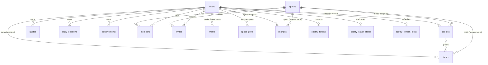

# Term — data model

Term's internal name is `rounds` (the Worker, the D1 databases, cookies and IndexedDB).
Cloudflare D1 (SQLite), several users, every row stamped with its owner: a `scope` on
courses and items (`u:<user id>` for a person's own; `c:<space id>` for a shared class,
`p:<space id>` for a team project), a `user_id` on the rest. Shared classes are live
(collaboration Stages 1–4) but admin-only until Stage 6.
The browser never talks to the database. A Worker reads the session cookie, resolves
the user, and every query it runs has `user_id = ?` (or the user's scope) in it.

```
users            one row per account: username, password hash, profile, coat, theme, background
courses          a course + its weekly class meetings, as a JSON column
items            exams, quizzes, assignments, labs, tutorials, office hours, tasks, projects
quotes           the quote tile's list
study_sessions   study time: timer runs and time logged by hand, by course and item
achievements     your own achievements: an uploaded sticker and what earns it
spaces, members  shared classes and team projects, and who is in each
invites          invitations to a space by username
marks            your layer on a shared item: status, grade, notes, hidden
space_prefs      your colour, target, term and archive for a space
```

The schema is [`migrations/0001_schema.sql`](../migrations/0001_schema.sql), in one
piece. Six times between September and 5 October 2026 the live data moved into a fresh database built from it
(`node scripts/move-db.mjs --from <old> --to <new> --remote`): first `rounds` into
`rounds-v2`, replacing ten migrations of patches, then `rounds-v2` into `rounds-v3`,
folding in the study timer, quizzes, grade targets and the calendar feed, then
`rounds-v3` into `rounds-v4`, folding in study history, achievements, the school
calendar and the leaderboard, then `rounds-v4` into `rounds-v5`, widening the theme to
six, then `rounds-v5` into `rounds-v6`, adding the Admin page (`users.is_admin`,
`users.last_seen_day`, `error_log`, `admin_log`, `app_meta`), then `rounds-v6` into
`rounds-v7`, giving courses, items and the change feed a scope. `rounds-v7` is the live
database. The schema the last move copied from is kept as a test
fixture in `test/fixtures/legacy-migrations/`. Later changes are new numbered files:
`0002_spaces.sql` (`spaces`, `members`), `0003_invites.sql` (`invites`) and
`0004_marks.sql` (`marks`, `space_prefs`). The next one is `0005`.

## Structure at a glance

| Area | Tables | Responsibility |
| --- | --- | --- |
| Account and tracker data | `users`, `courses`, `items`, `quotes`, `study_sessions`, `achievements` | Profiles and the records users edit |
| Shared classes and projects | `spaces`, `members`, `invites` | Who is in which space, join codes and invitations |
| Your layer on shared rows | `marks`, `space_prefs` | Your status, grade and notes on a shared item; your settings for a space |
| Synchronization | `changes`, `sync_state` | Latest record changes, ordered cursors per scope, and the retention floor |
| Authentication and request control | `login_throttle`, `request_limits` | Temporary attempt counts and cooldowns |
| Spotify connection | `spotify_tokens`, `spotify_oauth_states`, `spotify_refresh_locks` | Credentials, one-use consent attempts, and refresh leases |
| Admin page | `error_log`, `admin_log`, `app_meta` | Caught failures (30 days), what admins did (90 days), app-wide values (announcement, maintenance, last cron run) |
| Read-only inspection | `active_items`, `account_summary` | Views over existing records, with no duplicate stored data |



An item's optional course relationship is `(scope, course_id)` to
`courses(scope, id)`, so ownership cannot cross scope boundaries. Direct hard
deletion of a referenced course is restricted. The application's soft-delete
transaction clears only `course_id`, increments affected item revisions, and
records the resulting changes before a later purge can remove the course.
Account removal remains an explicit operation that deletes dependent records first.

Conventions used throughout:

- **Ids** are client-generated strings, up to 24 chars (the prototype's are 7). The
  primary key is `(scope, id)` for courses and items, `(user_id, id)` for the others, so
  two people can hold the same id without colliding and ownership is part of the key, not a filter you might
  forget.
- **Dates** are `YYYY-MM-DD` strings in *your* local calendar, never a timestamp.
  A deadline of "Friday 23:59" must not shift because you opened the app in another
  timezone, and ISO strings sort chronologically, so `date >= ?` works.
- **Times** are `HH:MM` 24-hour strings, or `''` for none. Displayed as `0800`.
- **Weekdays** are `0`–`6`, Sunday = 0, matching `Date.prototype.getDay()`.
- **Timestamps** (`created_at`, `updated_at`, `deleted_at`, `completed_at`)
  are integers, milliseconds since the epoch, the same unit as
  `Date.now()`. The server sets `updated_at` on every write.
- **Deletes are soft.** `deleted_at` is set, the row stays, and the next `sync` pull
  tells other devices to drop it. A daily cron hard-deletes tombstones after 30 days.
- Small, always-read-together lists (class meetings, checklists, links) are **JSON
  columns**, not tables. They are read with their parent every time and never queried
  on their own. The schema checks they are valid JSON arrays and caps their length;
  the Worker validates each entry.

---

## `users`

| Column | Type | Rules | Notes |
| --- | --- | --- | --- |
| `id` | text, PK | random | Never the username, so a rename is one `UPDATE`. |
| `username` | text, unique | 3–32, `[a-z0-9._-]`, lower-cased | What you sign in with. |
| `password_hash` | text | | `pbkdf2$iterations$salt$hash`, see `worker/password.js`. Never leaves the Worker. |
| `display_name` | text | ≤ 60 | Editable. |
| `coat_name` | text | ≤ 28 | Your name, shown on the theme's sidebar picture (lab coat, ID badge, suit, flight jacket, jersey, vest). |
| `coat_role` | text | ≤ 34 | Your goal, the line "Headed for …" on the picture, e.g. `Headed for MS II`. |
| `coat_color` | text | one of the five | Tints the Medicine coat (the only theme where it is chosen), the Spotify clip and your own achievements. |
| `theme` | text | `light` \| `dark` \| `system` | |
| `bg` | text | `med` \| `cs` \| `law` \| `pilot` \| `sports` \| `eng`, default `med` | The theme (Medicine, Computer Science, Law, Aviation, Sports, Engineering), independent of `theme` (the appearance). |
| `term_start` | text \| null | `YYYY-MM-DD` | The week board's default start. Null means today. With a school calendar, its current semester's first day counts instead. |
| `school_calendar` | JSON object | `{}` = none | The school's academic calendar, below. |
| `types` | JSON array | ≤ 20 | Your item types: overrides for the built-ins (label, colour, hidden, order) and up to 12 of your own, ids `c-` plus 1–12 of `[a-z0-9]`. |
| `study_flow` | JSON object | | The study timer's steps and rounds, below. |
| `study_prefs` | JSON object | `{}` = defaults | Daily goal, streak rules and celebrations, below. |
| `feed_gen` | int \| null | > 0 | The calendar feed: a number while it is on, null when off. The feed URL carries an HMAC of the user id and this number, so bumping it retires every old link. |
| `leaderboard` | int 0/1 | default 0 | Joined the study leaderboard (opt-in; only those who joined see it or are listed). |
| `is_admin` | int 0/1 | default 0 | May open the Admin page. The first admin is made with `npm run user:add -- <name> --admin --remote`. |
| `last_seen_day` | text \| null | `YYYY-MM-DD` | Last UTC day the person opened the app; written by `GET /api/me` at most once a day. |
| `hidden_sources` | JSON array | ≤ 40 | What you have hidden from your views, below. |
| `created_at`, `updated_at` | int | | |
| `revision` | int | starts at 1 | Optimistic concurrency for profile edits. |
| `pw_gen` | int | starts at 0 | Password/session generation; changing it revokes existing sessions. |

A row is created by `npm run user:add`, or from the Admin page, with the defaults. The API
exposes it as the **profile**, with the coat fields nested: `{coat: {name, role,
color}, theme, bg, types, studyFlow, studyPrefs, schoolCalendar, hiddenSources,
termStart, isAdmin, ...}`. `feed_gen`, `leaderboard` and `last_seen_day` are not in it.

`hidden_sources`: what you have hidden from your Week and Month (and, from Stage 6, your calendar feed): `course:<id>`, `space:<sid>`, `personal`; at most 40. Sent and received as the profile's `hiddenSources`; a `PUT /api/me` without it keeps it.

The twelve course colours; the first five are also the coat colours:

| Name | Hex |
| --- | --- |
| Pink | `#E4749B` |
| Purple | `#8B5CC7` |
| Turquoise | `#17B3AE` |
| Baby blue | `#79B6EA` |
| Little lilac | `#BCA6E6` |
| Coral | `#F08A6C` |
| Sunflower | `#E8B33A` |
| Mint | `#4FBF8B` |
| Sage | `#8FAE86` |
| Royal blue | `#4F74D9` |
| Berry | `#B8457E` |
| Slate | `#7D8A99` |

---

## `courses`

| Column | Type | Rules | Notes |
| --- | --- | --- | --- |
| `scope`, `id` | text, PK | | `u:<user id>` (personal), `c:<space id>` (class), `p:<space id>` (project; items only). |
| `code` | text | 1–8 | `CVS`, `ANAT`. Shown in the table and month chips. |
| `name` | text | 1–80 | `Cardiovascular Block`. |
| `color` | text | one of the twelve | Drives every chip, pip and card for this course. |
| `instructor` | text | ≤ 60 | `Dr. Alvarez`. |
| `term` | text | ≤ 40 | The school calendar semester the course runs in, by name (`Winter 2027`); its classes show only between that semester's first and last day. `''`, or a name no semester has, means all year. |
| `archived` | int 0/1 | | Hidden from the sidebar, kept for the record. |
| `meetings` | JSON array | ≤ 12 | The class timetable. |
| `target` | int \| null | 1–100 | The final grade you are aiming for. Personal courses only; a class keeps each member's in `space_prefs`. |
| `updated_by` | text \| null | | The member who last wrote a class's course; null on your own. |
| `created_at`, `updated_at`, `deleted_at` | int | | |
| `revision` | int | starts at 1 | Optimistic concurrency, as on every synced row. |

A class's course (`c:` scope) holds the class's facts only: `target` is null and
`archived` 0; its colour and term are the class defaults that members' prefs start from.

### `meetings[]` — one weekly class

| Field | Type | Rules | Notes |
| --- | --- | --- | --- |
| `id` | string | ≤ 24 | Client-generated, stable across edits. |
| `kind` | string | `Lecture` \| `Lab` \| `Seminar` \| `Tutorial` \| `PBL` \| `Clinical` | |
| `weekday` | number | 0–6 | |
| `start`, `end` | string | `HH:MM` | `end` after `start`. |
| `room` | string | ≤ 40 | `Hall A`, `Lab 3B · table 7`. |

These are what the **month view** shows, and only these. They are not `items` — a class
that meets every Monday all term is one array entry, expanded onto the calendar in the
client.

---

## `items`

One table for all eight built-in types and your own (`c-…`, see `users.types`). They share every column, differ only in which `status`
values apply, and the week board and table need them interleaved by date.

| Column | API field | Type | Rules | Notes |
| --- | --- | --- | --- | --- |
| `scope`, `id` | `id` | text, PK | | `u:<user id>` (personal), `c:<space id>` (class), `p:<space id>` (project; items only). |
| `type` | | text | see below | Fixed at creation, editable in the drawer. |
| `title` | | text | 1–140 | |
| `course_id` | `courseId` | text \| null | FK to `courses` | Cleared on every matching item when a course is deleted. The FK is composite, so it cannot point at another user's course. |
| `date` | | text | `YYYY-MM-DD` | For a deadline, the day it's due. For a recurring slot, the first occurrence. |
| `start`, `end` | | text | `HH:MM` or `''` | A deadline usually has `end` only (`23:59`). |
| `location` | `where` | text | ≤ 80 | Room, lab, platform. `where` is a SQL keyword, hence the rename. |
| `status` | | text | see below | |
| `grade` | | real \| null | 0–100 | Only meaningful when `status == 'graded'`. |
| `weight` | | real \| null | 0–100 | The share of the course grade the item carries; a missed item with a weight counts as 0 (`src/core/grades.ts`). |
| `notes` | | text | ≤ 5000 | The item's page. |
| `checklist` | | JSON array | ≤ 50 | `{id, text ≤140, done}`. Drives the pink progress bars. |
| `links` | | JSON array | ≤ 20 | `{label ≤60, url ≤500}`. |
| `recur` | | text \| null | `weekly` \| null | Office hours and standing tutorials. |
| `weekday` | | int \| null | 0–6 | Required when `recur == 'weekly'`, enforced by a table-level `CHECK`. |
| `recur_until` | `recurUntil` | text \| null | `YYYY-MM-DD` | End of term; null means open-ended. |
| `dept` | | text | ≤ 40 | Office hours only: the faculty's department, shown greyed. |
| `completed_at` | `completedAt` | int \| null | | Stamped when status leaves `todo`. |
| `updated_by` | `updatedBy` | text \| null | | The member who last wrote a shared row; null on your own. |
| `class_id` | `classId` | text \| null | ≤ 24 | A personal item filed under a shared class (the class's space id): an extra quiz, a lecture review. A label only; it never grants access. Not with `course_id`. |
| `assignees` | | JSON array | ≤ 30 | Project tasks only: user ids, or `["*"]` for everyone. |
| `completed_by` | `completedBy` | text \| null | | Project tasks only: who finished it. |
| `created_at`, `updated_at`, `deleted_at` | camelCase | int | | |
| `revision` | | int | starts at 1 | Optimistic concurrency. |

A `CHECK` limits what each scope may hold. A class item (`c:`) hangs off the class's
course and carries only the class's facts: `status` stays `todo`, with no grade,
checklist or completion; each member's live in their `marks`. A project row (`p:`) is a
`project` or `task`, with the team's status, checklist and completion, and never a
grade, weight or course.

The Worker converts between `snake_case` columns and the camelCase the prototype
already uses, so the front end's field names do not change.

### `type` and its `status` set

| `type` | Statuses | Counts as complete (pink row) |
| --- | --- | --- |
| `exam` | `todo` Upcoming · `done` Taken · `graded` Graded | `done`, `graded` |
| `quiz` | `todo` Upcoming · `done` Taken · `graded` Graded | `done`, `graded` |
| `assignment` | `todo` Open · `submitted` Submitted · `graded` Graded | `submitted`, `graded` |
| `lab` | `todo` Scheduled · `done` Attended · `missed` Missed | `done` |
| `tutoring` (shown as Tutorial) | `todo` Scheduled · `done` Attended · `missed` Cancelled | `done` |
| `office` | `todo` Planned · `done` Went · `missed` Skipped | `done` |
| `task` | `todo` To do · `done` Done | `done` |
| `project` | `todo` In progress · `done` Shipped · `missed` Dropped; milestones are the checklist | `done` |
| `c-…` (your own) | those of its kind: To-do as `task`, Event as `lab`, Graded as `assignment` | as that type |

The schema validates `status` against the whole set (`todo`, `submitted`, `graded`,
`done`, `missed`); the per-type restriction is the client's job, since it's a UI
affordance rather than a data guarantee.

### Derived, never stored

| Value | How |
| --- | --- |
| Overdue | `status` is open, not recurring, and `date < today` |
| Due soon | open and `0 ≤ date − today ≤ 2` |
| Next exam countdown | earliest open `exam` with `date ≥ today` |
| Class hours / week | sum of `meetings[]` durations across courses |
| Lab hours | `lab` durations, closed vs all |
| Checklist progress | `checklist` done / total |

Storing any of these would mean a write every midnight. They cost nothing to compute.

---

## `quotes`

| Column | Type | Rules |
| --- | --- | --- |
| `user_id`, `id` | text, PK | |
| `text` | text | 1–300 |
| `source` | text | ≤ 80, may be empty |
| `created_at`, `updated_at`, `deleted_at` | int | |

---

## `study_sessions`

One row per finished study-timer run, or per stretch logged by hand from Log study
(`note` and `manual`). Only study time is logged,
never breaks; a run with under a minute of study saves nothing. The run in
progress lives in the browser's IndexedDB on that device and does not sync.

| Column | Type | Rules |
| --- | --- | --- |
| `user_id`, `id` | text, PK | |
| `course_id` | text, nullable | cleared when the course is deleted; the session stays |
| `item_id` | text, nullable | cleared when the item is deleted; the session stays |
| `started_at` | int | ms since the epoch |
| `study_minutes` | int | 1–1440, whole minutes |
| `rounds_done` | int | 0–12, rounds whose every step finished |
| `note` | text | up to 200 characters: what was covered |
| `manual` | int | 1 when logged by hand, 0 when the timer recorded it |
| `space_id` | text, nullable | the shared space `course_id` or `item_id` belongs to, when it is a class's or a project's |
| `created_at`, `updated_at`, `deleted_at` | int | |

The flow itself is `users.study_flow`, JSON `{"steps":[["study",25],["break",5]],"rounds":4}`:
1–12 steps of 1–180 minutes with at least one Study step, 1–12 rounds.

The school's academic calendar is `users.school_calendar`, JSON
`{"name":"Vanier College 2026–27","terms":[{"name":"Autumn 2026","start":"2026-08-24","end":"2026-12-10"}],"days":[{"from":"2026-10-06","to":"2026-10-06","kind":"swap","label":"Monday schedule","follows":1}]}`:
1–4 semesters (first and last day of classes) and up to 80 special days, each `off`
(no classes), `break` (study break, left out of week numbers), `exams`, `swap` (runs the
`follows` weekday's timetable) or `note` (a marker). Read from a PDF by
`POST /api/school-calendar` and checked by the person before it is saved;
`src/core/school.ts` works out each day for the views, the lecture reviews and the
calendar feed.

The goal and streak rules are `users.study_prefs`, JSON `{"goal":120,"dayMin":15,"rest":[0],"celebrate":true}`:
a daily goal of 0–720 minutes (0 = none), 1–240 minutes to make a day count, up to six
rest days (0 = Sunday) that never break the streak, and fireworks on or off. Streaks,
weeks, months and the heatmap are worked out on the device (`src/core/history.ts`).

---

## `achievements`

Your own achievements. The built-in ones (study hours,
streaks, big days, tasks, exams, grades) are never stored: they are worked out on the
device from sessions and items, as is whether one of these is earned
(`src/core/achievements.ts`). At most 30 live rows per account; `PUT` a 31st is
`400 too_many`.

| Column | Type | Rules |
| --- | --- | --- |
| `user_id`, `id` | text, PK | |
| `name` | text | 1–40 |
| `sticker` | text | the picture itself: a `data:image/{webp,png,jpeg};base64,` URL, at most 90,000 characters. Cut to a circle and shrunk to 256px or less in the browser (`src/core/sticker.ts`). Served only through the API, to its owner. |
| `rule` | text | `hours` \| `grade` |
| `course_id` | text | `hours` only: the course whose study time counts. A plain reference; a deleted course leaves it locked. |
| `item_id` | text | `grade` only: the exam or quiz. A deleted one leaves it locked. |
| `target` | int | hours 1–1000, or the least grade, 1–100 |
| `space_id` | text | the shared space `course_id` or `item_id` belongs to, when it is a class's or a project's |
| `created_at`, `updated_at`, `deleted_at` | int | |

---

## `spotify_tokens`

One row per user who has connected Spotify. Not synced to the browser; the Worker
reads it to call Spotify on the user's behalf.

| Column | Type | Rules |
| --- | --- | --- |
| `user_id` | text, PK | |
| `refresh_token` | text | Versioned AES-GCM ciphertext: `keyId.ciphertext`, encrypted using independent `SPOTIFY_TOKEN_KEYS`. Legacy unversioned tokens are migrated when refreshed; see [DEPLOYING.md](DEPLOYING.md#spotify) for the keyring and rotation. |
| `access_token` | text | lives an hour, kept in clear |
| `expires_at`, `updated_at` | int | ms since the epoch |

---

## `spaces`

A shared class (`kind = 'class'`, its rows in scope `c:<id>`) or team project (`'project'`, scope `p:<id>`). The id is 12 characters of `[a-z0-9]`, made by the Worker. A space has no name of its own: a class is named by its one course, a project by its `project` item. `archived` makes it read-only for everyone. `school_calendar` (class) is the owner's calendar offered to joiners; `parent_space`/`parent_item` (project) link it to a class assignment. `code_hash`/`code_expires`/`code_uses_left` hold the join code (Stage 3). `revision` moves on with every change to the space **or its members** (`worker/spaces.js`: above the change feed's head and above every other space's revision), so sync sends a member list only when it moved.

## `members`

`(space_id, user_id)`, `role` `owner`|`editor`|`member`, `joined_at`, `deleted_at` (left or removed; a rejoin revives the row). A partial unique index keeps exactly one live owner per space. Every shared read and write checks live membership of a live space inside its own statement (`worker/access.js`).

## `invites`

`(space_id, user_id)`: an invitation to a space by username (spec §11). `invited_by` (NULL once that account is gone), `role` given on accepting (`editor` or `member`; never `owner`, which moves only by a transfer), `status` `pending` | `accepted` | `declined`, `created_at`, `expires_at` (30 days on). A repeat invite refreshes the one row; accepting makes or revives the membership and marks the row `accepted`. Deleted with its space or the invited account. Nothing purges old rows yet: Stage 5 plans a nightly purge of invites 90 days old (the `invites_created` index is ready for it).

## `marks`

`(user_id, id)`, `id = '<space id>:<item id>'`, unique `(user_id, space_id, item_id)`: your layer on one shared item (spec §4). `status`, `grade`, `weight` (an override; NULL uses the class's), `notes`, `checklist` (exam prep's topics), `completed_at`, `hidden` ("not mine": out of your views, grades and stats), timestamps, `deleted_at`, `revision`. Same `CHECK`s as the matching `items` columns. On a project's item only `notes` and `hidden` are used. Its changes go into your own feed (`'u:' || user_id`). Written through `/api/marks/:sid/:itemId` with a field-level merge, and by the convert and absorb batches. Deleted with the account.

## `space_prefs`

`(user_id, id)`, `id = space_id`: your settings for one space: `color` (one of the twelve), `target`, `term` (your semester for a class; `''` is every semester), `archived` (in your sidebar), timestamps, `deleted_at`, `revision`. Written by the Worker when you make, convert, accept or join (the class's colour unless you use it, else the first free; its term), then through `/api/space_prefs/:sid` with whole-row `If-Match`. Its changes go into your own feed. Deleted with the account.

## Indexes

| Index | Serves |
| --- | --- |
| `study_sessions (user_id, started_at)` | the week's study log |
| `study_sessions (user_id, course_id)`, `(user_id, item_id)` | unlinking a deleted course or item |
| `items (scope, date)` | any future "this term only" query |
| `items (scope, course_id)` | course detachment and composite foreign-key lookups, including tombstones |
| `*_deleted (deleted_at)` | the nightly tombstone purge |
| `changes (scope, seq)` | current paginated sync protocol |
| `changes (deleted_at)` | expired deletion-history cleanup |
| `login_throttle (updated_at, locked_until)` | expired login-attempt cleanup |
| `request_limits (reset_at)` | expired request-window cleanup |
| `spotify_oauth_states (expires_at)` | expired consent-attempt cleanup |
| `spotify_refresh_locks (expires_at)` | expired refresh-lease cleanup |
| `spaces (revision)` | which spaces' member lists moved, on sync |
| `spaces (code_hash)` | looking up a join code |
| `members (space_id)` unique, live owners only | exactly one live owner per space |
| `members (user_id)`, live only | my spaces, on every sync |
| `invites (user_id)`, pending only | my invites |
| `invites (created_at)` | the planned invite purge |
| `error_log (at)`, `admin_log (at)` | the Admin page's lists and their nightly cleanup |

Primary keys and unique constraints also provide indexes. Clients page through
`changes`; no route reads rows by timestamp.
Filters, search, and view switches use the browser's local data after sync.
The added indexes cover existing relationship and maintenance queries; tests check
their query plans. See [D1 index guidance](https://developers.cloudflare.com/d1/best-practices/use-indexes/).

## Inspection and maintenance

`active_items` shows live items with their course code and name. `account_summary`
shows each account's live course, item, and quote counts. Neither view contains
password hashes or Spotify credentials. They are administrative SQL conveniences,
not permission boundaries: queries for an account must still filter `user_id`.

```sql
SELECT * FROM active_items WHERE user_id = ? ORDER BY date, id;
SELECT * FROM account_summary WHERE user_id = ?;
```

The health command checks SQLite integrity, foreign keys, revision values, live
course references, and change-feed coverage/orphans. It prints aggregate counts,
exits nonzero on problems or incomplete results, and changes no records.

```sh
npm run db:local                 # apply pending migrations to local development
npm run db:check                 # inspect local data, read-only
npm run db:check -- --json        # machine-readable report
npm run db:check -- --remote      # explicitly inspect production, read-only
```

A change that would rebuild a table goes into a fresh database instead:
`scripts/move-db.mjs` builds the new database from the squashed schema and copies the
rows across with their revisions, tombstones and change feed, so cursors keep working.
Resolve reported data problems explicitly instead of deleting records to make a move
pass. The previous database is kept as a backup.

Meetings, checklists, and links remain bounded JSON arrays because they are loaded
and edited with their parent. There is no second source of truth for these lists.
Foreign-key behavior follows [D1's enforced relationship rules](https://developers.cloudflare.com/d1/sql-api/foreign-keys/).

---

## API

All routes are under `/api`, speak JSON, and require the session cookie except
`POST /api/login`. Rows are camelCase on the wire.

| Route | Body → Response |
| --- | --- |
| `POST /api/login` | `{username, password}` → `{profile}` and `Set-Cookie`. `401 bad_login` for a wrong password or an unknown user alike. |
| `DELETE /api/session` | → clears the cookie. |
| `POST /api/session/revoke-all` | → `204`, clears the cookie and invalidates every other session of this user. |
| `GET /api/me` | → `{profile}`, with `announcement` and `maintenance` (see Maintenance mode) |
| `PUT /api/me` | `{coat, theme, bg, termStart, displayName, types, studyFlow, studyPrefs, schoolCalendar, hiddenSources}` (`bg` optional, default `med`; `types`, `studyFlow`, `studyPrefs`, `schoolCalendar` and `hiddenSources` optional, kept when left out; `schoolCalendar: {}` removes it) → `{profile}` |
| `POST /api/outline` · `POST /api/school-calendar` · `POST /api/ai/schedule` | the file (or a PDF's text; a timetable PDF's starts with one line per class read from its grid, `Mon 08:30-10:00 \| title \| code \| room`) as the body, `?name=&today=` (and `terms`, `codes`) → what Workers AI read: an outline, a school calendar `{name, terms, days, truncated}`, or a timetable. Nothing is saved. The three share ten reads a day per person (`429 outline_limit`); a failed read is `503 outline_unavailable`. |
| `GET /api/ai/reads` | → `{left, limit}`: the AI reads left today. |
| `GET /api/sync?v=3&cursors=<scope>:<seq>,…&sv=<n>` | the current protocol: a cursor per scope, your own rows (including `marks` and `space_prefs`) and those of your live spaces. See Sync v3 below. |
| `GET /api/sync?v=2&cursor=<seq>` | kept only for tabs on the old client: `{changes: [{kind, row}], cursor, more, reset}`, at most 100 changes of your own `courses`, `items`, `quotes`, `study_sessions`, `achievements` after `cursor`. |
| `GET /api/{courses,items,quotes,study_sessions,achievements}/:id` | one live row of yours, or `404`. The client uses it to undo a rejected save. |
| `PUT /api/courses/:id` | a course (with an optional `target`, a whole-number grade goal 1–100) → the stored course, with server `updatedAt`. Upsert. |
| `DELETE /api/courses/:id` | → `204`. Soft-deletes and nulls `courseId` on the user's items and study sessions. |
| `PUT /api/items/:id` · `DELETE /api/items/:id` | as above; deleting nulls `itemId` on the user's study sessions |
| `PUT /api/quotes/:id` · `DELETE /api/quotes/:id` | as above |
| `PUT /api/study_sessions/:id` · `DELETE /api/study_sessions/:id` | `{courseId, itemId, startedAt, studyMinutes, roundsDone, note, manual}`, as above |
| `PUT /api/achievements/:id` · `DELETE /api/achievements/:id` | `{name, sticker, rule, courseId, itemId, target}`, as above; `400 too_many` past 30. `classId` (items), `spaceId` (sessions, achievements) and `hiddenSources` (profile) left out of a body keep their stored values. |
| `GET /api/calendar` · `POST /api/calendar` · `DELETE /api/calendar` | the calendar feed: → `{on, url}`; POST turns it on or makes a new link (the old one stops working); DELETE turns it off. See `worker/calendar.js`. |
| `GET /api/calendar/:userId/:token.ics?tz=` | no session: the feed itself, `text/calendar`. The token is an HMAC of the user id and `users.feed_gen`; a wrong one is `404`. At most 60 fetches an hour per link. |
| `POST /api/spaces` | `{kind:'class', course}` (blank) or `{kind:'class', convertCourseId, items:[id]}` → `201 {space}`; you become the owner, with prefs from the course. Admins only until Stage 6 (`403`). A convert **moves** your course and the items named into the class in class shape: your status, grade, checklist, notes and completion into marks, your colour, target, term and archive into prefs; your course and those items are soft-deleted, the course's other items filed under the class (`classId`), your sessions and achievements on them labelled with the space. Converting the same course again answers the class it made (`200`). `409 limit` past 20 spaces. |
| `GET /api/spaces/:sid` | → `{id, scope, kind, role, archived, members, invites, code}`: the members for everyone in the space, its invites for the owner and editors, the join code's expiry and uses left for the owner. `404` outside it. |
| `POST /api/spaces/:sid/invites` · `DELETE /api/spaces/:sid/invites/:userId` | `{username, role?}` → `201` the invite (30 days; a repeat refreshes it). The owner or an editor; only the owner gives a role other than the default. `404 no_user`, `409 member`, `409 not_admin` (until Stage 6); 20 an hour. DELETE withdraws it: whoever sent it, or the owner. |
| `GET /api/invites` · `POST /api/invites/:sid/accept` · `POST /api/invites/:sid/decline` | your invites, expired ones marked; accept → `{space}` (admins only until Stage 6; `404` once withdrawn, `410 expired`, `409 limit`/`full`); decline → `204`. |
| `POST /api/spaces/:sid/code` · `DELETE /api/spaces/:sid/code` | the owner: a new 8-character code → `201 {code, expires, usesLeft}` (7 days, 10 uses; only its SHA-256 is kept; a new one retires the old) · turn it off. |
| `POST /api/join` | `{code}` → `{space}`. Admins only until Stage 6; 10 tries an hour; `404` unknown, `410 expired`, `409 limit`/`full`. A pending invite to that class is accepted with it, with its role. |
| `PUT /api/spaces/:sid/members/:userId` · `POST /api/spaces/:sid/transfer` | the owner: `{role: 'editor'\|'member'}` → `{userId, role}`; `{userId}` makes that member the owner and you an editor → `204`. |
| `POST /api/spaces/:sid/absorb` | `{courseId, pairs:[[yourItemId, classItemId]], fromCourse?}` → `{paired, filed}`: merge a course of yours into a class you are in. Marks from your paired items, sessions and achievements moved to the class's ids, your other items filed under the class, your course soft-deleted; your target (and, with `fromCourse`, colour, term and archive) into your prefs. Writes no shared row. A custom-typed item is refused (`400 {field:'pairs'}`); a course already gone answers `{paired: 0, filed: 0}`. |
| `GET\|PUT\|DELETE /api/marks/:sid/:itemId` | your mark on an item of a space you are in (`404` otherwise, or when the item is deleted). `PUT` merges field by field with `changed` (as shared rows), else whole at `If-Match`; on a project's item only `notes` and `hidden`. |
| `GET\|PUT\|DELETE /api/space_prefs/:sid` | your prefs for a space you are in: `{color, target, term, archived}`, whole-row `If-Match`. |
| `GET\|PUT\|DELETE /api/spaces/:sid/{courses,items}/:id` | a shared row of a space you are in; see Sync v3 for how a `PUT` merges. |
| `GET /api/leaderboard?since=<ms>` · `PUT /api/leaderboard` | → `{joined, week, all}`, each list `[{name, minutes, me}]`, empty until you join; `since` is your Monday 00:00. PUT `{joined: true\|false}` → `204`. See `worker/leaderboard.js`. |
| `/api/spotify/…` | the Music player: `connect` and `callback` (OAuth), `status`, `token` (for the Web Playback SDK), `player` and its controls, `devices`, `transfer`, `shuffle`, `repeat`, `volume`, `queue`, `play`, `search`, `recent`, `me`, `playlists`, `albums/:id/tracks`, `artists/:id/albums`; `DELETE /api/spotify` disconnects. Compact answers, never raw Spotify JSON. See `worker/api.js` and `worker/spotify/`. |
| `/api/admin/…` | admins only (`403 forbidden` otherwise): `accounts` (list, create, `:id/password`, `:id/revoke`, `:id/admin`, delete), `locks/:key` (clear a login lockout), `errors`, `audit`, `traffic`, `health`, `announcement`, `maintenance`. See `worker/admin.js`. |

Errors are `{error, field?}`: `400` bad shape (with the field), `401` no session,
`404` a row that isn't yours, `413` body over 1 MB.

### Maintenance mode

The Admin page's Maintenance tab switches features off while an admin works on
them. `app_meta` key `maintenance` holds `{features, message, updatedAt, updatedBy}`
(no table of its own, no migration); `features` ⊆ `app` (the whole app), `week`,
`month`, `table` (All items), `study`, `spotify` (Music), `import` (Import with AI),
`classes` (shared classes & projects), and `message` is at most 280 characters
(empty: the app's default copy). `GET/PUT /api/admin/maintenance` read and set it
(admins only, `400 invalid` for an unknown feature). Changes are not in `admin_log`,
whose `action` CHECK would need a migration; the value records who changed it.

`GET /api/me` carries `maintenance: {features, message, updatedAt}` while any is on,
else `null`, so a switch reaches everyone within a sync (a focus, five minutes, a
reload). The app shows non-admins the maintenance page in place of a page that is
off, and the message in the Import with AI sheet; admins keep the feature under a
bar. The Worker enforces what is a feature of its own: for non-admins, with
`import` or `app` on, `/api/outline`, `/api/school-calendar` and `/api/ai/*` answer
`503 {error: 'maintenance', feature}`; with `classes` or `app` on, so does every
`/api/spaces…`, `/api/invites…` and `/api/join` route. Personal
rows, `/api/me` and `/api/sync` are never stopped. A shared edit refused this way
stays pending on the device, with no try counted, and uploads once it is back.

### Session

`POST /api/login` looks the username up, verifies the password against its stored
PBKDF2-SHA256 hash (100,000 iterations, 16-byte salt, constant-time compare), and
runs the verification even for an unknown username so timing gives nothing away.
On success it sets `rounds_session`, an `HttpOnly; Secure; SameSite=Lax` cookie
holding `userId.generation.expiry.signature`, signed with `SESSION_SECRET`, valid
30 days and re-issued by `GET /api/me` once it is in its last week, so a regular
user stays signed in. The generation is `users.pw_gen`: a password reset and
`POST /api/session/revoke-all` ("sign out everywhere") bump it, and every older
cookie for that user stops working. There is no sessions table; rotating the secret
signs everyone out.

---

## Sync

Profiles and tracker rows carry a `revision`, with
`changes` for the latest change to each record, and `sync_state.floor` for the oldest
supported incremental cursor.

1. A local IndexedDB transaction saves a row and an individual `pending` operation
   together. The UI only announces the change after commit. Opening the database
   (now version 6, `src/core/db.ts`) moves a version 1 dirty map into `pending`
   without deleting unsent work.
2. Web Locks permit one sync cycle per account across tabs. IndexedDB transactions
   and persisted operation tokens remain the correctness boundary if Web Locks are
   unavailable. BroadcastChannel refreshes other tabs' render caches.
3. Writes require `If-Match: "revision"`; new records use `"0"`. The server compares
   and increments the revision within the write statement. A stale write returns
   `409 {error: "conflict", current}`; a missing precondition returns 428 so an old
   client cannot overwrite current data. Deletes use the same precondition.
4. `GET /api/sync?v=3` with zero cursors starts reconciliation (see Sync v3 below;
   `v=2`, one cursor for your own rows, remains for old tabs). Pages contain at most 100
   changes, the cursors, `more`, and `reset`. SQLite triggers capture each
   write transaction in an increasing sequence keyed by scope (`'u:' || user_id` for a
   person's own rows); repeated updates retain the latest
   change for that entity. Profile reads use `/api/me` and revisions separately.
5. The nightly purge advances the cursor floor before deleting old tombstones and
   their change entries, in one transaction. An expired cursor receives `reset:true`.
   The client clears only clean local rows and rebuilds them from cursor zero;
   pending edits and saved conflict copies remain. Each page and its cursor commit
   together.
6. A rejected edit is preserved in the `conflicts` store with the server's version.
   Settings lets the user inspect, export, restore, or discard that copy. Restoring
   uses a revision precondition again, so another intervening edit stays protected.
   Legacy queued edits to existing rows need review because their base revision is
   unknown; newly created offline records can upload normally.
7. Sign-out broadcasts connection closure and waits for database deletion. A durable
   cleanup marker prevents reopening data when cleanup was blocked. Account-bound
   request headers prevent an old tab uploading data under a newly changed cookie.

### Sync v3 (a cursor per scope)

The app pulls `GET /api/sync?v=3&cursors=u:<me>:812,c:<space id>:640&sv=905`. The Worker pages the person's own scope and their live spaces (at most 20), never a scope taken from the request; each scope's changes are read by its own statement, capped at 101 rows and guarded by live membership, all in one D1 batch (D1 refuses a compound SELECT of more than five terms). The answer is `{scopes, cursors, changes:[{scope, kind, row}], more, reset, revoked}`: `scopes` describes each space (with its members only when its revision is above `sv`), `reset` lists scopes whose cursor fell below the floor (each starts again from 0), and `revoked` lists scopes sent that the person may no longer read; the app removes them after the cycle's last page. A scope resyncing from 0 that is still below the floor carries a tagged cursor `r<seq>.<floor>` instead of a number; the app stores and sends it as it came, and the Worker answers a plain number once the scope is past the floor. Shared rows are written through `/api/spaces/<space id>/{courses,items}/<id>`: at the row's revision as a whole; otherwise the fields named in `changed` merge when each still holds its old or new value, else `409 {current, fields, by}`. `?v=2` remains for tabs on the old client and pages only the person's own scope.

On the device, IndexedDB version 6 holds shared rows in `shared_courses` and `shared_items` (keyed `[scope, id]`), the spaces in `spaces`, your `marks` and `space_prefs`, and `meta.cursors` (`{scope: seq}`, or the tagged string while a resync is under way); pending keys for shared rows are `shared_items:<scope>:<id>`.

---

## Security model

1. **Ownership** — `requireUser()` runs first in every handler and every SQL statement
   filters on that user (`user_id`, or the scope `u:<user id>` for courses and items). No route accepts a `user_id` from the client. A row that
   belongs to someone else is a `404`, indistinguishable from a row that doesn't exist.
2. **Shape** — `CHECK` constraints in the schema enforce enums, lengths, date and
   time formats, JSON validity and array caps. `validate.js` runs the same rules first
   so the client gets a `400` naming the field instead of a raw SQLite error. Link URLs
   must be `http(s)`. A bug in the client cannot corrupt the tables or write a document
   large enough to matter; bodies over 1 MB are refused.
3. **Passwords** — PBKDF2-SHA256, 100,000 iterations, a 16-byte salt per user, a
   constant-time compare, and the same work done for unknown usernames. After five
   failures a username is locked, for one minute doubling up to an hour per further
   failure (`login_throttle`, cleared on success, swept nightly). A browser that has
   signed in as that name before carries a signed `rounds_device` cookie and is counted
   on its own, so failures from elsewhere cannot lock its owner out.
4. **Sessions** — `HttpOnly` keeps the cookie away from scripts, `SameSite=Lax` keeps
   other sites from posting with it, and every state-changing request must also carry
   a same-origin `Origin` / `Sec-Fetch-Site`, or none at all, else `403 cross_site`.
   Every API response, errors and redirects included, is `Cache-Control: no-store`
   and `X-Content-Type-Options: nosniff`. There is no CORS: unknown paths are a JSON
   `404`, a known path with another method `405` with `Allow`.
5. **The page** — `public/_headers` sets a Content Security Policy (scripts only from
   this origin, the Spotify SDK, and a hash of the inline theme script; no framing; no inline event
   handlers; `style-src-attr 'none'`), HSTS, `nosniff` and a same-origin referrer policy.
   React escapes all text it renders, and nothing uses `dangerouslySetInnerHTML`.
   Inline `style` attributes are blocked; React's `style` props are set through the
   DOM, and ids and colours are validated before they reach an attribute.
6. **Rate limits** — `worker/limits.js`, fixed one-minute windows in D1
   (`request_limits`), so they hold across tabs and isolates; a refused request does
   not extend or count toward its window, and gets `429` with `Retry-After`.

   | Budget | Limit | Key |
   | --- | --- | --- |
   | Sign-in, per IP | 30 a minute (`too_many_attempts`) | a SHA-256 of `cf-connecting-ip`; plus the per-username lockout above |
   | Every signed-in request | 600 a minute per account | `api:<user>`, claimed with the session check in one batch |
   | Spotify routes | 60 a minute per account | `spotify:<user>`; `token`, `status`, `connect`, `callback` and the `GET player` poll are exempt (still under the 600) |
   | AI reads (outline, school calendar, schedule) | 10 a day per account (`outline_limit`) | `outline:<user>`, counted before the model runs |
   | Calendar feed | 60 fetches an hour per link | |
   | Invites, join codes | 20 invites an hour, 10 join tries an hour | |

   When Spotify answers `429`, the Worker keeps a cooldown for its `Retry-After`
   (30 seconds when missing, at most 7 days) and refuses calls until it ends. A token
   refresh holds a 15-second lease; other requests wait up to 12 seconds, then get a
   retryable `503`. Playback commands are never retried. The nightly cron removes
   expired windows, OAuth states and leases.
7. **Caching** — the service worker (`public/sw.js`) caches only the public app shell
   and never `/api`. Your data lives in per-account IndexedDB for offline use, deleted
   on sign-out. Spotify lists are kept in memory only; sign-in, sign-out and disconnect
   reload the page to drop them.
