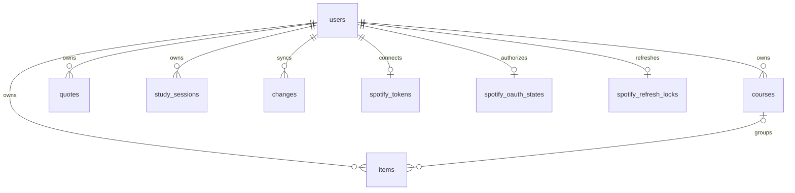

# Rounds — data model

Cloudflare D1 (SQLite), several users, every row stamped with the owner's `user_id`.
The browser never talks to the database. A Worker reads the session cookie, resolves
the user, and every query it runs has `user_id = ?` in it.

```
users            one row per account: username, password hash, profile, coat, theme, background
courses          a course + its weekly class meetings, as a JSON column
items            exams, quizzes, assignments, labs, tutorials, office hours, tasks, projects
quotes           the quote tile's list
study_sessions   study time: timer runs and time logged by hand, by course and item
achievements     your own achievements: an uploaded sticker and what earns it
```

The schema is [`migrations/0001_schema.sql`](../migrations/0001_schema.sql), in one
piece. Three times in September 2026 the live data moved into a fresh database built from it
(`node scripts/move-db.mjs --from <old> --to <new> --remote`): first `rounds` into
`rounds-v2`, replacing ten migrations of patches, then `rounds-v2` into `rounds-v3`,
folding in the study timer, quizzes, grade targets and the calendar feed, then
`rounds-v3` into `rounds-v4`, folding in study history, achievements, the school
calendar and the leaderboard. The databases before `rounds-v3` have been deleted. The schema the last move copied from is kept as a test
fixture in `test/fixtures/legacy-migrations/`. Later changes are new numbered files.

## Structure at a glance

| Area | Tables | Responsibility |
| --- | --- | --- |
| Account and tracker data | `users`, `courses`, `items`, `quotes`, `study_sessions` | Profiles and the records users edit |
| Synchronization | `changes`, `sync_state` | Latest record changes, ordered cursors, and the retention floor |
| Authentication and request control | `login_throttle`, `request_limits` | Temporary attempt counts and cooldowns |
| Spotify connection | `spotify_tokens`, `spotify_oauth_states`, `spotify_refresh_locks` | Credentials, one-use consent attempts, and refresh leases |
| Read-only inspection | `active_items`, `account_summary` | Views over existing records, with no duplicate stored data |



An item's optional course relationship is `(user_id, course_id)` to
`courses(user_id, id)`, so ownership cannot cross account boundaries. Direct hard
deletion of a referenced course is restricted. The application's soft-delete
transaction clears only `course_id`, increments affected item revisions, and
records the resulting changes before a later purge can remove the course.
Account removal remains an explicit operation that deletes dependent records first.

Conventions used throughout:

- **Ids** are client-generated strings, up to 24 chars (the prototype's are 7). The
  primary key of every user-owned table is `(user_id, id)`, so two people can hold the
  same id without colliding and ownership is part of the key, not a filter you might
  forget.
- **Dates** are `YYYY-MM-DD` strings in *your* local calendar, never a timestamp.
  A deadline of "Friday 23:59" must not shift because you opened the app in another
  timezone, and ISO strings sort chronologically, so `date >= ?` works.
- **Times** are `HH:MM` 24-hour strings, or `''` for none. Displayed as `0800`.
- **Weekdays** are `0`–`6`, Sunday = 0, matching `Date.prototype.getDay()`.
- **Timestamps** (`created_at`, `updated_at`, `deleted_at`, `completed_at`)
  are integers, milliseconds since the epoch, the same unit as
  `Date.now()`. The server sets `updated_at` on every write.
- **Deletes are soft.** `deleted_at` is set, the row stays, and the next `sync` pull
  tells other devices to drop it. A daily cron hard-deletes tombstones after 30 days.
- Small, always-read-together lists (class meetings, checklists, links) are **JSON
  columns**, not tables. They are read with their parent every time and never queried
  on their own. The schema checks they are valid JSON arrays and caps their length;
  the Worker validates each entry.

---

## `users`

| Column | Type | Rules | Notes |
| --- | --- | --- | --- |
| `id` | text, PK | random | Never the username, so a rename is one `UPDATE`. |
| `username` | text, unique | 3–32, `[a-z0-9._-]`, lower-cased | What you sign in with. |
| `password_hash` | text | | `pbkdf2$iterations$salt$hash`, see `worker/password.js`. Never leaves the Worker. |
| `display_name` | text | ≤ 60 | Editable. |
| `coat_name` | text | ≤ 28 | Embroidered on the pocket. |
| `coat_role` | text | ≤ 34 | The line under it, e.g. `MS II · Cardio block`. |
| `coat_color` | text | one of the five | Tints the sidebar fabric, pocket and embroidery. |
| `theme` | text | `light` \| `dark` \| `system` | |
| `bg` | text | `med` \| `cs`, default `med` | background art; independent of `theme` (0008) |
| `term_start` | text \| null | `YYYY-MM-DD` | The week board's default start. Null means today. With a school calendar, its current semester's first day counts instead. |
| `school_calendar` | JSON object | `{}` = none | The school's academic calendar (`0004`), below. |
| `created_at`, `updated_at` | int | | |
| `revision` | int | starts at 1 | Optimistic concurrency for profile edits. |
| `pw_gen` | int | starts at 0 | Password/session generation; changing it revokes existing sessions. |

A row is created by `npm run user:add`, with the defaults. The API
exposes it as the **profile**, with the coat fields nested: `{coat: {name, role,
color}, theme, termStart, ...}`.

The twelve course colours; the first five are also the coat colours:

| Name | Hex |
| --- | --- |
| Pink | `#E4749B` |
| Purple | `#8B5CC7` |
| Turquoise | `#17B3AE` |
| Baby blue | `#79B6EA` |
| Little lilac | `#BCA6E6` |
| Coral | `#F08A6C` |
| Sunflower | `#E8B33A` |
| Mint | `#4FBF8B` |
| Sage | `#8FAE86` |
| Royal blue | `#4F74D9` |
| Berry | `#B8457E` |
| Slate | `#7D8A99` |

---

## `courses`

| Column | Type | Rules | Notes |
| --- | --- | --- | --- |
| `user_id`, `id` | text, PK | | |
| `code` | text | 1–8 | `CVS`, `ANAT`. Shown in the table and month chips. |
| `name` | text | 1–80 | `Cardiovascular Block`. |
| `color` | text | one of the twelve | Drives every chip, pip and card for this course. |
| `instructor` | text | ≤ 60 | `Dr. Alvarez`. |
| `term` | text | ≤ 40 | `2026 Autumn`. Used later for archiving. |
| `archived` | int 0/1 | | Hidden from the sidebar, kept for the record. |
| `meetings` | JSON array | ≤ 12 | The class timetable. |
| `created_at`, `updated_at`, `deleted_at` | int | | |

### `meetings[]` — one weekly class

| Field | Type | Rules | Notes |
| --- | --- | --- | --- |
| `id` | string | ≤ 24 | Client-generated, stable across edits. |
| `kind` | string | `Lecture` \| `Lab` \| `Seminar` \| `Tutorial` \| `PBL` \| `Clinical` | |
| `weekday` | number | 0–6 | |
| `start`, `end` | string | `HH:MM` | `end` after `start`. |
| `room` | string | ≤ 40 | `Hall A`, `Lab 3B · table 7`. |

These are what the **month view** shows, and only these. They are not `items` — a class
that meets every Monday all term is one array entry, expanded onto the calendar in the
client.

---

## `items`

One table for all seven types. They share every column, differ only in which `status`
values apply, and the week board and table need them interleaved by date.

| Column | API field | Type | Rules | Notes |
| --- | --- | --- | --- | --- |
| `user_id`, `id` | `id` | text, PK | | |
| `type` | | text | see below | Fixed at creation, editable in the drawer. |
| `title` | | text | 1–140 | |
| `course_id` | `courseId` | text \| null | FK to `courses` | Cleared on every matching item when a course is deleted. The FK is composite, so it cannot point at another user's course. |
| `date` | | text | `YYYY-MM-DD` | For a deadline, the day it's due. For a recurring slot, the first occurrence. |
| `start`, `end` | | text | `HH:MM` or `''` | A deadline usually has `end` only (`23:59`). |
| `location` | `where` | text | ≤ 80 | Room, lab, platform. `where` is a SQL keyword, hence the rename. |
| `status` | | text | see below | |
| `grade` | | real \| null | 0–100 | Only meaningful when `status == 'graded'`. |
| `weight` | | real \| null | 0–100 | Reserved for grade projection (backlog item 3). |
| `notes` | | text | ≤ 5000 | The item's page. |
| `checklist` | | JSON array | ≤ 50 | `{id, text ≤140, done}`. Drives the pink progress bars. |
| `links` | | JSON array | ≤ 20 | `{label ≤60, url ≤500}`. |
| `recur` | | text \| null | `weekly` \| null | Office hours and standing tutorials. |
| `weekday` | | int \| null | 0–6 | Required when `recur == 'weekly'`, enforced by a table-level `CHECK`. |
| `recur_until` | `recurUntil` | text \| null | `YYYY-MM-DD` | End of term; null means open-ended. |
| `dept` | | text | ≤ 40 | Office hours only: the faculty's department, shown greyed. |
| `completed_at` | `completedAt` | int \| null | | Stamped when status leaves `todo`. |
| `created_at`, `updated_at`, `deleted_at` | camelCase | int | | |

The Worker converts between `snake_case` columns and the camelCase the prototype
already uses, so the front end's field names do not change.

### `type` and its `status` set

| `type` | Statuses | Counts as complete (pink row) |
| --- | --- | --- |
| `exam` | `todo` Upcoming · `done` Sat · `graded` Graded | `done`, `graded` |
| `assignment` | `todo` Open · `submitted` Submitted · `graded` Graded | `submitted`, `graded` |
| `lab` | `todo` Scheduled · `done` Attended · `missed` Missed | `done` |
| `tutoring` (shown as Tutorial) | `todo` Scheduled · `done` Attended · `missed` Cancelled | `done` |
| `office` | `todo` Planned · `done` Went · `missed` Skipped | `done` |
| `task` | `todo` To do · `done` Done | `done` |
| `project` | `todo` In progress · `done` Shipped · `missed` Dropped; milestones are the checklist | `done` |

The schema validates `status` against the whole set (`todo`, `submitted`, `graded`,
`done`, `missed`); the per-type restriction is the client's job, since it's a UI
affordance rather than a data guarantee.

### Derived, never stored

| Value | How |
| --- | --- |
| Overdue | `status` is open, not recurring, and `date < today` |
| Due soon | open and `0 ≤ date − today ≤ 2` |
| Next exam countdown | earliest open `exam` with `date ≥ today` |
| Class hours / week | sum of `meetings[]` durations across courses |
| Lab hours | `lab` durations, closed vs all |
| Checklist progress | `checklist` done / total |

Storing any of these would mean a write every midnight. They cost nothing to compute.

---

## `quotes`

| Column | Type | Rules |
| --- | --- | --- |
| `user_id`, `id` | text, PK | |
| `text` | text | 1–300 |
| `source` | text | ≤ 80, may be empty |
| `created_at`, `updated_at`, `deleted_at` | int | |

---

## `study_sessions`

One row per finished study-timer run, or per stretch logged by hand from Log study
(`note` and `manual`). Only study time is logged,
never breaks; a run with under a minute of study saves nothing. The run in
progress lives in the browser's IndexedDB on that device and does not sync.

| Column | Type | Rules |
| --- | --- | --- |
| `user_id`, `id` | text, PK | |
| `course_id` | text, nullable | cleared when the course is deleted; the session stays |
| `item_id` | text, nullable | cleared when the item is deleted; the session stays |
| `started_at` | int | ms since the epoch |
| `study_minutes` | int | 1–1440, whole minutes |
| `rounds_done` | int | 0–12, rounds whose every step finished |
| `note` | text | up to 200 characters: what was covered |
| `manual` | int | 1 when logged by hand, 0 when the timer recorded it |
| `created_at`, `updated_at`, `deleted_at` | int | |

The flow itself is `users.study_flow`, JSON `{"steps":[["study",25],["break",5]],"rounds":4}`:
1–12 steps of 1–180 minutes with at least one Study step, 1–12 rounds.

The school's academic calendar is `users.school_calendar`, JSON
`{"name":"Vanier College 2026–27","terms":[{"name":"Autumn 2026","start":"2026-08-24","end":"2026-12-10"}],"days":[{"from":"2026-10-06","to":"2026-10-06","kind":"swap","label":"Monday schedule","follows":1}]}`:
1–4 semesters (first and last day of classes) and up to 80 special days, each `off`
(no classes), `break` (study break, left out of week numbers), `exams`, `swap` (runs the
`follows` weekday's timetable) or `note` (a marker). Read from a PDF by
`POST /api/school-calendar` and checked by the person before it is saved;
`src/legacy/js/school.js` works out each day for the views, the lecture reviews and the
calendar feed.

The goal and streak rules are `users.study_prefs`, JSON `{"goal":120,"dayMin":15,"rest":[0],"celebrate":true}`:
a daily goal of 0–720 minutes (0 = none), 1–240 minutes to make a day count, up to six
rest days (0 = Sunday) that never break the streak, and fireworks on or off. Streaks,
weeks, months and the heatmap are worked out on the device (`src/legacy/js/history.js`).

---

## `achievements`

Your own achievements. The built-in ones (study hours,
streaks, big days, tasks, exams, grades) are never stored: they are worked out on the
device from sessions and items, as is whether one of these is earned
(`src/legacy/js/achievements.js`). At most 30 live rows per account; `PUT` a 31st is
`400 too_many`.

| Column | Type | Rules |
| --- | --- | --- |
| `user_id`, `id` | text, PK | |
| `name` | text | 1–40 |
| `sticker` | text | the picture itself: a `data:image/{webp,png,jpeg};base64,` URL, at most 90,000 characters. Cut to a circle and shrunk to 256px or less in the browser (`src/legacy/js/sticker.js`). Served only through the API, to its owner. |
| `rule` | text | `hours` \| `grade` |
| `course_id` | text | `hours` only: the course whose study time counts. A plain reference; a deleted course leaves it locked. |
| `item_id` | text | `grade` only: the exam or quiz. A deleted one leaves it locked. |
| `target` | int | hours 1–1000, or the least grade, 1–100 |
| `created_at`, `updated_at`, `deleted_at` | int | |

---

## `spotify_tokens`

One row per user who has connected Spotify. Not synced to the browser; the Worker
reads it to call Spotify on the user's behalf.

| Column | Type | Rules |
| --- | --- | --- |
| `user_id` | text, PK | |
| `refresh_token` | text | Versioned AES-GCM ciphertext: `keyId.ciphertext`, encrypted using independent `SPOTIFY_TOKEN_KEYS`. Legacy unversioned tokens are migrated when refreshed; see RELIABILITY-UPGRADE.md. |
| `access_token` | text | lives an hour, kept in clear |
| `expires_at`, `updated_at` | int | ms since the epoch |

---

## Indexes

| Index | Serves |
| --- | --- |
| `study_sessions (user_id, started_at)` | the week's study log |
| `study_sessions (user_id, course_id)`, `(user_id, item_id)` | unlinking a deleted course or item |
| `items (user_id, date)` | any future "this term only" query |
| `items (user_id, course_id)` | course detachment and composite foreign-key lookups, including tombstones |
| `*_deleted (deleted_at)` | the nightly tombstone purge |
| `changes (user_id, seq)` | current paginated sync protocol |
| `changes (deleted_at)` | expired deletion-history cleanup |
| `login_throttle (updated_at, locked_until)` | expired login-attempt cleanup |
| `request_limits (reset_at)` | expired request-window cleanup |
| `spotify_oauth_states (expires_at)` | expired consent-attempt cleanup |
| `spotify_refresh_locks (expires_at)` | expired refresh-lease cleanup |

Primary keys and unique constraints also provide indexes. The timestamp indexes
support the legacy read-only sync route; current clients page through `changes`.
Filters, search, and view switches use the browser's local data after sync.
The added indexes cover existing relationship and maintenance queries; tests check
their query plans. See [D1 index guidance](https://developers.cloudflare.com/d1/best-practices/use-indexes/).

## Inspection and maintenance

`active_items` shows live items with their course code and name. `account_summary`
shows each account's live course, item, and quote counts. Neither view contains
password hashes or Spotify credentials. They are administrative SQL conveniences,
not permission boundaries: queries for an account must still filter `user_id`.

```sql
SELECT * FROM active_items WHERE user_id = ? ORDER BY date, id;
SELECT * FROM account_summary WHERE user_id = ?;
```

The health command checks SQLite integrity, foreign keys, revision values, live
course references, and change-feed coverage/orphans. It prints aggregate counts,
exits nonzero on problems or incomplete results, and changes no records.

```sh
npm run db:local                 # apply pending migrations to local development
npm run db:check                 # inspect local data, read-only
npm run db:check -- --json        # machine-readable report
npm run db:check -- --remote      # explicitly inspect production, read-only
```

Migration 0007 copies all existing item fields into the corrected table before
replacing the old table, then restores its indexes and sync triggers. The copy runs
without change-feed triggers, preserving existing revisions, tombstones, history,
and cursors. Other data tables are not rebuilt. Failed copies roll back, including
when invalid legacy revisions are found; resolve reported data problems explicitly
instead of deleting records to make the migration pass. Upgrade and rollback tests
run against an isolated D1 database populated with the old schema.

Meetings, checklists, and links remain bounded JSON arrays because they are loaded
and edited with their parent. There is no second source of truth for these lists.
Foreign-key behavior follows [D1's enforced relationship rules](https://developers.cloudflare.com/d1/sql-api/foreign-keys/).

---

## API

All routes are under `/api`, speak JSON, and require the session cookie except
`POST /api/login`. Rows are camelCase on the wire.

| Route | Body → Response |
| --- | --- |
| `POST /api/login` | `{username, password}` → `{profile}` and `Set-Cookie`. `401 bad_login` for a wrong password or an unknown user alike. |
| `DELETE /api/session` | → clears the cookie. |
| `POST /api/session/revoke-all` | → `204`, clears the cookie and invalidates every other session of this user. |
| `GET /api/me` | → `{profile}` |
| `PUT /api/me` | `{coat, theme, bg, termStart, displayName, studyFlow, studyPrefs, schoolCalendar}` (`bg` optional, default `med`; `studyFlow`, `studyPrefs` and `schoolCalendar` optional, kept when left out; `schoolCalendar: {}` removes it) → `{profile}` |
| `POST /api/outline` · `POST /api/school-calendar` | the file (or a PDF's text) as the body, `?name=&today=` → what Workers AI read: an outline, or `{name, terms, days, truncated}`. Nothing is saved. Ten reads a day between them (`429 outline_limit`). |
| `GET /api/sync?v=2&cursor=<seq>` | → `{changes: [{kind, row}], cursor, more, reset}` — at most 100 changes after `cursor`, deleted rows included with `deletedAt` set. `cursor=0` is a full load. See the sync protocol below. |
| `GET /api/{courses,items,quotes,study_sessions,achievements}/:id` | one live row of yours, or `404`. The client uses it to undo a rejected save. |
| `PUT /api/courses/:id` | a course (with an optional `target`, a whole-number grade goal 1–100) → the stored course, with server `updatedAt`. Upsert. |
| `DELETE /api/courses/:id` | → `204`. Soft-deletes and nulls `courseId` on the user's items and study sessions. |
| `PUT /api/items/:id` · `DELETE /api/items/:id` | as above; deleting nulls `itemId` on the user's study sessions |
| `PUT /api/quotes/:id` · `DELETE /api/quotes/:id` | as above |
| `PUT /api/study_sessions/:id` · `DELETE /api/study_sessions/:id` | `{courseId, itemId, startedAt, studyMinutes, roundsDone, note, manual}`, as above |
| `PUT /api/achievements/:id` · `DELETE /api/achievements/:id` | `{name, sticker, rule, courseId, itemId, target}`, as above; `400 too_many` past 30 |
| `GET /api/calendar` · `POST /api/calendar` · `DELETE /api/calendar` | the calendar feed: → `{on, url}`; POST turns it on or makes a new link (the old one stops working); DELETE turns it off. See `worker/calendar.js`. |
| `GET /api/calendar/:userId/:token.ics?tz=` | no session: the feed itself, `text/calendar`. The token is an HMAC of the user id and `users.feed_gen`; a wrong one is `404`. At most 60 fetches an hour per link. |

Errors are `{error, field?}`: `400` bad shape (with the field), `401` no session,
`404` a row that isn't yours, `413` body over 1 MB.

### Session

`POST /api/login` looks the username up, verifies the password against its stored
PBKDF2-SHA256 hash (100,000 iterations, 16-byte salt, constant-time compare), and
runs the verification even for an unknown username so timing gives nothing away.
On success it sets `rounds_session`, an `HttpOnly; Secure; SameSite=Lax` cookie
holding `userId.generation.expiry.signature`, signed with `SESSION_SECRET`, valid
30 days and re-issued by `GET /api/me` once it is in its last week, so a regular
user stays signed in. The generation is `users.pw_gen`: a password reset and
`POST /api/session/revoke-all` ("sign out everywhere") bump it, and every older
cookie for that user stops working. There is no sessions table; rotating the secret
signs everyone out.

---

## Sync

Profiles and tracker rows carry a `revision`, with
`changes` for the latest change to each record, and `sync_state.floor` for the oldest
supported incremental cursor.

1. A local IndexedDB transaction saves a row and an individual `pending` operation
   together. The UI only announces the change after commit. IndexedDB version 2
   migrates the old dirty map without deleting unsent work.
2. Web Locks permit one sync cycle per account across tabs. IndexedDB transactions
   and persisted operation tokens remain the correctness boundary if Web Locks are
   unavailable. BroadcastChannel refreshes other tabs' render caches.
3. Writes require `If-Match: "revision"`; new records use `"0"`. The server compares
   and increments the revision within the write statement. A stale write returns
   `409 {error: "conflict", current}`; a missing precondition returns 428 so an old
   client cannot overwrite current data. Deletes use the same precondition.
4. `GET /api/sync?v=2&cursor=0` starts reconciliation. Pages contain at most 100
   `{kind, row}` changes, `cursor`, `more`, and `reset`. SQLite triggers capture each
   write transaction in an increasing sequence; repeated updates retain the latest
   change for that entity. Profile reads use `/api/me` and revisions separately.
5. The nightly purge advances the cursor floor before deleting old tombstones and
   their change entries, in one transaction. An expired cursor receives `reset:true`.
   The client clears only clean local rows and rebuilds them from cursor zero;
   pending edits and saved conflict copies remain. Each page and its cursor commit
   together. The timestamp endpoint remains read-only compatibility for old clients.
6. A rejected edit is preserved in the `conflicts` store with the server's version.
   Settings lets the user inspect, export, restore, or discard that copy. Restoring
   uses a revision precondition again, so another intervening edit stays protected.
   Legacy queued edits to existing rows need review because their base revision is
   unknown; newly created offline records can upload normally.
7. Sign-out broadcasts connection closure and waits for database deletion. A durable
   cleanup marker prevents reopening data when cleanup was blocked. Account-bound
   request headers prevent an old tab uploading data under a newly changed cookie.

---

## Security model

1. **Ownership** — `requireUser()` runs first in every handler and every SQL statement
   filters on that `user_id`. No route accepts a `user_id` from the client. A row that
   belongs to someone else is a `404`, indistinguishable from a row that doesn't exist.
2. **Shape** — `CHECK` constraints in the schema enforce enums, lengths, date and
   time formats, JSON validity and array caps. `validate.js` runs the same rules first
   so the client gets a `400` naming the field instead of a raw SQLite error. Link URLs
   must be `http(s)`. A bug in the client cannot corrupt the tables or write a document
   large enough to matter; bodies over 1 MB are refused.
3. **Passwords** — PBKDF2-SHA256, 100,000 iterations, a 16-byte salt per user, a
   constant-time compare, and the same work done for unknown usernames. After five
   failures a username is locked, for one minute doubling up to an hour per further
   failure (`login_throttle`, cleared on success, swept nightly). A browser that has
   signed in as that name before carries a signed `rounds_device` cookie and is counted
   on its own, so failures from elsewhere cannot lock its owner out.
4. **Sessions** — `HttpOnly` keeps the cookie away from scripts, `SameSite=Lax` keeps
   other sites from posting with it, and every state-changing request must also carry
   a same-origin `Origin` / `Sec-Fetch-Site`, or none at all, else `403 cross_site`.
   API responses are `Cache-Control: no-store`.
5. **The page** — `public/_headers` sets a Content Security Policy (scripts only from
   this origin, the Spotify SDK, and a hash of the inline theme script; no framing; no inline event
   handlers), HSTS, `nosniff` and a same-origin referrer policy. Dynamic text is escaped through `esc()`; inline style attributes are blocked.
   Presentation values are applied through validated CSS properties; ids and colours are validated before they reach an attribute.
