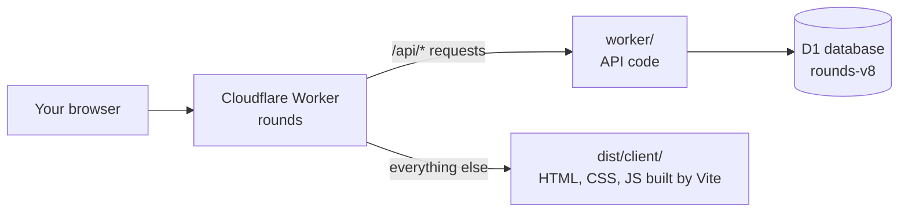
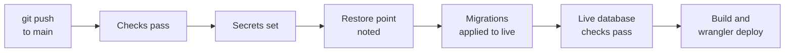

# Running and deploying Rounds

How the app fits together, how to work on it, and how to put changes live. The app is
called Term; its internal name, used for the Worker, the database and the cookies, is
`rounds`.

## How Rounds fits together

Rounds runs entirely on Cloudflare. The website and the API go online together at
https://rounds.termanitor07.workers.dev, usually by pushing `main` (see
[Deploying](#deploying)).



Pages load from the Vite build in `dist/client/`. Anything under `/api/`, such as signing in or saving an
item, runs the code in `worker/`, which reads and writes the D1 database.

| Piece | Folder or place | What it does |
| --- | --- | --- |
| Front end | `index.html`, `src/`, `public/` | The pages, styles and scripts your browser runs; `npm run build` turns them into `dist/client/` |
| API | `worker/` | Sign-in, sync, shared classes, Spotify, AI import and the Admin page. The endpoints are listed in [DATA-MODEL.md](DATA-MODEL.md) |
| Database | Cloudflare D1, named `rounds-v8` (binding `DB`) | Stores users and everyone's data |
| Schema changes | `migrations/` | Numbered SQL files that build and change the database |
| Settings | `wrangler.jsonc` | The app name, the static assets in `dist/client/`, the database, the Workers AI binding, public vars (`SPOTIFY_CLIENT_ID`, `CF_ACCOUNT_ID`) and the nightly cleanup job |
| Secret | `SESSION_SECRET` | Signs login cookies. Locally it's in `.dev.vars`; live it's stored in Cloudflare |
| Secret | `SPOTIFY_CLIENT_SECRET` | Lets the Worker talk to Spotify for the player. Same two places. The matching client id is in `wrangler.jsonc` |
| Secret | `SPOTIFY_TOKEN_KEYS` | Encrypts stored Spotify refresh tokens (see [Spotify keys](#spotify-keys)). Required whenever the client id is set |
| Secret | `CF_ANALYTICS_TOKEN` | Optional. A Cloudflare API token with only "Account Analytics: Read", for the Admin page's traffic chart |

There are two copies of everything. **Local** is what `npm run dev` runs on your
computer, with its own test database. **Live** (also called remote or production) is
what people actually use. Changes reach live only when you deploy.

## Setting up a new computer

You do this once per computer. After that, the everyday commands just work.

1. Install [Node.js](https://nodejs.org) (the LTS version) and [Git](https://git-scm.com).
2. Get the code and install its tools. Run these in PowerShell:
    ```
    git clone https://github.com/gvogas/medDashboard.git tracker
    cd tracker
    npm install
    ```
3. Sign in to Cloudflare with `npx wrangler login`. A browser window opens; approve it
   with the Cloudflare account that owns Rounds.
4. Make the local secret file. Copy `.dev.vars.example` to `.dev.vars`, then replace
   `change-me-locally` with any long random string. This file is never committed to Git.
   The two Spotify lines can stay empty unless you want the player locally (see
   [Spotify](#spotify) below).
5. Build the local database with `npm run db:local`.
6. Make yourself a local account with `npm run user:add -- yourname --name "Your Name"`.
   It asks for a password twice and doesn't show what you type.

The live site already has its secret and database, so this setup doesn't touch it.
Your local account is separate from your live account, and the two can have
different passwords.

## Working on it day to day

Make and try every change locally first. Nothing you do locally affects the live site.

1. Start the local server with `npm run dev`, then open http://127.0.0.1:8787 and sign
   in with your local account. Leave the command running. It picks up most edits when
   you save; press Ctrl+C to stop it.
2. Edit files in `src/` (what you see) or `worker/` (the API).
3. Run `npm test`. Both the Worker tests and local-storage regression tests should pass. A failing test means something
   broke, so fix it before deploying.
4. Save the change in Git:
    ```
    git add -A
    git commit -m "Say what changed"
    git push
    ```
   Pushing `main` puts the change live (see [Deploying](#deploying)). Work on a branch
   until it is ready.

One catch: if you edit the small inline script inside `index.html`, run
`npm run csp:update` to update `public/_headers`. The release build stops if the hash is stale.

## Deploying

GitHub Actions deploys the site (`.github/workflows/deploy.yml`). Every push to `main`
runs, in order, and stops at the first step that fails:

1. `npm run check`: types, all tests and the release build
2. the Worker secrets are set (`scripts/check-secrets.mjs`)
3. a restore point for the live database is noted in the run's summary
4. new migrations are applied to the live database (`npm run db:remote`)
5. the live database checks pass (`npm run db:check -- --remote`)
6. `npm run build` and `wrangler deploy`

So a migration in the push reaches the live database before the code that needs it,
and code whose migration failed never goes live. Watch it under the repository's
**Actions** tab; a failed run emails you.



Other workflows:

| Workflow | When | What it does |
| --- | --- | --- |
| Check (`check.yml`) | Every other branch and every pull request | `npm run check`; on a pull request, also stops if a migration that already exists was edited, renamed or deleted |
| Deploy staging (`staging.yml`) | By hand: Actions → Deploy staging → Run workflow, pick a branch | Runs the tests, then `npm run deploy:staging` for that branch |
| Database health (`db-health.yml`) | Nightly, or by hand | Read-only: fails if the live database is missing a migration that `main` has, or its integrity checks fail |

**Setting it up (once)**

1. In Cloudflare, My Profile → API Tokens → Create Token, start from the **Edit
   Cloudflare Workers** template and add **Account → D1 → Edit**. Limit it to the
   account that owns Rounds.
2. In GitHub, the repository's Settings → Secrets and variables → Actions, add
   `CLOUDFLARE_API_TOKEN` (the token) and `CLOUDFLARE_ACCOUNT_ID`
   (`2c6057041650be9d99932b4013571adb`, the `CF_ACCOUNT_ID` in `wrangler.jsonc`).
3. In Cloudflare, Workers & Pages → rounds → Settings → Build, **disconnect the Git
   repository**. Otherwise Cloudflare's own build deploys each push too, without
   waiting for the migrations.
4. Optional: in GitHub, Settings → Environments → `production`, add yourself as a
   required reviewer so each deploy waits for a click.

The Worker's own secrets (`SESSION_SECRET`, Spotify, push) stay in Cloudflare, set with
`npx wrangler secret put` as before. The workflow only checks that they are there.

**Before you push to `main`**

- [ ] You tried the change locally with `npm run dev`, or `npm run dev:built` to try
      the built, versioned site that goes live
- [ ] For a change worth trying for real (Workers AI, push, a migration), you tried it on
      [staging](#staging) first
- [ ] A new migration works on the code that is live now too, since it is applied a
      minute or two before the new code arrives

`npm run deploy` is the manual route, the same steps from your computer. Use it when
GitHub Actions is unavailable. Never run a bare `wrangler deploy` with code that needs a
migration not yet applied.

When `db:remote` finds new migrations, it lists them and asks `continue? (Y/n)`. Type
Y and press Enter. If there are none, it says "No migrations to apply!".

If a live request hits a missing table or column, `npx wrangler tail` shows "D1 schema
is behind the code" next to the error.

**After it goes live**

1. Open https://rounds.termanitor07.workers.dev and sign in.
2. Check the thing you changed.
3. If something is wrong, see [Troubleshooting](#troubleshooting) below. To undo
   quickly, run `npx wrangler rollback` to put the previous version back. Rollback
   restores the code only; database changes stay. Don't roll back past a release that
   raised the IndexedDB version: browsers that already upgraded can't open their
   local data with the older code. Fix forward instead.

### Undoing a migration

Rollback puts code back, not the database. For the database, D1 keeps its history
(7 days on the free plan) and can go back to any minute of it. Each Deploy run notes the
bookmark from just before its migrations in the run's summary, with the restore command.
By hand, before `npm run db:remote`:

```sh
npx wrangler d1 time-travel info rounds-v8     # prints the current bookmark; copy it
```

If the migration goes wrong, put the database back to that bookmark, then roll the code
back too (`npx wrangler rollback`), since the new code expects the new tables:

```sh
npx wrangler d1 time-travel restore rounds-v8 --bookmark=<the bookmark you copied>
```

A restore undoes **every** write since the bookmark, people's edits included, and devices
that already synced past it can disagree with the server afterwards. Treat it as the last
resort, used within minutes of a failed migration, and check the site afterwards. If you
have to go back further than that, fixing forward with a new migration is usually safer.

## Staging

A test copy of the site at https://rounds-staging.termanitor07.workers.dev, with its own
Worker (`rounds-staging`), its own empty database and its own secrets. It is the place to
try what only works for real: Import with AI against the real models, push on a phone, a
migration on a database that is not the live one. `env.staging` in `wrangler.jsonc` sets it
up; Spotify is off there. It costs nothing on the free plan, but its AI reads count toward
the account's shared 10,000 neurons a day.

**Once:**

```sh
npx wrangler d1 create rounds-staging
#   put the database_id it prints in wrangler.jsonc, env.staging, in place of 000…000
npx wrangler secret put SESSION_SECRET --env staging     # a new long random value
#   optional, for push on staging: npm run push:key prints a pair; then
#   npx wrangler secret put VAPID_PUBLIC_KEY --env staging   (and VAPID_PRIVATE_KEY, VAPID_SUBJECT)
```

Commit the `database_id` (it is not a secret).

**Each time:**

```sh
git checkout <the branch to try>
npm run deploy:staging                          # typecheck, staging secrets, migrations, build, deploy
npm run user:add -- yourname --staging          # the first time: an account there (add --admin)
```

`deploy:staging` never touches the live site or the live database. The staging database
starts empty and keeps what you put in it between deploys. The Deploy workflow only
deploys `main` to the live site; staging is deployed only by this command, or by the
**Deploy staging** workflow in the Actions tab, which runs it for the branch you pick.


## Changing the database

The database's shape (its tables and columns) changes only through numbered files in
`migrations/`. Each database remembers which files it has already run, so each file
runs once per database.

| File | What it adds |
| --- | --- |
| `0001_schema.sql` | The whole schema: users, courses, items, quotes, study, Spotify tokens, the change feed, the Admin page's tables, shared spaces (classes and projects) with their members and invites, marks and space prefs, activity and the inbox, push devices, grades and friends (see [DATA-MODEL.md](DATA-MODEL.md)) |
| `0002_rooms.sql` | Study rooms: the shared timer and who is in each room (`rooms`, `room_members`) |
| `0003_presence.sql` | A solo run friends can see (`presence`) |
| `0004_space_indexes.sql` | Indexes on `marks` and `space_prefs` for lookups by class or project |
| `0005_feed_off.sql` | The calendar feed's off switch (`users.feed_off`) |
| `0006_revoked_sessions.sql` | Sessions signed out of, until they would have expired (`revoked_sessions`) |
| `0007_session_registry.sql` | The sessions a browser holds right now (`sessions`) |
| `0008_push_device_session.sql` | The session a push device subscribed under (`push_subscriptions.sid`) |
| `0009_room_chat.sql` | Room chat between the people in a room (`room_messages`) |
| `0010_buddy.sql` | Study Buddy: the Gameplay switch and the coin ledger (`buddy_settings`, `buddy_ledger`); `admin_log` is rebuilt so it can record `grant` |

The files that used to follow it (`0002_spaces.sql` to `0009_friend_cancel.sql`) were
folded into `0001_schema.sql` for the move of `rounds-v7` into `rounds-v8` (see
[Moving to a fresh database](#moving-to-a-fresh-database)). `rounds-v7` was built from
`0001_schema.sql` to `0009_friend_cancel.sql`, kept in
`test/fixtures/legacy-migrations/`.
Its schema and the folded one are the same, table for table and column for column.
The `0002`–`0009` files listed above came after the fold, so they are not in that fixture.

Collaboration Stages 5 (leaving and removal) and 6 (the feed, outline imports, classes
open to everyone) added no migration: deploying them is a plain push of `main`. Stage 6
uses `spaces.school_calendar`, which has been there since spaces were added. Stage 8
(team projects) adds none either: it uses Stage 1's `assignees` and `completed_by`
columns and Stage 7's `space.linked` and `space.deleted` verbs. Stage 9 (projects in
the views) changes only the app: no migration, no Worker change. Stage 10 (projects in
the feed, open to everyone) adds no migration either.

To change the database:

1. Add a new file with the next number, `0011_something.sql`. Never edit a file that
   has already run.
2. Apply it locally with `npm run db:local`, then test.
3. Push it with the code that needs it. The Deploy workflow applies it to live and runs
   `npm run db:check -- --remote` before it deploys the code.

To see what the live database is missing, run
`npx wrangler d1 migrations list DB --remote`. "No migrations to apply!" means
it's up to date.

`npm run db:check` runs read-only integrity checks and prints row counts for the
local database; add `-- --remote` for live. It never changes records.

## Moving to a fresh database

Now and then the migrations are folded into one `0001_schema.sql` and the live data
is moved into a new, empty database. This keeps every row and the change-feed position,
so devices sync on without a reset. The last move was `rounds-v7` to `rounds-v8` in
October 2026.

1. Fold the migrations into `migrations/0001_schema.sql`. Move the files the live
   database was built from into `test/fixtures/legacy-migrations/` (for the move to
   `rounds-v8`, the `rounds-v7` chain `0001_schema.sql` to
   `0009_friend_cancel.sql`).
   A column added with `ALTER TABLE` goes at the end of its table, where SQLite put it,
   so the fresh database's columns are in the same order as the old one's.
   This rewrites and deletes migrations that have already run, which the Check
   workflow's `migrations-unchanged` job refuses on a pull request. So a fold never goes
   through a pull request: its branch is pushed straight to `main`, and only after the
   data has moved (step 5).
2. If the old database has tables or columns the copy doesn't know, add them to
   `TABLES` in `scripts/lib/move-db.js`, in the schema's column order. The script
   refuses to run while anything would be dropped.
3. Create the new database with `npx wrangler d1 create rounds-vN`. Keep the switch of
   the `DB` binding in `wrangler.jsonc` (and the docs naming the live database) in a
   commit of its own, the branch's last, so every commit before it still points at the
   live database. Check that commit out, run `npm run build`, and apply the schema
   with `npm run db:remote`.
4. Rehearse locally first (a second binding for the new database, the schema applied to
   it with `npx wrangler d1 migrations apply rounds-vN --local`, the same command without
   `--remote`), then copy live:
    ```
    npm run build
    node scripts/move-db.mjs --from rounds-v8 --to rounds-vN --remote
    ```
   It only reads the old database, refuses a target that already holds data, and
   compares both afterwards. Don't pipe its output, or you lose its exit code.
5. Deploy straight away (`npx wrangler deploy`) so no live edits land in the old
   database, then run `npm run db:check -- --remote` and push the branch straight to
   `main` (`git push origin <branch>:main`, a fast-forward). The Deploy workflow finds no
   migration to apply and deploys the same code again.
6. Keep the old database as a backup until you're sure the move went well.

## Maintenance switches

The Admin page's **Maintenance** tab turns features off while you fix them: the whole
app, week, month, all items, study, music, import with AI, and shared classes and
projects, with an optional message. No deploy is needed. People who aren't admins get
a maintenance page for that feature; admins get a bar and can still use it. Sync of
personal data keeps working. Shared-class edits made meanwhile wait in the browser and
upload once the switch is off.

## Spotify

The player on the coat is off until Rounds has a Spotify app of its own. Setting one up
is done once, by whoever owns the Cloudflare account, and takes about ten minutes.
Spotify's rules, as of 2026: the app's owner needs Spotify Premium; up to five people
can use the app, each added by email; and playback controls only work for listeners
with Premium (free listeners still see what is playing).

1. Go to [developer.spotify.com/dashboard](https://developer.spotify.com/dashboard),
   sign in with your Spotify account and create an app. Any name and description.
2. Under **Redirect URIs** add both of these, exactly:
    ```
    https://rounds.termanitor07.workers.dev/api/spotify/callback
    http://127.0.0.1:8787/api/spotify/callback
    ```
   Tick *Web API* and *Web Playback SDK* under the APIs used. Save.
3. In the app's **User Management** tab add the name and Spotify email of each person
   who wants the player, yourself included. Spotify allows five.
4. Copy the **Client ID** from the app's settings into `wrangler.jsonc`:
    ```jsonc
    "vars": { "SPOTIFY_CLIENT_ID": "paste it here" },
    ```
   and into `.dev.vars` as `SPOTIFY_CLIENT_ID=...` for local runs.
5. Show the **Client secret** and store it. Live, in Cloudflare:
    ```
    npx wrangler secret put SPOTIFY_CLIENT_SECRET
    ```
   It asks for the value and hides what you paste. Locally, put it in `.dev.vars` as
   `SPOTIFY_CLIENT_SECRET=...`.

   Then the key that encrypts stored refresh tokens. Locally, `npm run spotify:key`
   adds one to `.dev.vars`. Live, `npx wrangler secret put SPOTIFY_TOKEN_KEYS` with the
   JSON keyring described under [Spotify keys](#spotify-keys).
   `npm run deploy` refuses to run while it is missing.
6. Commit the new client id and push `main` (or run `npm run deploy`). The
   `spotify_tokens` table is already in the schema.
7. In Rounds, open Settings, find **Spotify** and click **Connect**. Spotify asks you
   to allow Rounds to see and control playback, then sends you back. The badge at the
   bottom of the sidebar shows what is playing; start something in the Spotify app
   on any device if it says *Nothing playing*. The **Spotify** view in the top bar
   has search, your playlists, the queue and volume.
8. The Rounds tab is itself a Spotify device, called **Rounds**, in desktop Chrome,
   Edge or Firefox. With no Spotify app open anywhere, press play (or pick something
   in the Spotify view) and it plays in the tab. If music is on another device, the
   badge shows **Play here** to move it into the tab. It never takes over on its own,
   and the music stops when the tab closes. Phone browsers are not supported by
   Spotify, so there Rounds only controls another device.

If you connected before the in-tab player existed, Settings says *Reconnect Spotify to
play in this browser*: click **Reconnect** once to grant the new permission.

Locally, open the dev server at `http://127.0.0.1:8787`, not `localhost`: Spotify no
longer accepts `localhost` as a redirect.

Each person connects their own account from their own Settings; nobody sees anyone
else's. **Disconnect** in Settings forgets the connection on the Rounds side; to
revoke it on Spotify's side too, remove Rounds under *Manage apps* in the Spotify
account settings. The stored refresh tokens are encrypted under `SPOTIFY_TOKEN_KEYS`,
not `SESSION_SECRET`, so rotating the session secret leaves Spotify connected.

If the badge says *Open Spotify on a device first*, Spotify has no active device:
press play in the Spotify app once and the controls work from then on. *Controls need
Spotify Premium* means the listener's account is free. *Spotify is not answering* is
Spotify's side; the badge dims and tries again on its own. The volume slider is greyed
out when the playing device does not take volume from the API, which is the case for
phones; it works for the desktop app and web player.

### Spotify keys

`SPOTIFY_TOKEN_KEYS` is one JSON secret of this shape:

```json
{"current":"v1","keys":{"v1":"<random secret, at least 32 characters>"}}
```

Use a securely generated value, never the placeholder, and never commit it. Refresh
tokens are stored as `keyId.ciphertext`, sealed under the `current` key.

- **Rotating:** add a new random key under a new id, set `current` to that id, and
  keep the old keys. Each token is resealed under the current key the next time it
  refreshes. Remove an old key only once no stored token uses it, or have those people
  reconnect. A token whose key id is missing fails without being deleted.
- **Old tokens:** tokens stored without a key id predate the keyring. They are read
  with `SPOTIFY_LEGACY_TOKEN_SECRET`, or `SESSION_SECRET` when that is unset. Before
  rotating `SESSION_SECRET` while any remain, put the old value in
  `SPOTIFY_LEGACY_TOKEN_SECRET`.

## Push reminders

The morning digest (Settings → Connections → Reminders) needs the
`push_subscriptions` table (part of `0001_schema.sql`) and three secrets. Without the secrets the app says reminders are not set up, and nothing else
changes. The alerts in the calendar feed need neither.

1. Make a key pair locally: `npm run push:key` writes `VAPID_PUBLIC_KEY` and
   `VAPID_PRIVATE_KEY` into `.dev.vars` without printing the private key. Set
   `VAPID_SUBJECT` there to `mailto:` and an address of yours; push services write to it
   if something goes wrong.
2. Copy the three values to the live Worker, one at a time:
   `npx wrangler secret put VAPID_PUBLIC_KEY` (and the same for the other two).
   `npm run deploy` refuses to go on with only one or two of them set.

The hourly cron (`0 * * * *` in `wrangler.jsonc`) sends each device its digest once a
day, between 07:00 and 09:59 in that device's time zone, and only when something is due
today or tomorrow, or overdue. Changing the keys stops every device until its owner turns
reminders off and on again. A device the push service says is gone, or that fails five
times in a row, is dropped. On an iPhone or iPad, push works only in the app added to
the Home Screen.

## Sign-in CAPTCHA (Turnstile)

After five wrong passwords a username is locked (1 minute, doubling to an hour). A
Cloudflare Turnstile check lets the real owner through the lock with the right password;
nobody sees it otherwise. The widget was made in the Cloudflare dashboard (Turnstile →
the Rounds widget, Managed mode). It needs three settings:

- `TURNSTILE_SITE_KEY` in `wrangler.jsonc` `vars`: public, shown to the browser.
- `TURNSTILE_HOSTNAMES` in `wrangler.jsonc` `vars`: the site's own hostnames, comma
  separated. A token issued anywhere else is refused. Never list `localhost` here.
- `TURNSTILE_SECRET`, set once with `npx wrangler secret put TURNSTILE_SECRET`.

The Worker (`worker/captcha.js`) asks Cloudflare about each token and accepts it only for
the sign-in widget (action `login`) on one of those hostnames. A token works once. Without
the secret, a locked name simply stays locked until the wait is over.

If a refused check is a puzzle, Workers Logs show `turnstile refused:` with Cloudflare's
error codes: `invalid-input-secret` means the secret is wrong, `invalid-input-response` a
bad or reused token. A different `hostname` there means `TURNSTILE_HOSTNAMES` (or the
widget's domains in the dashboard) needs the new address.

Locally `.dev.vars` has no `TURNSTILE_SECRET`, so a locked name stays locked until the
wait is over, even if the check appears.

## Managing accounts

There's no sign-up page, so you create every account yourself from the command line.
Add `--remote` to act on the live site; leave it off to act on your local database.

| To do this | Run |
| --- | --- |
| Create an account | `npm run user:add -- username --remote --name "Their Name"` |
| Change a password | `npm run user:add -- username --reset --remote` |
| Delete an account and all its data | `npm run user:add -- username --delete --remote` (the same statements as the Admin page: refuses the last admin, writes an audit entry by `cli`) |
| Give someone the Admin page | `npm run user:add -- username --admin --remote` (`--admin --off` takes it away) |

Create and reset ask for the password twice and hide what you type. Delete asks you to
type the username again to confirm, and it can't be undone.

Once you are an admin, the **Admin** page does the same jobs in the browser: create
accounts, reset passwords, give or take admin, and delete accounts. It also shows usage
against the daily limits, the error and audit logs, an announcement banner, the
[maintenance switches](#maintenance-switches), which secrets are set, and live traffic
(needs `CF_ANALYTICS_TOKEN`).

- **Usernames** are 3 to 32 letters, digits, dots, dashes or underscores. Capital
  letters don't matter.
- **Lockouts:** after 5 wrong passwords, that username is locked for 1 minute. Each
  further wrong guess doubles the wait, up to 1 hour. The sign-in screen shows how
  long to wait. A browser that has signed in as that name before has its own count,
  so someone else's wrong guesses don't lock you out there.
- **Staying signed in:** a sign-in lasts 30 days and renews itself automatically while
  the app is used.
- **Sign out everywhere:** changing a password signs that person out on every device.

## Troubleshooting

Most problems show up as a message on the sign-in screen. Find it here, then do what
the right-hand column says.

| What you see | What it means | What to do |
| --- | --- | --- |
| Sign-in failed (internal) | The server hit an error, usually because the live database is missing a migration | Run `npx wrangler d1 migrations list DB --remote`, then `npm run db:remote` if anything is listed |
| Wrong username or password | No such account on this site, or the password is wrong | Local and live accounts are separate. Create or reset the account with `npm run user:add` (add `--remote` for live) |
| Too many attempts. Try again in N min. | 5 or more wrong passwords | Wait it out, or reset the password |
| You seem to be offline. | The browser couldn't reach the server | Check your internet. Locally, make sure `npm run dev` is still running |
| Sign in from the app itself, not from another site. | The request came from a different web address | Open the site directly at its own address |
| `npm run dev` stops with `Port 8787 is already in use` | Another server already holds port 8787. It is pinned there because it's the address registered with Spotify | Close the other `npm run dev` window, or run `Get-NetTCPConnection -LocalPort 8787` in PowerShell to find the process |
| Spotify's own page says "Too many requests" | Spotify rate-limits its sign-in page after several tries | Wait 15–30 minutes, then click Connect once |
| Page loads but a script is blocked | The inline script changed without its security hash | Run `npm run csp:update`, which rewrites the hash in `public/_headers` |

To see the live server's errors as they happen, run `npx wrangler tail`, then
reproduce the problem in the browser. Press Ctrl+C to stop.

**Live 500s or "internal" errors: check migrations first.** The Deploy workflow applies
migrations before the code, but a bare `wrangler deploy`, or Cloudflare's Git build left
connected, does not, so new code can reach a database that lacks its tables. This
happened on 2026-09-21, when every live sign-in failed. The nightly Database health
workflow fails when this is the case. Run
`npx wrangler d1 migrations list DB --remote`; if anything is listed, run
`npm run db:remote`, then `npm run db:check -- --remote`.

## Command cheat sheet

Run every command in PowerShell from the project folder.

| Command | What it does | Affects |
| --- | --- | --- |
| `npm run dev` | Runs the app at http://127.0.0.1:8787 | Local |
| `npm run dev:built` | Builds, then runs the site the deploy uploads | Local |
| `npm test` | Runs all tests | Local |
| `npm run check` | Type check, all tests and the release build | Local |
| `npm run csp:update` | Rewrites the inline script's hash in `public/_headers` | Local |
| `npm run db:local` | Applies new migrations to the local database | Local |
| `npm run push:key` | Makes a local VAPID key pair for push reminders in `.dev.vars` | Local |
| `npm run db:check` | Read-only database checks and row counts (`-- --remote` for live, `-- --staging`) | Local, live or staging, read-only |
| `git push` to `main` | GitHub Actions checks, applies migrations, then publishes | Live |
| `npm run deploy` | Manual deploy: checks, applies migrations to live, checks the live database, then publishes | Live |
| `npm run db:remote` | Applies new migrations to live without deploying code | Live |
| `npx wrangler d1 time-travel info rounds-v8` | Prints the live database's current restore point | Live, read-only |
| `npm run deploy:staging` | Puts the current branch on the staging site, with migrations | Staging |
| `npm run db:staging` | Applies new migrations to the staging database only | Staging |
| `npm run user:add -- name --staging` | Creates an account on staging | Staging |
| `npx wrangler d1 migrations list DB --remote` | Shows migrations the live database is missing | Live, read-only |
| `npx wrangler deployments list` | Shows when each version went live | Live, read-only |
| `npx wrangler rollback` | Puts the previous code version back | Live |
| `npx wrangler tail` | Streams live server errors | Live, read-only |
| `npm run user:add -- name --remote` | Creates a live account (`--reset`, `--delete` or `--admin` to change one) | Live |
| `npx wrangler login` | Connects this computer to your Cloudflare account | Neither |
