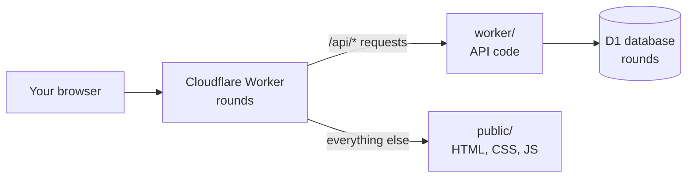
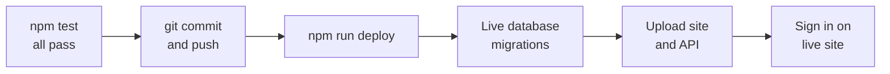

# Running and deploying Rounds

How the app fits together, how to work on it, and how to put changes live.

## How Rounds fits together

Rounds runs entirely on Cloudflare. One command, `npm run deploy`, puts the website
and the API online together at https://rounds.termanitor07.workers.dev.



Pages load from `public/`. Anything under `/api/`, such as signing in or saving an
item, runs the code in `worker/`, which reads and writes the D1 database.

| Piece | Folder or place | What it does |
| --- | --- | --- |
| Front end | `public/` | The pages, styles and scripts your browser runs |
| API | `worker/` | Sign-in, sessions, and saving courses, items and quotes |
| Database | Cloudflare D1, named `rounds` | Stores users and everyone's data |
| Schema changes | `migrations/` | Numbered SQL files that build and change the database |
| Settings | `wrangler.jsonc` | Tells Cloudflare the app name, the database and the nightly cleanup job |
| Secret | `SESSION_SECRET` | Signs login cookies. Locally it's in `.dev.vars`; live it's stored in Cloudflare |
| Secret | `SPOTIFY_CLIENT_SECRET` | Lets the Worker talk to Spotify for the player. Same two places. The matching client id is in `wrangler.jsonc` |

There are two copies of everything. **Local** is what `npm run dev` runs on your
computer, with its own test database. **Live** (also called remote or production) is
what people actually use. Changes reach live only when you deploy.

## Setting up a new computer

You do this once per computer. After that, the everyday commands just work.

1. Install [Node.js](https://nodejs.org) (the LTS version) and [Git](https://git-scm.com).
2. Get the code and install its tools. Run these in PowerShell:
    ```
    git clone https://github.com/gvogas/medDashboard.git tracker
    cd tracker
    npm install
    ```
3. Sign in to Cloudflare with `npx wrangler login`. A browser window opens; approve it
   with the Cloudflare account that owns Rounds.
4. Make the local secret file. Copy `.dev.vars.example` to `.dev.vars`, then replace
   `change-me-locally` with any long random string. This file is never committed to Git.
   The two Spotify lines can stay empty unless you want the player locally (see
   [Spotify](#spotify) below).
5. Build the local database with `npm run db:local`.
6. Make yourself a local account with `npm run user:add -- yourname --name "Your Name"`.
   It asks for a password twice and doesn't show what you type.

The live site already has its secret and database, so this setup doesn't touch it.
Your local account is separate from your live account, and the two can have
different passwords.

## Working on it day to day

Make and try every change locally first. Nothing you do locally affects the live site.

1. Start the local server with `npm run dev`, then open http://localhost:8787 and sign
   in with your local account. Leave the command running. It picks up most edits when
   you save; press Ctrl+C to stop it.
2. Edit files in `public/` (what you see) or `worker/` (the API).
3. Run `npm test`. All tests should pass (53 today). A failing test means something
   broke, so fix it before deploying.
4. Save the change in Git:
    ```
    git add -A
    git commit -m "Say what changed"
    git push
    ```

One catch: if you edit the small inline script inside `public/index.html`, run
`node scripts/csp-hash.mjs` and paste the hash it prints into `public/_headers`. If
you skip this, the browser's security policy blocks that script on the live site.

## Deploying

To put your changes live, run `npm run deploy` from the project folder. It first
applies any new database changes to the live database, then uploads the website and
API. It takes under a minute.



**Before you deploy**

- [ ] `npm test` passes
- [ ] You tried the change locally with `npm run dev`
- [ ] The change is committed and pushed, so GitHub matches what goes live

**While it runs**

If there are new migrations, it lists them and asks `continue? (Y/n)`. Type Y and
press Enter. If there are none, it says "No migrations to apply!" and carries on. If
the migration step fails, the deploy stops, so new code never goes live on an old
database.

**After it finishes**

1. Open https://rounds.termanitor07.workers.dev and sign in.
2. Check the thing you changed.
3. If something is wrong, see [Troubleshooting](#troubleshooting) below. To undo
   quickly, run `npx wrangler rollback` to put the previous version back. Rollback
   restores the code only; database changes stay.

## Changing the database

The database's shape (its tables and columns) changes only through numbered files in
`migrations/`. Each database remembers which files it has already run, so each file
runs once per database.

| File | What it adds |
| --- | --- |
| `0001_init.sql` | Users, courses, items and quotes |
| `0002_login_throttle.sql` | The table that counts wrong passwords, for lockouts |
| `0003_password_generation.sql` | A counter that powers "sign out everywhere" |

To change the database:

1. Add a new file with the next number, such as `0004_something.sql`. Never edit a
   file that has already run.
2. Apply it locally with `npm run db:local`, then test.
3. Deploy. `npm run deploy` applies it to the live database first.

To see what the live database is missing, run
`npx wrangler d1 migrations list rounds --remote`. "No migrations to apply!" means
it's up to date. To apply migrations to live without deploying code, use
`npm run db:remote`.

## Spotify

The player on the coat is off until Rounds has a Spotify app of its own. Setting one up
is done once, by whoever owns the Cloudflare account, and takes about ten minutes.
Spotify's rules, as of 2026: the app's owner needs Spotify Premium; up to five people
can use the app, each added by email; and playback controls only work for listeners
with Premium (free listeners still see what is playing).

1. Go to [developer.spotify.com/dashboard](https://developer.spotify.com/dashboard),
   sign in with your Spotify account and create an app. Any name and description.
2. Under **Redirect URIs** add both of these, exactly:
    ```
    https://rounds.termanitor07.workers.dev/api/spotify/callback
    http://127.0.0.1:8787/api/spotify/callback
    ```
   Tick *Web API* under the APIs used. Save.
3. In the app's **User Management** tab add the name and Spotify email of each person
   who wants the player, yourself included. Spotify allows five.
4. Copy the **Client ID** from the app's settings into `wrangler.jsonc`:
    ```jsonc
    "vars": { "SPOTIFY_CLIENT_ID": "paste it here" },
    ```
   and into `.dev.vars` as `SPOTIFY_CLIENT_ID=...` for local runs.
5. Show the **Client secret** and store it. Live, in Cloudflare:
    ```
    npx wrangler secret put SPOTIFY_CLIENT_SECRET
    ```
   It asks for the value and hides what you paste. Locally, put it in `.dev.vars` as
   `SPOTIFY_CLIENT_SECRET=...`.
6. Deploy: `npm run deploy`. It applies the `spotify_tokens` migration and ships the
   Worker with the new id.
7. In Rounds, open Settings, find **Spotify** and click **Connect**. Spotify asks you
   to allow Rounds to see and control playback, then sends you back. The badge at the
   bottom of the sidebar shows what is playing; start something in the Spotify app
   on any device if it says *Nothing playing*. The **Spotify** view in the top bar
   has search, your playlists, the queue and volume.

Locally, open the dev server at `http://127.0.0.1:8787`, not `localhost`: Spotify no
longer accepts `localhost` as a redirect.

Each person connects their own account from their own Settings; nobody sees anyone
else's. **Disconnect** in Settings forgets the connection on the Rounds side; to
revoke it on Spotify's side too, remove Rounds under *Manage apps* in the Spotify
account settings. Rotating `SESSION_SECRET` disconnects everyone, because the stored
refresh tokens are encrypted under it; they reconnect from Settings.

If the badge says *Open Spotify on a device first*, Spotify has no active device:
press play in the Spotify app once and the controls work from then on. *Controls need
Spotify Premium* means the listener's account is free. *Spotify is not answering* is
Spotify's side; the badge dims and tries again on its own. The volume slider is greyed
out when the playing device does not take volume from the API, which is the case for
phones; it works for the desktop app and web player.

## Managing accounts

There's no sign-up page, so you create every account yourself from the command line.
Add `--remote` to act on the live site; leave it off to act on your local database.

| To do this | Run |
| --- | --- |
| Create an account | `npm run user:add -- username --remote --name "Their Name"` |
| Change a password | `npm run user:add -- username --reset --remote` |
| Delete an account and all its data | `npm run user:add -- username --delete --remote` |

Each command asks for the password twice and hides what you type. Delete asks you to
type the username again to confirm, and it can't be undone.

- **Usernames** are 3 to 32 letters, digits, dots, dashes or underscores. Capital
  letters don't matter.
- **Lockouts:** after 5 wrong passwords, that username is locked for 1 minute. Each
  further wrong guess doubles the wait, up to 1 hour. The sign-in screen shows how
  long to wait.
- **Staying signed in:** a sign-in lasts 30 days and renews itself automatically while
  the app is used.
- **Sign out everywhere:** changing a password signs that person out on every device.

## Troubleshooting

Most problems show up as a message on the sign-in screen. Find it here, then do what
the right-hand column says.

| What you see | What it means | What to do |
| --- | --- | --- |
| Sign-in failed (internal) | The server hit an error, usually because the live database is missing a migration | Run `npx wrangler d1 migrations list rounds --remote`, then `npm run db:remote` if anything is listed |
| Wrong username or password | No such account on this site, or the password is wrong | Local and live accounts are separate. Create or reset the account with `npm run user:add` (add `--remote` for live) |
| Too many attempts. Try again in N min. | 5 or more wrong passwords | Wait it out, or reset the password |
| You seem to be offline. | The browser couldn't reach the server | Check your internet. Locally, make sure `npm run dev` is still running |
| Sign in from the app itself, not from another site. | The request came from a different web address | Open the site directly at its own address |
| Page loads but a script is blocked | The inline script changed without its security hash | Run `node scripts/csp-hash.mjs` and update `public/_headers` |

To see the live server's errors as they happen, run `npx wrangler tail`, then
reproduce the problem in the browser. Press Ctrl+C to stop.

**What happened on 2026-09-21:** every live sign-in failed with "internal". The code
had been deployed, but the live database was still missing migrations 0002 and 0003.
Running `npm run db:remote` fixed it, and `npm run deploy` now applies migrations
automatically so this can't recur.

## Command cheat sheet

Run every command in PowerShell from the project folder.

| Command | What it does | Affects |
| --- | --- | --- |
| `npm run dev` | Runs the app at http://localhost:8787 | Local |
| `npm test` | Runs all tests | Local |
| `npm run db:local` | Applies new migrations to the local database | Local |
| `npm run deploy` | Applies new migrations to live, then publishes the site and API | Live |
| `npm run db:remote` | Applies new migrations to live without deploying code | Live |
| `npx wrangler d1 migrations list rounds --remote` | Shows migrations the live database is missing | Live, read-only |
| `npx wrangler deployments list` | Shows when each version went live | Live, read-only |
| `npx wrangler rollback` | Puts the previous code version back | Live |
| `npx wrangler tail` | Streams live server errors | Live, read-only |
| `npm run user:add -- name --remote` | Creates a live account (`--reset` or `--delete` to change or remove one) | Live |
| `npx wrangler login` | Connects this computer to your Cloudflare account | Neither |
