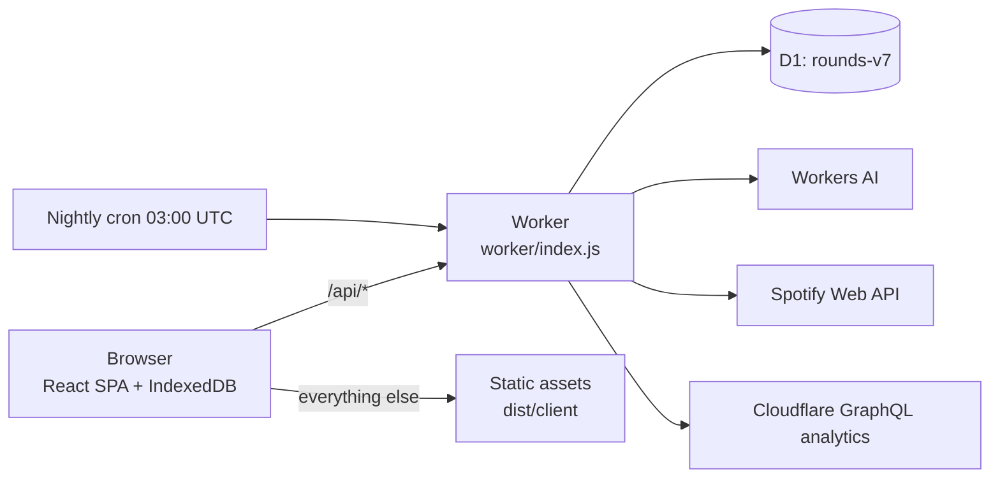

# Term — project overview

A starting point for anyone, person or AI, new to this codebase. It says what the app
is, how it is built and where things live. The detail is in the documents it links to.

## What it is

**Term** is a web app for students to track their term: courses and their weekly class
timetable (day, time, room), and dated items: exams, quizzes, assignments, labs,
tutorials, office hours, tasks and projects. Around that core it has grades, a study
timer with study history, achievements, a school calendar, a calendar feed, AI import,
a Spotify player and an admin page.

- **Who uses it:** a small group of invited people. There is no sign-up page; the owner
  creates every account from the terminal or from the Admin page.
- **Live at:** https://rounds.termanitor07.workers.dev (Cloudflare free plan, no custom domain).
- **Names:** people see **Term**. It started as a med-school tracker called **Rounds**,
  and that name is still used inside: the Worker, the D1 databases (`rounds-v7` live, `rounds-v6` kept as a backup), cookies,
  IndexedDB and CSS classes. The GitHub repo is `gvogas/medDashboard`.
- **Constraints:** everything has to fit Cloudflare's **free tiers**. That means no paid
  plan, no Cloudflare Access, no custom domain, and Workers AI is capped at 10,000
  neurons a day for the whole account.

## Features

| Area | What it does |
| --- | --- |
| Courses | Code, name, one of 12 colours, instructor, semester, archived flag, and a list of weekly meetings (Lecture/Lab/Seminar/Tutorial/PBL/Clinical, weekday, start, end, room). |
| Items | 8 types, each with its own set of statuses. Every item has a date, times, location, notes, a checklist, links, a grade and a weight, and can repeat weekly (office hours). |
| Views | **Week** (one band per day), **Month** (calendar of classes and deadlines), **All items** (sortable, filterable table), **Study**, **Music**, **Admin** (admins only). |
| Stats | Four boxes: next exam or quiz countdown, open assignments, overdue, studied today against a goal and the streak. |
| Grades | Weighted average per course, what the remaining work needs to reach a target, and "what if" scores. |
| Semesters | A school calendar (1–4 semesters, special days: off, break, exams, swapped weekday) read from a PDF by AI. Courses belong to a semester. |
| Study | A flip-clock timer that runs a flow of study and break steps you build. A focus screen. Sessions logged against a course or item. Streaks, a daily goal, a heatmap, history, spaced lecture reviews, exam prep pacing, built-in and custom achievements (with an uploaded sticker), and an opt-in leaderboard. |
| Themes | Six: Medicine, Computer Science, Law, Aviation, Sports, Engineering. Each has its own accent colour, sidebar picture (lab coat, badge, suit, jacket, jersey, vest), next-exam animation, wording and quote. All of them work in light, dark or follow-the-device. |
| Import | `.ics` calendars, CSV timetables, course outlines (PDF or Word), school calendars and class schedules (PDF or screenshot) read by Workers AI. A timetable PDF's days and times are read from its grid in the browser first, so the model only copies them; a room ending in a lone "L" (Omnivox's mark) is a lab. Everything goes through a preview where the person ticks what to keep. An outline's preview can go into **My courses**, into a class you own or edit (each row New, Changed, saying what it was, or Already there; Changed rows start unticked), or into a **new class** made from it on Import (`src/data/class-import.ts`). |
| Calendar feed | A private `.ics` link that Google or Apple Calendar can subscribe to. It carries your classes with your layer on top, and leaves out whatever you hid with the sidebar's eye toggles. |
| Spotify | Each person connects their own account. Now playing, controls, search, playlists, queue and volume. The tab itself can play music through the Web Playback SDK. |
| Shared classes | Open to everyone signed in. A class is a shared space with its own course and items. Make one blank, from a course outline, or by converting a course (all in the **+ New** menu, beside New course), invite by username or a join code, roles (owner, editor, member). Each person keeps a private layer on it: marks on its items (status, grade, weight, notes, checklist, hidden) and prefs (colour, target, term, archived). Leaving keeps a copy of the class as your own course by default. The owner removes members (they keep a copy), archives the class (read-only for everyone, members still managed) and deletes it once nobody else is in it. A class item an editor deletes stays with whoever has something on it, marked *Removed from … by …*, until they **Keep as mine** or **Dismiss** it (editors can **Restore** it for everyone). Editors share one of their own items filed under the class with it. Deleting an account hands its classes on. The sidebar's eye toggles hide a course, a class or *Personal items* from the Week, the Month and the calendar feed (All items, grades and stats still count them). A class keeps a copy of its owner's school calendar; someone joining without one is offered it. |
| Team projects | Admins only until Stage 10. **New team project** in **+ New** makes one, on its own or belonging to an item of a class you are in (its date follows the item's). Invitees join as editors. The project sheet has **Tasks** (owners and editors add, edit, assign and delete; members claim a task nobody has and complete what is theirs or everyone's), **Members** and **Activity**; the owner links or unlinks the assignment, archives, hands on, and deletes it by typing its name; anyone else leaves (their tasks become unassigned, their notes there go, nothing is copied). 200 live tasks per project. A **Projects** group in the sidebar lists them. Projects stay out of the Week, Month and other views until Stage 9 (`PROJECTS_IN_VIEWS`). |
| Inbox and activity | A bell in the top bar, for everyone, with the unread count (`99+` past 99) opens the **inbox**: your invites, with Accept and Decline, then what others did that concerns you (new, deleted and moved items, class times, archiving, and anything about you, such as a role change or a removal), newest 50, readable offline from the last copy. Opening it marks everything read. A class sheet's **Activity** tab shows the class's whole history, 30 at a time with Show older. Activity is kept 90 days; the count comes with each sync, nothing is pushed. The inbox replaced the sidebar's Invites row and sheet. |
| Admin | Overview (free-plan usage meters, traffic and health), Accounts, Errors, Audit log, a site-wide Announcement banner, and Maintenance. |
| Maintenance mode | Admins switch a feature off while they work on it (week, month, all items, study, music, import with AI, shared classes and projects), with a message. Personal data and sync never stop. `worker/maintenance.js`. |
| Offline / PWA | Local-first: an IndexedDB store (version 6). It can be installed to the home screen and works with no connection. |

## Architecture

One Cloudflare Worker serves both the static front end and the API, in front of a D1
(SQLite) database.



- **Front end:** React 19 + TypeScript, built by Vite 8 and styled with Tailwind 4 plus
  plain CSS (`src/styles/`). Fonts are self-hosted: Source Serif 4, IBM Plex Sans and
  IBM Plex Mono. Animation uses framer-motion. It is a single-page app.
- **Back end:** plain JavaScript (ES modules) in `worker/`, with no framework. Routes are
  a regex table in `worker/api.js`.
- **Database:** Cloudflare D1. The schema is `migrations/0001_schema.sql` (squashed)
  plus `0002_spaces.sql`, `0003_invites.sql`, `0004_marks.sql` and `0005_activity.sql`.
- **AI:** Workers AI. `@cf/openai/gpt-oss-120b` reads text (outlines, calendars,
  schedules) and `@cf/meta/llama-4-scout-17b-16e-instruct` reads screenshots. Both
  share a limit of reads per person per day.
- **Hosting/deploy:** `wrangler.jsonc`. Cloudflare's Git integration builds pushes to
  `main` with `npm run build`, but it does **not** apply remote D1 migrations. Run
  `npm run deploy` or `npm run db:remote` for those.
- **CI:** GitHub Actions (`.github/workflows/check.yml`) runs `npm run check`
  (typecheck, tests, build).

### Local-first sync (the core idea)

The UI always renders from **IndexedDB** in the browser, never directly from the server.

1. An edit writes the row and a pending operation to IndexedDB in one transaction.
2. Sync pushes pending operations with `PUT`/`DELETE`. Each request carries
   `If-Match: "<revision>"`, the optimistic concurrency check. A stale write gets a
   `409` and the person's version is kept as a "conflict" they can review in Settings.
3. Sync pulls with `GET /api/sync?v=3&cursors=<scope:seq,…>&sv=<space revision>`, in
   pages of up to 100 changes. SQLite triggers record every write in a `changes` table
   with an increasing sequence number and the row's **scope**: `u:<user>` for a person's
   own rows, `c:<space>` or `p:<space>` for a class or project. There is one cursor per
   scope: your own plus each space you belong to (up to 20). Scopes you have lost come
   back in `revoked`. A write to a shared row sends only the fields it changed, and they
   merge field by field (`src/core/shared.ts`). `v=2` is kept only for old open tabs.
4. Deletes are soft (`deleted_at`). The nightly cron hard-deletes tombstones older than
   30 days and moves the cursor floor forward. A client whose cursor is older than the
   floor gets `reset: true` and reloads.
5. Web Locks let only one tab sync at a time, and BroadcastChannel tells the other tabs
   to refresh.

The full protocol is in `docs/DATA-MODEL.md` under "Sync".

### Front-end structure

```
src/main.tsx        entry: boot() then React renders <App/>
src/boot.ts         wires controllers and page events once, before React mounts
src/bridge.ts       tiny pub/sub: notify() → hooks redraw (useSyncExternalStore)
src/core/           framework-free logic: IndexedDB (db.ts), store, sync, api client,
                    model/normalizers, dates, grades, school calendar, history, timer,
                    achievements, importers (ics, csv, plan), PDF text extraction and
                    timetable grids (pdftext.ts, timetable-grid.ts)
src/data/           state + hooks + controllers on top of core: views selectors, ui state,
                    session, themes, study timer, Spotify engine, item/course edits, keyboard,
                    the inbox (inbox.ts: the unread count, the list kept offline, what each
                    activity row says and opens), team projects (projects.ts: tasks,
                    permissions, make, link, leave, delete)
src/components/     React UI: shell, sidebar (with sidebar-projects.tsx, the Projects group),
                    top bar (with inbox-bell.tsx), views/ (week, month, table, stats), sheet/
                    (side sheets for editing items, courses, settings, import, AI;
                    inbox-sheet.tsx, activity-list.tsx for a space's Activity tab,
                    new-project-sheet.tsx, project-sheet.tsx and task-row.tsx), study/,
                    focus/, spotify/, admin/, sidebar-picture/ (the six SVG pictures)
src/styles/         tokens.css (theme colours), base.css, shell.css
```

The pattern: the store and the UI state are plain mutable objects. Anything that
changes them calls `notify()`, and hooks in `src/data/` read snapshots through
`useSyncExternalStore`. Pure selectors such as `src/data/views.ts` work out what each
view shows and can be tested on their own.

### Back-end structure (`worker/`)

| File | Responsibility |
| --- | --- |
| `index.js` | Entry: `/api/*` goes to `handleApi`, everything else to static assets. Also the nightly `scheduled()` purge. |
| `api.js` | Route table, same-origin checks, error handling and logging. |
| `auth.js`, `password.js`, `throttle.js` | Signed session cookie (`rounds_session`), PBKDF2-SHA256 passwords, login lockouts. |
| `http.js` | Small HTTP helpers shared by every handler (`json`, body reading, `HttpError`, revisions). |
| `db.js`, `validate.js` | Row reads and writes by scope, revisions, the sync feed (v2 and v3), input validation. |
| `access.js` | Who may do what in a shared space. Each guard is a SQL fragment run inside the statement that reads or writes. |
| `spaces.js` | Spaces: limits, Worker-made ids, the space revision, making a class, its details, its copy of the owner's school calendar, roles and transfer. |
| `classes.js` | The class routes: making a class, members, invites, join codes, absorb, leaving and removal; a project's making, link and deletion go through them to `projects.js`. |
| `projects.js` | Team projects (spec §10), admins only for now: making one, linking it to a class item, leaving or removal (no copy: off every task's assignees), deleting it, the 200-task limit. |
| `leaving.js` | Leaving and removal (spec §13): detach (a copy of the class into your own scope), leave, remove, archive, delete a class, Keep as mine, share an item, handing classes on, the purge's auto-keep. |
| `invites.js` | Invites by username and join codes; the 20-spaces and 30-members limits ride in each statement. |
| `layer.js` | Your layer on a space: marks on its items and your prefs for it, both yours alone. |
| `activity.js` | Activity (spec §12): `noteStmt`, the row a member or space route writes in its own batch (the triggers in `0005_activity.sql` write the rest), and the reads: the inbox, its unread count, the read marker, a space's Activity tab. |
| `inbox.js` | The inbox routes: `GET /inbox`, `PUT /inbox/seen`, `GET /spaces/:sid/activity`. |
| `maintenance.js` | Maintenance mode: stored in `app_meta`, sent with `GET /api/me`, enforced (503) for AI reads and shared classes. |
| `limits.js` | Per-user request rate limits. |
| `ai.js`, `outline.js`, `school.js`, `schedule.js` | Workers AI reads. They return JSON and **never save**; the browser previews and saves. |
| `calendar.js` | The private ICS feed (HMAC token): your courses and items, and your classes' with your layer (`feedRows`). |
| `leaderboard.js` | Opt-in study leaderboard. |
| `spotify.js`, `spotify/` | OAuth, encrypted refresh tokens (AES-GCM, `SPOTIFY_TOKEN_KEYS`), Spotify API proxy. |
| `admin.js`, `accounts.js`, `analytics.js`, `errors.js` | Admin routes (`users.is_admin` checked on the server), what deleting an account removes, Cloudflare traffic analytics, the error log. |

### API surface (all JSON, under `/api`)

- **Session:** `POST /login`, `DELETE /session`, `POST /session/revoke-all`, `GET|PUT /me`
  (profile, settings, school calendar, announcement).
- **Data:** `GET /sync`, and `GET|PUT|DELETE /{courses,items,quotes,study_sessions,achievements}/:id`.
- **Shared classes:** `POST /spaces`, `GET /spaces/:sid`, `GET|PUT|DELETE /spaces/:sid/{courses,items}/:id`,
  `PUT /spaces/:sid/members/:uid`, `POST /spaces/:sid/transfer`, `POST|DELETE /spaces/:sid/invites…`,
  `POST|DELETE /spaces/:sid/code`, `POST /spaces/:sid/absorb`, `POST /spaces/:sid/{leave,archive,school}`,
  `DELETE /spaces/:sid`, `DELETE /spaces/:sid/members/:uid`, `POST /spaces/:sid/items/:id/keep`, `GET /invites`
  (old clients only), `POST /invites/:sid/{accept,decline}`, `POST /join`.
- **Team projects:** the same space routes by kind: `POST /spaces {kind:'project'}`, `POST /spaces/:sid/link`,
  `DELETE /spaces/:sid {confirm}`; tasks through `/spaces/:sid/items/:id`.
- **Inbox and activity:** `GET /inbox`, `PUT /inbox/seen`, `GET /spaces/:sid/activity?before=`; the unread
  count rides on the last page of `GET /sync?v=3`.
- **Your layer:** `GET|PUT|DELETE /marks/:sid/:itemId`, `GET|PUT|DELETE /space_prefs/:sid`.
- **AI reads:** `POST /outline`, `POST /school-calendar`, `POST /ai/schedule`, `GET /ai/reads`.
- **Calendar feed:** `GET|POST|DELETE /calendar`, `GET /calendar/:userId/:token.ics` (no session).
- **Leaderboard:** `GET|PUT /leaderboard`.
- **Spotify:** `/spotify/connect|callback|status|player|token|devices|search|playlists|queue|volume|…`.
- **Admin:** `/admin/*` (admins only).

### Data model (D1)

| Group | Tables |
| --- | --- |
| User data | `users` (account and profile: theme, coat, study flow and prefs, school calendar, `hidden_sources`, `is_admin`), `courses` (meetings stored as a JSON column), `items`, `quotes`, `study_sessions`, `achievements` |
| Sharing | `spaces`, `members`, `invites`, `marks` (your layer on a class item), `space_prefs` (your colour, target, term and archive per class) |
| Activity | `activity` (what members did, from triggers on shared rows and from the member routes; 90 days), `inbox_seen` (how far each person has read) |
| Sync | `changes`, `sync_state` |
| Security | `login_throttle`, `request_limits` |
| Spotify | `spotify_tokens`, `spotify_oauth_states`, `spotify_refresh_locks` |
| Admin | `error_log`, `admin_log`, `app_meta` (announcement, maintenance) |
| Views | `active_items`, `account_summary` |

Conventions:
- Courses and items are keyed `(scope, id)`; quotes, study sessions, achievements, marks
  and space prefs are keyed `(user_id, id)`. Ids are generated by the client (space ids
  by the Worker).
- Dates are local `YYYY-MM-DD` strings, times are `HH:MM`, and weekdays run 0–6 with
  Sunday as 0.
- Timestamps are milliseconds since the epoch.
- Small lists (meetings, checklists, links) are JSON columns with `CHECK` caps.
- Derived values (overdue, countdowns, hours, streaks, built-in achievements) are
  computed on the client and never stored.

Full column reference: `docs/DATA-MODEL.md`.

### Security model

- Every handler resolves the user from the signed cookie. Personal rows are read and
  written only in that user's own scope or `user_id`; another user's row returns `404`.
  Shared rows are guarded by live membership and role (`worker/access.js`) inside the
  same SQL statement, so there is no gap between the check and the write.
- Passwords use PBKDF2-SHA256 with sign-in lockouts. Cookies are `HttpOnly; Secure;
  SameSite=Lax`, and state-changing requests must be same-origin.
- `public/_headers` sets a strict CSP with a hash of the inline theme script in
  `index.html`. Run `npm run csp:update` after editing that script.

The details (lockouts, sessions, rate limits) are in `docs/DATA-MODEL.md`; secrets are in
`docs/DEPLOYING.md`.

## Repository map

```
index.html, src/, public/   front end (public/ = _headers, sw.js, manifest, icons)
worker/                     API Worker
migrations/                 D1 schema: 0001_schema (squashed), 0002_spaces, 0003_invites, 0004_marks,
                            0005_activity
scripts/                    add-user, build, check-db, check-secrets, csp-hash, move-db, spotify-key
test/                       Worker/API tests (vitest in the Workers runtime, local D1, fake Spotify)
src/**/*.test.ts(x)         UI tests (vitest + jsdom + Testing Library)
design/                     prototypes and mockups (design/term-prototype.dc.html = the redesign's source of truth)
docs/                       PROJECT-OVERVIEW, DATA-MODEL, DEPLOYING, superpowers/ (specs and
                            plans), archive/ (finished one-off docs)
wrangler.jsonc              Worker config: assets, D1 binding, AI binding, vars, cron
```

## Commands

```sh
npm install
npm run db:local                 # apply schema to local D1
npm run user:add -- name --name "Name"   # local account (add --remote for live, --admin, --reset, --delete)
npm run dev                      # http://127.0.0.1:8787 (Vite with the Worker inside)
npm test                         # all tests (workers + dom + node)
npm run check                    # typecheck + tests + build (what CI runs)
npm run db:remote                # apply migrations to the live D1 (Git builds do not)
```

Deploying, secrets, accounts and database moves: `docs/DEPLOYING.md`.

## History in brief

1. **Sep 2026:** built as "Rounds", a vanilla-JS med-school tracker turned into a
   Cloudflare app (accounts, sync, PWA). Then Spotify, the study timer, achievements and
   the school calendar.
2. **Sep 27–28:** migrated to React + TypeScript + Vite, stage by stage.
3. **Sep 29–Oct 1:** the **Term redesign**, in seven stages: an editorial look, six
   themes, semesters and repeats, an item card, Study tabs, Music, and Import with AI.
4. **Oct 1:** Admin dashboard. The database moved to a fresh `rounds-v6` built from the
   squashed schema.
5. **Oct 5:** Maintenance mode. Collaboration Stage 1 (scope keys on courses, items and
   the change feed) with a move to a fresh `rounds-v7`; `rounds-v6` is kept as a backup.
   Stage 2: spaces, members and sync v3.
6. **Oct 6:** Stages 3 and 4 (main `3bb488a`): shared classes (make, convert, invite,
   join codes, roles) and the personal layer (marks, space prefs, hidden sources,
   absorb), for admins at first.
7. **Oct 9:** Stage 5 (main `d3df959`): leaving and removal. Stage 6 (main `9dc8ea8`):
   classes in the calendar feed, outline imports into a class or a new class, the class's
   school calendar offered to joiners, and shared classes open to everyone. No migration.
8. **Oct 18:** Stage 7 (main `bafcd0c`): inbox and activity. Migration
   `0005_activity.sql` (`activity`, filled by triggers on shared rows and by the member
   routes, and `inbox_seen`); the bell and inbox sheet replace the Invites row and sheet;
   a class's Activity tab; the unread count rides on each sync.
9. **Oct 18:** Stage 8 (main `54ef5fa`): team projects, for admins only. Making one
   (on its own or under a class assignment), linking, tasks with claiming and
   completing, the project sheet and the sidebar's Projects group, leaving, removal and
   deleting; account deletion takes the account off its tasks. Out of the views until
   Stage 9. No migration.
10. **Next** (`docs/superpowers/plans/2026-10-02-collaboration.md`): Stage 9 projects in
    the views; Stage 10 projects in the inbox's news and the calendar feed, open to everyone.

## Gotchas worth knowing

- **Remote migrations lag.** Git-triggered builds do not apply D1 migrations. A 500 on
  the live site usually means a migration has not been applied remotely.
- **`meta.changes` counts trigger rows.** Writes to shared `items` and `courses` also
  write `activity` (and `changes`) rows by trigger, so count a statement's own rows with
  `SELECT changes()`, never D1's `meta.changes`.
- **Line endings must stay LF.** CRLF changes the inline script's hash and breaks the CSP.
- **Workers AI quota is shared** with the live site. Keep tests that hit real AI to a
  minimum; the automated tests use fakes.
- **Vite processes are left behind on Windows.** After stopping dev or preview, a
  process can keep holding port 8787 or 8790 and serve old code. Kill it by port.

## Docs

| Doc | What it holds |
| --- | --- |
| `README.md` | Short intro and quick start. |
| `docs/DATA-MODEL.md` | Schema, API, sync and security. |
| `docs/DEPLOYING.md` | Operations: secrets, migrations, Git builds, accounts, Spotify, maintenance, database moves. |
| `docs/superpowers/specs/`, `docs/superpowers/plans/` | Design specs and implementation plans. Code comments that cite "spec §N" mean the shared-classes spec, `2026-10-02-shared-classes-design.md`. |
| `docs/archive/` | Finished one-off docs kept for history: `PLAN.md`, `API-REVIEW.md`, `RELIABILITY-UPGRADE.md`. |
