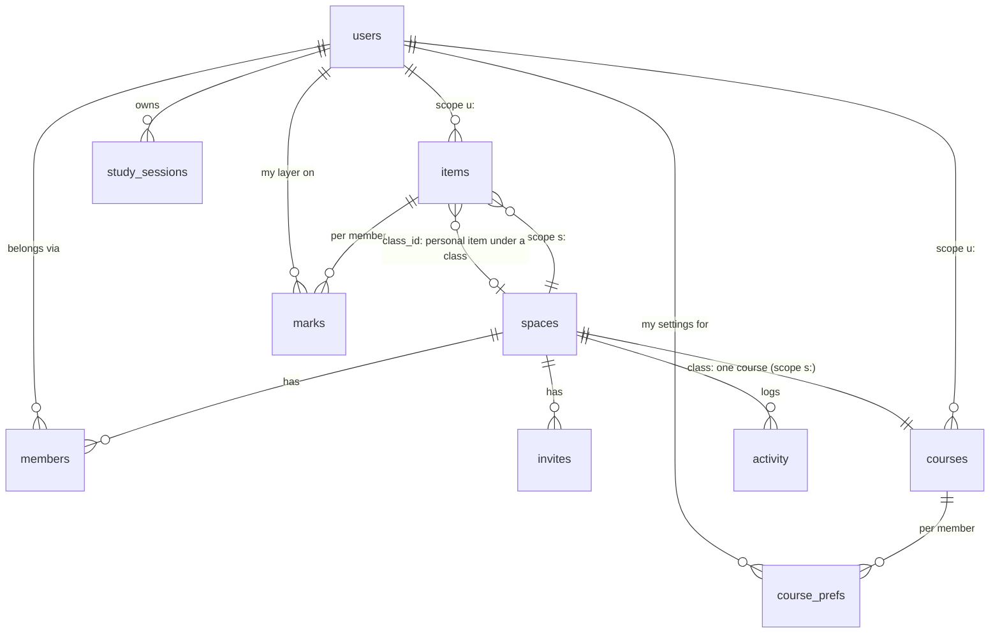

# Shared classes (collaboration v1) — design

Agreed in brainstorming 2026-10-02; written spec awaiting George's review. Not built yet. The source request is
`TERM-COLLABORATION-PLANNING-PROMPT.md`; this spec answers its 20 points in order.

Decisions taken with George:

| Question | Decision |
|---|---|
| Scale | Small groups, 2–10 people (accounts are still created by the admin) |
| First feature | Shared classes. Team projects are phase 2 on the same foundation |
| Who edits shared facts | Owner + editors they choose; members read and keep their own layer |
| Joining with a personal copy of the course | Offer to merge it into the class |
| Model | A **scope** on courses and items + a **personal layer** (option A of three) |
| Editors may invite | Yes; only the owner makes codes, removes people, changes roles |
| A removed member | Always keeps a personal copy |
| Unknown username on invite | Clear error ("No Term account named …") |
| Activity history | Kept 90 days |

---

## 1. Collaboration model

A **space** is a group of members that owns data. v1 has one kind, `class`: a space
holding exactly one course and its items. Phase 2 adds `project`. Every course and item
has a **scope**: `u:<userId>` (personal) or `s:<spaceId>` (shared). Things only a person
holds about a shared row (status, grade, notes, checklist, colour, target) live in
**personal-layer** tables keyed by that person.

Why this and not the alternatives:

- **Separate shared tables** (`space_items` next to `items`) would duplicate validators,
  triggers, the feed builder, the ICS builder and every view selector, and phase 2 would
  add a third copy.
- **A copy per member with server fan-out** has no authoritative object; every deadline
  change is N writes and copies drift after offline edits.
- Term already makes ownership part of the primary key, `(user_id, id)`. A scope
  generalises that from "which user" to "which owner", keeping the rule that every query
  is keyed by its owner, and keeping one `items` and one `courses` table, so Week,
  Month, the table, grades and the ICS feed keep working on one item shape.

## 2. Entity relationships



- A **shared item** belongs to the class's course (same scope, composite FK).
- A **personal item under a class** (an extra quiz you track, a lecture review) stays in
  your scope with `class_id` pointing at the space.
- A **mark** is your layer on one shared item; it exists only once you touch the item.
- **Study sessions and achievements** stay personal and may point at shared rows via
  `space_id` + `item_id`/`course_id`.

## 3. Database changes

A new database, **rounds-v7**, built from a re-squashed `0001_schema.sql` and filled
with `scripts/move-db.mjs`, the procedure used for v2–v6. The move rewrites
`user_id` to `'u:' || user_id` in `courses`, `items` and `changes`. Nothing becomes shared.

### New tables

| Table | Key | Columns and rules |
|---|---|---|
| `spaces` | `id` (`[A-Za-z0-9_-]`, ≤ 24) | `kind` (`class`), `name` (projects only; a class shows its course), `owner_id`, `archived` 0/1, `school_calendar` JSON snapshot (offered to joiners), `code_hash`, `code_expires`, `code_uses_left`, `created_at`, `updated_at`, `deleted_at`, `revision` |
| `members` | `(space_id, user_id)` | `role` `owner`\|`editor`\|`member`, `joined_at`, `updated_at`, `deleted_at` (left/removed), `revision`. One live owner per space |
| `invites` | `(space_id, user_id)` | `invited_by`, `status` `pending`\|`accepted`\|`declined`, `created_at` |
| `marks` | `(user_id, space_id, item_id)` | `status`, `grade`, `weight` (override), `notes`, `checklist`, `completed_at`, `hidden` 0/1, timestamps, `deleted_at`, `revision` |
| `course_prefs` | `(user_id, space_id, course_id)` | `color` (one of the twelve), `target`, `term` (your semester name), `archived`, timestamps, `revision` |
| `activity` | `seq` autoincrement | `space_id`, `actor_id`, `verb`, `subject` (item, course or user id; `''` for creations, never NULL, so the unique key can match), `subject_user` (for member verbs), `detail` JSON, `bucket` (10-minute bucket), `at`. Unique `(space_id, actor_id, verb, subject, bucket)` for coalescing |
| `inbox_seen` | `user_id` | `seq`: the last activity row read. Kept off `users` so reading the inbox never bumps the profile revision |

### Changed tables

| Table | Change |
|---|---|
| `courses`, `items` | `user_id` → `scope`; PK `(scope, id)`; `updated_by` (user id). Items FK becomes `(scope, course_id) → courses(scope, id)` |
| `items` | `class_id` (nullable space id): a personal item under a class. No FK (it crosses scopes); the Worker checks membership. `CHECK (class_id IS NULL OR (course_id IS NULL AND scope GLOB 'u:*'))` |
| `items` | Shared rows: `CHECK (scope GLOB 'u:*' OR (grade IS NULL AND checklist = '[]' AND status = 'todo' AND completed_at IS NULL AND type NOT GLOB 'c-*'))`. Shared `notes` and `links` are the class's notes and links |
| `study_sessions`, `achievements` | `space_id` (nullable): set when `course_id`/`item_id` point at a shared row |
| `users` | `hidden_sources` JSON array ≤ 40 (course ids, class space ids, `personal`): the calendar filter |
| `changes` | `user_id` → `scope`; `UNIQUE (scope, kind, row_id)`; index `(scope, seq)`. Triggers on `quotes`, `study_sessions`, `achievements`, `marks`, `course_prefs` write `'u:' \|\| user_id`. Only `courses` and `items` ever write an `s:` scope; spaces and members are not in the feed (they come with each sync response, section 5) |

### Indexes

`marks (user_id, space_id)`, `course_prefs (user_id, space_id)`, `members (user_id)`
where live, `activity (space_id, seq)`, `activity (subject_user, seq)`,
`items (class_id)` where set, `study_sessions (user_id, space_id)`; existing
`(user_id, …)` indexes on `courses`/`items` become `(scope, …)`.

### Limits

At most 30 live members per space and 20 spaces per user (Worker). A class has exactly
one course, and it cannot be deleted; the class is archived instead.

### Ids

Ids keep their current form. They only need to be unique within a scope: shared rows
live in their own client stores keyed `[scope, id]` (section 4), and every reference to
a shared row carries its space. Absorb, convert and detach keep ids when moving rows
between scopes, so study sessions and achievements only gain or lose a `space_id`.

## 4. Local IndexedDB changes (version 5)

| Store | Key | Holds |
|---|---|---|
| `courses`, `items`, … | `id` | Personal rows, unchanged |
| `shared_courses`, `shared_items` | `[scope, id]` | Class rows. Keeping them out of the personal stores means a shared id can never shadow a personal row or its pending op |
| `spaces` | `id` | The classes you're in, with role, archived and members (`{userId, name, role}`), replaced from each sync response's `scopes`; it gives "Edited by Alex" its name offline |
| `marks`, `course_prefs` | `[space_id, item_id]` / `[space_id, course_id]` | Your layer |
| `meta.cursors` | | `{scope: seq}`. The upgrade moves `meta.syncCursor` to `u:<me>` |

- Pending ops gain `base`, a snapshot of the row when the op was first queued, and
  shared keys are `items:s:<space>:<id>`.
- `effectiveItems()` (memoised in `src/data/`) returns personal items plus each live,
  unhidden shared item merged with its mark, each tagged
  `source: {kind: 'personal'} | {kind: 'class', spaceId, role}`. Week, Month, All items,
  stats, grades, achievements, exam prep and the pickers read it. The same goes for
  `effectiveCourses()` (shared course + `course_prefs`).
- The item editor splits a save: shared fields → `shared_items` (editors), personal
  fields → `marks`.
- A shared item that arrives deleted stays in `shared_items` when your mark on it holds
  anything (grade, notes, checklist, status other than todo); see section 16.

## 5. Sync protocol changes

### Pull: `GET /api/sync?v=3&cursors=u:<me>.812,s:abc.640`

1. A first query reads your live memberships with their spaces and member names
   (≤ 20 spaces × ≤ 30 members, joined to `users` for display names). The scopes to
   page are `u:<me>` plus those spaces. A scope the client hasn't seen starts at 0, so a
   new class loads in full.
2. A second statement pages up to 100 changes:
   `SELECT * FROM (SELECT … FROM changes WHERE scope = ? AND seq > ? AND <guard> ORDER BY seq LIMIT 101) UNION ALL … ORDER BY seq LIMIT 101`.
   Each branch reads at most 101 rows. `<guard>` for a space is
   `EXISTS (SELECT 1 FROM members m JOIN spaces s ON s.id = m.space_id WHERE m.space_id = ? AND m.user_id = ? AND m.deleted_at IS NULL AND s.deleted_at IS NULL)`,
   evaluated inside the statement, so a removal between the two queries cannot leak a page.
3. If the page ends at sequence X, every scope's rows up to X are delivered; each
   cursor becomes `max(cursor, X)`, or the head on the last page.
4. Response:
   `{scopes:[{id, role, archived, name, members:[{userId, name, role}]}], cursors, changes, more, reset:[scope], revoked:[scope], inbox}`.
   Sending spaces and members whole each time keeps them out of the change feed (no
   member triggers, renamed people show their new name) at a few dozen rows read per sync.
   `reset` is per scope: only that scope's clean rows are rebuilt. `revoked` lists
   scopes the client sent that it may no longer read. `inbox` is the unread count.
5. `cursors` holds at most 25 entries; malformed input is `400`.
6. `/api/sync?v=2` and the personal routes stay as they are (scope `u:<me>`), so
   clients that haven't updated keep working without seeing classes.

Freshness is unchanged: sync after each edit, on focus, and every 5 minutes while
visible. No WebSockets.

### Push: field-level merge for shared rows and marks

Personal tables keep today's whole-row `If-Match`. For shared courses, shared items and
marks, the client sends the full row plus `changed: {field: oldValue}` (from `base`):

1. Revision matches → write as today.
2. Otherwise, for each changed field: if the current value equals the old value or the
   new value, it's safe. If every changed field is safe, write only those fields onto the
   current row, guarded by the current revision, retrying once on a lost race.
3. Otherwise `409 {current, fields, by}`, and the existing Conflicts review shows
   "Gabriel changed Date to Oct 18".

JSON fields (`meetings`, `links`, `checklist`) count as one field, compared after
stable re-serialisation. Merging individual meetings is phase 3.

### Writes are authorised in the statement

Shared upserts and deletes carry
`EXISTS (SELECT 1 FROM members m JOIN spaces s … WHERE m.role IN ('owner','editor') AND s.archived = 0 AND s.deleted_at IS NULL)`,
the same pattern as `courseGuard`/`capGuard` in `worker/db.js`. A miss reads once to
choose `404` (not a member), `403 {error:'forbidden'}` (member), `403 {error:'archived'}`
or `409`. Mark writes check membership and that the item is in that space.

### Offline edits, membership and permission changes

| Situation | Behaviour |
|---|---|
| Removed while offline with pending edits | Next sync lists the scope in `revoked`; one IndexedDB transaction deletes its rows and moves its pending ops to Conflicts ("You no longer have access to Web Services"). Detach (section 7) wrote your personal copy in the same server batch, so it arrives in the same response |
| Made view-only while offline | Pushes get `403 forbidden`; the sync loop treats 403 like 409 (rejects to Conflicts at once). Today 403 would be retried three times |
| Class archived | `403 archived` for shared writes; marks still save |
| Edit to a row deleted meanwhile | `409` with the tombstone; the conflict copy says "Deleted by Alex"; an editor may restore it (upsert revives) |
| Delete of a row edited meanwhile | `409`; "Alex edited this. Delete anyway?" |

Upload order (`rank()`): course puts → item puts (shared and personal) → mark and
course-pref puts → course deletes. A mark on an item that was created offline waits for it.

## 6. Permission model

| Action | Owner | Editor | Member |
|---|:-:|:-:|:-:|
| See the class; keep marks, prefs and personal items under it | ✓ | ✓ | ✓ |
| Create, edit, delete and restore shared items; edit course facts (meetings, rooms, instructor) | ✓ | ✓ | |
| Import an outline into the class | ✓ | ✓ | |
| Invite by username | ✓ | ✓ | |
| Invite code, change roles, remove members | ✓ | | |
| Archive or unarchive, refresh the school-calendar snapshot, transfer ownership | ✓ | | |
| Delete the class | when the only member | | |
| Leave | after transferring | ✓ | ✓ |

One live owner per space, enforced inside the UPDATE so two requests cannot race.
Moderators and suggested changes are phase 3, for whole classes.

All guards come from one module, `worker/access.js`; `db.js` functions take a scope
instead of a user id; personal routes pass `u:${user.id}`. Non-members always get `404`.

## 7. Shared vs personal data rules

| Shared (one row, editors change it) | Personal (per member, only you see it) |
|---|---|
| Course: code, name, instructor, meetings, default `term` | Course: colour, grade target, your semester, archived |
| Item: type (built-in only), title, date, times, location, weight, recurrence, class notes, links | Item: status, completion, grade, weight override, checklist, your notes, hidden |
| | Study sessions, achievements, what-if scores, reviews, exam-prep checklists |

Rules:

- **No fan-out.** A mark exists only once you touch an item; no mark means todo, no
  grade. Adding an assignment is one write, joining is one write.
- **Absorb** (personal → class), one set-based D1 batch (`INSERT … SELECT`, pairs via
  `json_each()`), idempotent by construction:
  - **convert** (`POST /api/spaces {convertCourseId}`): create the class with you as
    owner, copy your course and its items into it under the same ids, move your personal
    fields into marks and course prefs, set `space_id` on your sessions and
    achievements, then soft-delete the personal course and items (written directly in
    the batch, not through the course-delete path that would null `course_id`);
  - **merge on join** (`POST /api/spaces/:sid/absorb {courseId, pairs}`): for matched
    pairs, write marks from your item, repoint sessions and achievements from your item
    id to the shared one, and soft-delete your item; set `class_id` on unmatched items
    in place (lecture reviews included; the review generator's `through` watermark stops
    it re-creating past steps); then soft-delete the now-empty personal course.
  - Absorb by a member never writes a shared row: only marks, prefs and the member's own
    rows. The Worker checks every `mine` id is yours and in `courseId`, and every
    `shared` id is a live item of that class.
- **Detach** (class → personal), the reverse: copy the course and items into your scope
  under the same ids (an upsert, so a converted course's tombstones, if not yet purged,
  are revived rather than duplicated), fold marks back in, repoint `class_id` items,
  clear `space_id` on sessions and achievements. Runs on leave (opt out with a
  checkbox), on removal (always), and per item on **Keep as mine**. A rare id clash with
  a live personal row gets a new id.

## 8. Calendar integration

- Week, Month and All items read `effectiveItems()`: shared items appear like any other,
  in your colour for the class, with a small two-person glyph and an aria-label
  ("Shared · Web Services"), so colour is never the only cue. A "you" pip marks a
  personal item under a class.
- All items gains a **Source** filter (Personal, or a class).
- **Calendar filter:** an eye toggle on each sidebar course row plus a *Personal items*
  row writes `users.hidden_sources`. Hidden courses stay listed, dimmed. It syncs across
  devices and the ICS feed honours it. It's separate from the existing sidebar course
  selection, which is a temporary focus.
- Each person's semester for a class comes from `course_prefs.term` (section 9).
- **ICS feed:** in addition to personal items and courses, it includes your classes'
  courses and items with your mark applied (✓ when complete, cancelled when missed, left
  out when hidden), and personal items under a class. `hidden_sources` and archived
  course prefs are skipped. Membership is joined in the query, so a removed member's next
  fetch leaves the class out. Shared events' UIDs carry the space id
  (`item-<spaceId>-<id>`, `class-<spaceId>-<courseId>-…`), since ids are only unique
  per scope; converting a course therefore shows in calendar apps as a delete plus an add.

## 9. Study and grade integration

**Study.** Sessions stay personal; `space_id` is set when one is logged against a class
or its item. History, streaks, daily goal, heatmap and the leaderboard count your minutes
only and don't change. Per-course totals group by `(space_id, course_id)`. The timer, Log
study and achievement pickers list merged items.

- **Lecture reviews** are personal tasks generated from the shared course's meetings,
  with `class_id` set. A converted course keeps its course id, so review ids (derived
  from the lecture) carry on; after a merge, existing reviews move under the class and
  the `through` watermark prevents duplicates.
- **Exam prep** writes its lecture checklist into your mark.
- **Achievements:** built-in ones read merged items. Custom `hours`/`grade` achievements
  gain `space_id`. Once shown as earned, a built-in achievement is never taken back
  because you hide an item.

**Grades.** `courseGrade()` is unchanged and receives merged items: weight is
`mark.weight ?? item.weight`, status and grade come from the mark, and personal items
under the class count too. The target comes from `course_prefs.target`; what-if scores
stay on the device. Marks are only ever read with `user_id = me`; there is no class
average. If an editor changes a weight you've overridden, the card says
"Class weight changed to 25% · yours: 20%" with **Use class weight**.

**Semesters.** Everyone keeps their own school calendar. On join, Term picks your
semester whose name matches the course's `term`, else the one covering today, and asks
you to confirm. The owner's school-calendar snapshot on the space is offered to a joiner
who has none ("Use Vanier College 2026–27 from this class"), copied into their profile.
Your relabelled or recoloured built-in types and hidden types apply to shared items too.

## 10. Invitation flow

- **By username** (owner, editor): `POST /api/spaces/:sid/invites {username}`. Unknown
  username is `404 {error:'no_user'}`, shown as "No Term account named 'gabriel'".
  20 invites an hour per user (`limits.js`). The invite appears in the recipient's inbox
  with **Accept** and **Decline**. Inviting a current member is `409 {error:'member'}`;
  joining by code marks any pending invite to you as accepted; re-inviting someone who
  declined resets it to pending.
- **By code or link** (owner): 8 characters of Crockford base32 (~40 bits), stored as
  SHA-256, valid 7 days, up to 10 uses; a new code retires the old one. The link is
  `/#join=<code>`, handled like `#spotify=` in `src/data/session.ts`: a hash never reaches
  the server, request logs or `Referer`, and it's cleared with `history.replaceState`.
  10 join attempts an hour per user. A full class returns `409 {error:'full'}`.
- **Joining** inserts your membership row; sync then downloads the class. The join
  screen shows "Downloading Web Services…" until the first page arrives, picks your
  semester and colour (the owner's colour unless you already use it, else the first free
  of the twelve), offers the school calendar, and opens the **merge sheet** if it finds a
  matching personal course (type + normalised title, then closest date; unsure pairs are
  left unpaired; "Not the same item" undoes a pair; **Skip** leaves a banner for later).
- No arbitrary email addresses and no account creation from an invite: accounts still
  come from the admin.

## 11. Notification and activity model

**Activity** is server-side, user-facing and separate from `changes`, which stays an
internal sync log. The Worker writes it in the same batch as each shared write, for
meaningful events only: item created, deleted or restored; an item's date, times, weight
or title changed; course meetings, room or instructor changed; a member joined, left,
was removed or changed role; the class archived or unarchived; ownership transferred.

- **Coalescing** via the unique key: changes coalesce per (space, actor, verb, subject,
  10-minute bucket), keeping the first `from` and updating `to`; a change that ends where
  it started is deleted. Creations use `subject = ''` and so coalesce per (space, actor, bucket), with up to 10
  titles, so an import is one row.
- **The inbox** is derived, not stored: invites to you, plus others' activity in your
  live classes filtered to what concerns you (new items, date changes, deletions, your
  role, archiving), plus rows with `subject_user = you` (removed, ownership transferred)
  that stay visible after you leave. `GET /api/inbox` loads it when the sheet opens; it's
  cached in IndexedDB for offline. The unread count comes with each sync response.
  `PUT /api/inbox/seen {seq}` moves `inbox_seen`.
- **A class's Activity tab** fetches on open (`GET /api/spaces/:sid/activity?before=`);
  offline it says "Connect to see activity".
- Rows older than 90 days are deleted by the nightly cron.

## 12. API changes (endpoints only)

```
GET    /api/sync?v=3&cursors=…
GET    /api/spaces                                   the classes I'm in
POST   /api/spaces                                   create: blank, from an outline, or {convertCourseId}
GET|PATCH|DELETE /api/spaces/:sid                    archive/unarchive, refresh school calendar, delete (only member)
GET|PUT|DELETE   /api/spaces/:sid/courses/:id
GET|PUT|DELETE   /api/spaces/:sid/items/:id
POST   /api/spaces/:sid/items/:id/keep               detach one removed item
POST   /api/spaces/:sid/absorb                       {courseId, pairs:[{mine, shared}]}
PUT    /api/spaces/:sid/members/:uid                 change role (owner)
DELETE /api/spaces/:sid/members/:uid                 remove (owner); always detaches their copy
POST   /api/spaces/:sid/leave                        {keepCopy}
POST   /api/spaces/:sid/transfer                     {userId}
POST   /api/spaces/:sid/invites                      {username}
DELETE /api/spaces/:sid/invites/:uid
POST   /api/invites/:sid/accept · /decline
POST|DELETE /api/spaces/:sid/code                    new code · turn off
POST   /api/join                                     {code}
GET|PUT|DELETE /api/marks/:sid/:itemId
GET|PUT|DELETE /api/course_prefs/:sid/:courseId
GET    /api/spaces/:sid/activity?before=
GET    /api/inbox
PUT    /api/inbox/seen
```

The admin's account deletion (`worker/accounts.js`) transfers each owned class to the
longest-standing editor, else member, else archives it, then removes memberships.

## 13. UX changes

- **Sidebar:** classes sit in the course list with the shared glyph, hover "Shared · 5
  members", and the eye toggle. **+ New course** becomes a menu: *New course*, *New shared
  class*, *Join with code*. No separate Groups page.
- **Course sheet** for a class: the existing tab plus **Members** (display names, roles,
  invite, code, remove, transfer, archive, merge my personal course) and **Activity**.
  *Convert to shared class* appears on a personal course.
- **Item card:** a **Class** section (title, date, weight, class notes and links,
  "Edited by Alex · 2h ago"; read-only with a lock for members) and a **Yours** section
  (status, grade, checklist, my notes, weight override, Hide). Hiding a graded item asks
  first ("Its 87% will stop counting toward Web Services"). A hidden item stays listed
  under the class with **Show again**.
- **Removed items:** "Removed from Web Services by Alex" with **Keep as mine** and
  **Dismiss**; it keeps counting in grades until you choose.
- **Top bar:** a bell with the unread count opens the inbox sheet.
- **Import:** the outline import gets a target picker (My courses, or a class you edit)
  and, for a class, a diff preview (New / Changed / Already there, for items and course
  facts; Changed rows start unticked). *New shared class → From course outline* uses the
  same flow. AI never saves.
- **Conflicts** in Settings show who made the competing change.

## 14. Migration and backwards compatibility

- rounds-v7 via the clean-db procedure; `move-db.mjs` maps `user_id` → `'u:' || user_id`
  for `courses`, `items`, `changes`, with a test against the legacy fixture. Remote
  migrations still have to be applied by hand (Git builds skip them).
- All existing data stays personal. Sharing happens only through *Convert to shared
  class*, merge on join, or creating a new class.
- Personal routes and `sync?v=2` are kept, so a stale tab keeps working until it reloads.
- IndexedDB v5 upgrade moves the cursor, creates the new stores, keeps pending ops and
  conflicts.
- Conversion is safe because it's reversible: leaving (or removal) detaches a full
  personal copy under the same ids, with your marks folded back in, so study sessions,
  achievements and grades line up again.

## 15. Security risks

| Risk | Mitigation |
|---|---|
| A route or query forgets authorisation | Guards inside each statement, built only by `access.js`; per-route tests: non-member → 404, member on an editor action → 403 |
| Id collision or spoofing across scopes | Separate `[scope, id]` client stores; space-id charset; every shared reference carries its space |
| Invite-code guessing | ~40 bits, hashed, 7-day expiry, use limit, 10 attempts an hour |
| Username enumeration | Accepted for an invited group; rate-limited; login lockouts protect each name |
| Grade leakage | Marks read only with `user_id = me`; no aggregates; ICS built per user |
| A removed member keeps data | Accepted; they had it already, and the copy is intended |
| A careless or hostile editor | Activity shows who did what; conflict copies; restore of deleted items; owner can demote or remove |
| Removal race | Membership guard evaluated inside the sync and write statements |

## 16. Important edge cases

- **Delete vs offline edit:** 409 with the tombstone → Conflicts; editors can restore.
- **An editor deletes an item you graded:** the item stays on your device as "Removed…"
  until you Keep or Dismiss; before the nightly purge hard-deletes it, meaningful marks
  are detached automatically, so a grade can't be lost by waiting.
- **Lose access while offline:** pending shared edits → Conflicts; your copy arrives via
  detach in the same response.
- **Joining with a personal copy:** the merge sheet; nothing duplicates for long.
- **Owner leaves or their account is deleted:** transfer first; account deletion
  transfers automatically or archives.
- **Two devices press Keep:** same ids, upserts; the second is a no-op.
- **Mismatched semester names:** `course_prefs.term` per person.
- **Colour clash on join:** first free colour.
- **Recurring shared items** (office hours): one status per series, as today, on your mark.
- **Expired cursor:** that scope alone resets.
- **Clients that haven't updated:** keep v2 and personal routes, see no classes.
- **A class of 30:** joins fail with `full`; v1 is built for 2–10.

## 17. Cloudflare free-tier considerations

- **Requests:** no polling and no new background traffic. The unread count rides on
  sync; the inbox and activity load on open.
- **D1 reads:** sync reads at most 101 rows per scope per page through `(scope, seq)`;
  the ICS feed is four queries in one batch, fetched hourly by calendar apps.
- **D1 writes:** no fan-out (marks on touch); activity coalesces; absorb, detach and
  convert are a handful of set-based statements in one batch even for 200 items.
- **Workers AI:** one editor's outline import serves the whole class, and the shared
  school-calendar snapshot saves each joiner a read.
- **Storage:** activity pruned at 90 days; tombstones at 30 as today.
- No Durable Objects, WebSockets, Queues, R2 or paid services.

## 18. Not in the first version

Team projects (phase 2); moderators and suggested changes; comments; attachments
(links only); subtask trees; task dependencies; personal date overrides; class
leaderboards; meeting-level merge; `.ics`, CSV, school-calendar and schedule import into
classes; templates; meeting conflict detection; WebSockets or push; email; public class
discovery.

## 19. Recommended MVP and phases

**v1 — shared classes**, in seven stages like the Term redesign, each merged and
deployed on its own. Stages 1–2 are invisible. From stage 3, **New shared class**,
**Join with code** and invites are shown only to admins (`isAdmin`, so George can test
with a second account) until stage 5 is live; otherwise someone could join a class
before they could keep a grade on it (stage 4) or leave it (stage 5). Stages 6–7 add
to a feature that is already open to everyone.

1. **rounds-v7 and the scope refactor.** `scope` columns, `access.js`, `changes` by
   scope, `move-db.mjs`. No visible change; every existing test passes.
2. **Sync v3.** Per-scope cursors, revocation, split shared stores, `effectiveItems()`,
   field-level merge, 403 handling.
3. **Classes.** Create, convert, invites, codes, join, members, roles.
4. **The personal layer.** Marks, course prefs, the split item card, source markers, the
   eye filter, the merge sheet.
5. **Leaving and removal.** Detach, leave, remove, archive, transfer, Keep/Dismiss,
   account deletion.
6. **ICS feed and outline import into a class**, class from an outline, school-calendar
   offer.
7. **Inbox and activity.**

**Phase 2 — team projects:** `project` spaces; tasks as items with an `item_assignees`
table (nobody, one, several, everyone); claiming; progress (12 / 18 · 67%); workload;
milestones as tasks; a project linked to a class assignment
(Course → Assignment → Team project → Tasks). Members see assigned tasks in Week and
Month with an "Assigned to me" marker; the inbox gains assignment and completion events.

**Phase 3:** moderator role and suggested changes for whole classes, comments, personal
date overrides, class leaderboards, meeting-level merge, `.ics`/CSV into classes,
templates, conflict detection.

## Testing

- **Worker** (vitest in the Workers runtime, local D1, as today):
  - an access matrix for every new route: non-member → 404, member on an editor action
    → 403 `forbidden`, archived class → 403 `archived`, owner-only actions;
  - sync v3: paging across scopes in global order, cursor rules, a new scope from 0,
    per-scope reset, `revoked`, and a removal landing between the two queries;
  - field-level merge: disjoint fields merge, same field conflicts, JSON fields compared
    by value, edit vs delete both ways, the lost-race retry;
  - absorb, convert and detach run **twice** with identical results; ids, marks,
    sessions and achievements line up after convert → leave;
  - activity coalescing (bursts, imports, a change undone within the bucket);
  - `move-db.mjs` against the legacy fixture, and the schema's new `CHECK`s.
- **Client** (vitest + jsdom): `effectiveItems()` and `courseGrade()` on merged items
  (weight override, hidden, removed-but-kept), the IndexedDB v5 upgrade keeping pending
  ops and conflicts, 403 handling in the sync loop, the merge sheet's matching.
- **By hand, two accounts:** convert, invite, join with merge, edit on both sides
  offline, demote, remove, leave, with the ICS feed checked after each step.

## 20. Open design questions

All of George's questions are answered (table at the top). Left for the implementation
plan, with the default this spec assumes:

- **Stage 1 deploy window:** the move to rounds-v7 takes the site briefly read-only, as
  earlier moves did. Default: do it at a quiet hour with the announcement banner.
- **Inbox on mobile:** the bell sits in the top bar at every width. Default: same sheet,
  full-screen on phones.
- **Phase 2 trigger:** start team projects only after v1 has been used for a few weeks.
