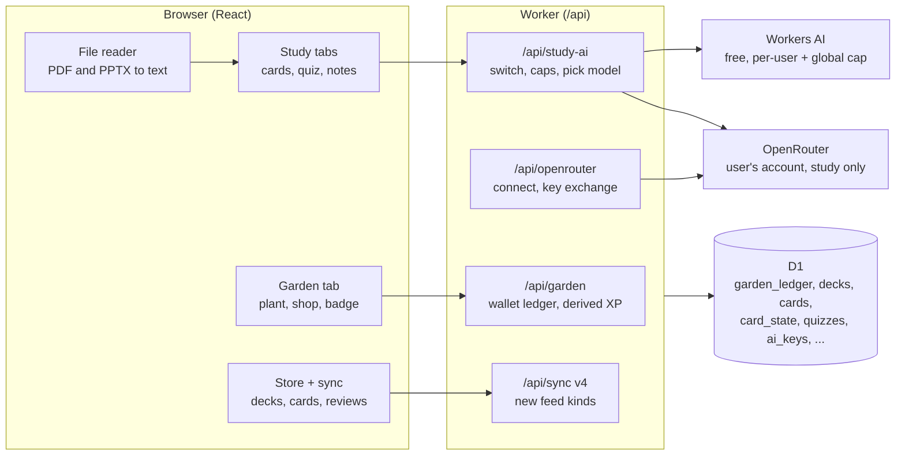

# Study Garden — Design

2026-10-14 · George · Companion spec: [2026-10-14-study-garden-spec.md](2026-10-14-study-garden-spec.md)

## Summary

Study Garden brings the study tools and game layer from [gvogas/hacks](https://github.com/gvogas/hacks) into the tracker as an opt-in mode. It adds AI notes, flashcards, quizzes and study plans, plus coins, a shop and a plant pet that grows as you study. Members of a shared class can also share their decks, quizzes, notes and material with the class.

The tracker already has Study tabs, a focus timer, achievements, Spotify and Import with AI. Study Garden builds on those instead of copying hacks' FastAPI and SQLite code. Work starts only after Collab Stages 7–10 are on main.

In the app the feature is the **Garden** tab with a **Gameplay** toggle in Settings; "Study Garden" is only the project name.

## Goals and non-goals

**Goals**

- Turn a class's material into flashcards, quizzes, notes and a study plan, and review the cards with spaced repetition.
- Shared classes: members share decks, quizzes, notes and pasted or uploaded material with the class, so everyone studies from the same pool. Each person keeps their own review progress.
- Reward real study: focus-timer minutes, finished items and good grades earn XP and coins.
- A plant pet with 7 tiers, a shop and cosmetics, all behind a gameplay toggle that is off by default.
- Keep AI free: Workers AI with per-user caps, or the user's own OpenRouter account for study features.
- Never block the core tracker: game and study-AI each get their own maintenance switch.

**Non-goals**

- The game is personal: plants, coins and review progress are never shown to others. The existing opt-in study leaderboard stays as it is.
- No web research (hacks used Tavily).
- No paid tiers, no custom domain, no Gemini/OpenAI/Anthropic key paste.
- The plant never dies and never costs coins.
- No AI for Scout or Import with AI through the user's key; those stay on Workers AI.

## Plan review

The decisions from the 10/14 Q&A hold up, but the plan needed eight changes. The biggest: coins and XP must be worked out on the server from synced rows, because the tracker is local-first and every row can be edited.

| # | Finding | Why it matters | Change to the plan |
| --- | --- | --- | --- |
| 1 | Study sessions can be typed in (`manual = 1`) and edited up to 1,440 minutes | A user could log 24 h and buy everything | Only timed sessions earn. XP counts at most 240 timed min/day; manual logs earn nothing |
| 2 | Item status toggles freely (`todo` ↔ `done`), in `items` and in `marks` for class items | Toggling would farm the finish bonus | Award a finish once per item, ever, through a ledger row keyed by item id; tasks, office hours, tutoring and custom types pay at most 5 a day, since anyone can make those |
| 3 | The tracker syncs through the `changes` feed, and the browser holds a full copy | A client-side coin count can be forged | The Worker owns the wallet. The browser only shows what `GET /api/garden` returns |
| 4 | XP from edited or deleted sessions | Deleting a session should not keep its XP | XP is derived from live sessions on read, not stored. Coins earned are ledger rows, so a spend never goes negative after a delete |
| 5 | PDF text is already extracted in the browser (`src/core/pdftext.ts`, vendored pdf.js) | The plan said "parse files in the Worker" | Parse in the browser. PPTX = zip + slide XML, read with `DecompressionStream`; no new library |
| 6 | Workers AI is shared: ~108 neurons per Scout screenshot, 10 outline reads per user per day | Study AI could starve Import with AI | A global study-AI ceiling of 4,000 neurons/day (estimated from token counts) on top of per-user caps |
| 7 | Today's client rejects a whole sync page that holds a kind it does not know (`src/core/api.ts:186`); old v2 tabs pull only five kinds (`worker/db.js:294`) | New decks and cards must not break open tabs | New kinds are served only on a new sync v4; v3 keeps its seven kinds |
| 8 | Flashcards are useful without AI | Everyone gets value even with the AI cap spent | Manual card creation ships first; AI generation fills the same decks |

**Stage order, revised.** Game core (toggle, ledger, Garden) comes first because it touches no AI. Decks and spaced repetition come before the AI gateway, so AI generation drops into a working deck. Quizzes need the gateway; notes and plans come next; shared class materials come last.

## Architecture

Study Garden adds three Worker route groups, extends sync, and adds eleven D1 tables. Every coin and every AI call passes through the Worker, which checks the `garden` or `studyai` switch first.

The browser turns files into text and sends only text. `/api/study-ai` uses the user's OpenRouter key when one is stored, and capped Workers AI when not.

- **Wallet.** `garden_ledger` holds one row per award or spend, with a unique key per source (`session:<id>`, `item:<scope>:<id>`, `claim:<tier>`, `buy:<sku>:<n>`) so nothing pays twice. Balance = sum of rows. XP is worked out on read from timed sessions and first finishes.
- **Decks and reviews.** Study content (decks, cards, quizzes, docs) carries a `scope` like items: `u:` when personal, `c:<space>` when shared with a class. Review progress (`card_state`, `card_reviews`) is always personal, in the user's `u:` feed, so review works offline and syncs.
- **AI gateway.** One module picks the provider, enforces caps through `request_limits` (`claimLimit`, as outline reads do), estimates neurons from token counts, and writes the usage line to Workers Logs.
- **OpenRouter Connect.** PKCE: the browser goes to `openrouter.ai/auth` with an S256 challenge and a state; the callback swaps the code at `POST /api/v1/auth/keys` within 10 minutes. The key is encrypted with the AES-GCM keyring already used for Spotify tokens (`worker/spotify/tokens.js`) and never sent to the browser.

## User experience

With gameplay off, nothing new shows apart from flashcards and AI tools in Study. Turning it on in Settings adds the Garden tab and a header badge.

| Surface | Shows | Gameplay off |
| --- | --- | --- |
| Settings › Gameplay | Gameplay toggle; "AI for study" card: Connect OpenRouter / Disconnect, "Using: free shared quota (2 left today)" or "Using: your OpenRouter account" with a model picker (4 tested free models; any model when the account has credit) | AI card still shows |
| Header badge | Plant thumbnail + coin count; tap opens Garden | Hidden |
| Garden tab | Plant (sprite by tier, wilt level by health), XP bar to next tier, streak, tier list with Claim/Equip, shop (upgrades, backgrounds and frames, AI uses), recent earnings | Hidden |
| Study › Cards | Decks per class (mine and shared), "N due" count, review screen (flip, Again/Good/Easy), add card by hand, Generate with AI | Shows; no coins or heal |
| Study › Quiz | Generate quiz (1–20 questions, difficulty), take it, score, weak topics; link to an exam | Shows; no plant effect |
| Study › Notes & plan | Generate notes from class data, files or a topic; a plan up to the class's next exam that weights weak topics | Shows |
| Class sheet › Materials | Shared decks, quizzes, notes and material; Add material; Share from mine; Generate | Shows (shared classes) |
| Focus screen | "+N XP" toast when a timed session ends | No toast |

**Generate flow.** Pick a class, pick sources (class items and notes, uploaded PDF/PPTX/TXT/MD, or a typed topic), pick counts, then Generate. Files are read in the browser and only text is sent. A preview lists the cards or questions; the user removes any before saving.

**Caps shown up front.** The Generate button says how many free uses are left today, or that the user's OpenRouter account will be used. A spent cap offers Connect OpenRouter or a coin-bought extra use.

**More ways in.** Generate also opens from an exam's item card, the class sheet, and a toast after a lecture review. A quiz can be linked to an exam and add its weak topics to that exam's prep checklist. The study plan runs to the class's next exam by default.

**Reminders.** A "N cards due" chip on today in Week view, a drooping header plant while cards wait, and optional "Review N cards" events in the calendar feed.

**Sharing.** Sharing to a class makes a copy and posts to the class inbox (Collab Stage 7 activity). The author edits; the author or the class owner/editors remove. No votes or reports.

**Maintenance.** Two new switches: `garden` (hides Garden, badge, earning) and `studyai` (stops generation; hand-made cards still work). Sharing also respects `classes`.

## Game economy

Legendary takes about 65 hours of timed study, roughly one busy semester. hacks reached it in 7 hours (6 XP a minute), which suits a hackathon demo, not a term. All numbers are starting values, kept in one constants file for tuning. Gameplay starts fresh: nothing from before it was turned on counts.

**XP and tiers.** 1 XP per timed minute (max 240 a day) plus 10 XP the first time an item is finished. The plant's tier is set by total XP.

| Tier | XP | Hours of study (approx.) | Claim reward (coins) | Sprite |
| --- | --- | --- | --- | --- |
| Bad | 0 | 0 | 5 | MainFlower1 |
| Average | 120 | 2 | 25 | MainFlower2 |
| Good | 300 | 5 | 50 | MainFlower3 |
| Excellent | 700 | 11 | 100 | MainFlower4 |
| Amazing | 1,400 | 22 | 200 | Sunflower |
| Phenomenal | 2,500 | 40 | 400 | WhiteFlower |
| Legendary | 4,000 | 65 | 800 | CactiBro |

**Coins earned.** 1 coin per 5 timed minutes, 5 per finished item (15 for an exam or project; tasks and other self-made items at most 5 a day), 1 per 10 cards reviewed (max 10 a day), 1 per correct quiz answer (max 20 a day). Upgrades raise each rate.

**Grade bonus.** A grade of 80% or more pays 10 coins, 90% or more pays 25, once per item. Lowering the grade later takes nothing back.

**Streak.** A day with 15+ timed minutes or 10+ card reviews extends the streak and pays 2 coins per streak day, at most 20. Missing a day resets it and never hurts the plant.

**Author reward.** When a classmate first uses a deck or quiz you shared, you get 1 coin, at most 20 a day. Sharing pays a little; it can't be farmed alone.

**Plant health (0–100, never dies).**

| Event | Health |
| --- | --- |
| Lab missed, office hour skipped, or assignment still open a day after due (not tutoring Cancelled or project Dropped) | −10 |
| Wrong quiz answer | −3 |
| 4th and later day in a row with no timed study | −5 per day |
| 10 timed minutes | +1 |
| Card reviewed (once per card per day) | +2 |
| Correct quiz answer | +5 |

Health only changes the look: 70–100 healthy, 40–69 drooping, 15–39 cracked (Cracked2), 0–14 broken (Cracked1). It never removes XP or coins. The shattered-pot sprite (Broken) is not used.

**Shop.**

| Track | Effect per level | Cost (level n) | Max level |
| --- | --- | --- | --- |
| Focus Engine | +20% study coins | 40 + 35n | 5 |
| Card Foundry | +1 coin cap on cards | 55 + 45n | 5 |
| Quiz Magnet | +5 quiz coin cap | 70 + 55n | 5 |
| Finisher | +2 coins per finished item | 65 + 50n | 5 |
| Backgrounds and frames | Cosmetic only | 30–300 each | — |
| Extra AI use | +1 Workers AI generation today | 60 | 2 per day |

Extra AI uses still stop at the global ceiling, so coins can never buy past the shared quota.

## Alternatives considered

| Option | Why not |
| --- | --- |
| Run hacks' FastAPI app beside the tracker | Second host, second login, second database; Cloudflare free tier has no Python server |
| Coins counted in the browser and synced as a row | Editable on the device; any sync conflict could mint coins |
| Paste a Gemini, OpenAI or Anthropic key | User chose OpenRouter Connect: one login, many models, no copy-paste |
| Keep the key only in the browser | Re-entered per device; the Worker could not enforce caps or maintenance |
| User's key also powers Scout and Import with AI | User chose study features only; keeps those reads on the tested Workers AI prompts |
| Plant that dies and costs coins (as in hacks) | Punishing in a tool people open when stressed; user chose gentle |
| Simple flip deck instead of spaced repetition | User chose spaced repetition; the due count also gives a daily reason to return |
| Redraw sprites to follow the tracker's themes | More work; hacks' PNGs are the user's own and ready now |
| Parse uploads in the Worker | The browser already extracts PDF text; the Worker would spend CPU time and request size on it |
| Pot cosmetics | hacks' sprites have the pot drawn in; separate pots would need 7 new sprite sets each. User chose backgrounds and frames |
| Votes, reports or copy-to-mine on shared materials | User chose to keep it simple: the author edits, the author or class owner removes |
| Counting study logged before gameplay was turned on | User chose to start fresh |

## Rollout and open questions

Seven stages, each its own branch (`garden-N-<name>`), merged and released before the next starts. Nothing starts until Collab Stage 10 is on main. Every stage with a migration needs `db:remote` run by hand, since Git builds skip remote migrations.

1. **Game core.** Gameplay toggle, `garden` maintenance switch, wallet ledger, XP worked out from sessions and finished items, Garden tab with plant, tiers and claim, header badge, streak bonus, admin grant for testing.
2. **Shop.** Upgrades, backgrounds and frames, equip, grade bonus; extra AI use stays hidden until Stage 4.
3. **Decks and spaced repetition.** Decks per class, cards by hand, review screen, due counts, card XP and heal; synced as new feed kinds (sync v4); Week view chip, plant nudge and calendar reminders.
4. **AI gateway.** Per-user and global caps, `studyai` switch, OpenRouter Connect with encrypted key, AI flashcard generation from class data, files and topic; model picker; Admin usage and live caps; Generate from the exam card, class sheet and lecture review.
5. **Quizzes.** Generate, take, score, weak topics, plant effects; link to an exam and feed its prep checklist.
6. **Notes and study plan.** Generated notes per class; plan up to the class's next exam (max 30 days) weighted by weak topics.
7. **Shared class materials.** Share a deck, quiz or notes to a class as a copy; add material as text; author and class owner/editors can remove; each share posts to the class inbox; author reward. Uses the `scope` column built into Stages 3–6, so no migration.

**Settled in Q&A (10/14)**

- Sprites: hacks' own mapping (table above); Cracked2 and Cracked1 show low health; Broken is unused.
- OpenRouter shortlist: Gemma 4 31B (default), Nemotron 3 Super 120B, Inkling, Nemotron 3 Ultra 550B; re-test flashcard quality at Stage 4.
- A quiz linked to an exam offers "Add weak topics to exam prep".

**Open**

- [ ] Neurons per generation: measure a 20-card run on Workers AI before fixing the per-user cap (planned: 3 a day).
