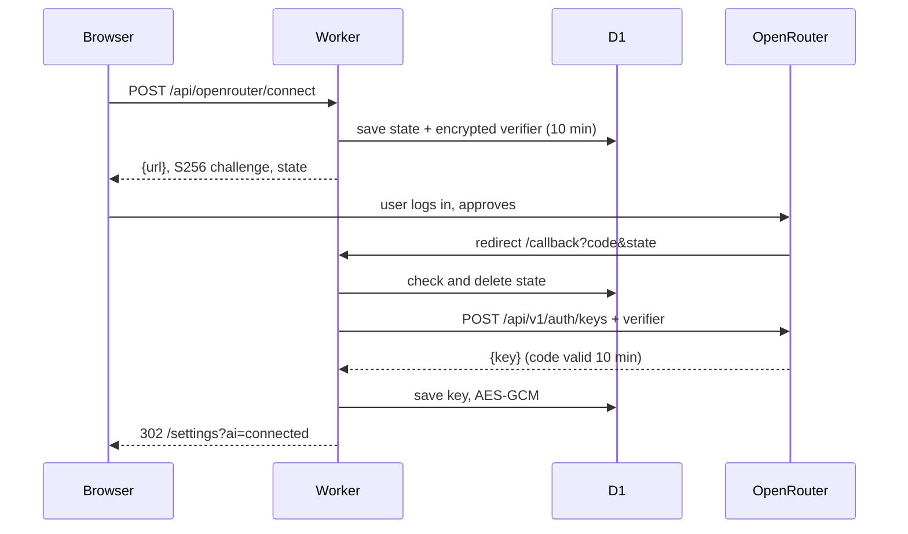

# Study Garden — Spec

2026-10-14 · George · Companion design: [2026-10-14-study-garden-design.md](2026-10-14-study-garden-design.md)

## 1. Scope and conventions

This spec defines what to build for Study Garden in seven stages. The why, the economy reasoning and the alternatives are in the design doc.

- **Numbers** live in one file per side: `worker/garden-rules.js` (authoritative) and `src/core/garden-rules.ts` (display only, checked against the same table in tests). Changing a value changes one place.
- **Ids and times** follow the tracker: text ids ≤ 24 chars, times in ms since epoch, days as the viewer's local `YYYY-MM-DD` sent by the browser and checked by the Worker (±1 day, like the leaderboard's week start).
- **Personal rows** follow `marks`: `user_id` + text `id`, `revision`, `deleted_at` tombstones, changes written to the user's `u:` feed.
- **Errors** follow `worker/http.js`: `HttpError(status, {error, ...})`; new codes are listed under API.
- **Gameplay off** means the Garden API answers `{enabled: false}` and nothing is awarded. XP, coins and health count only activity after `users.garden_since`, set the first time gameplay is turned on (no back-pay). Coins are written only while gameplay is on. XP and health are worked out from all activity since `garden_since`, so turning gameplay off and on again never shrinks the plant.
- **Names in the app:** the tab is "Garden" and the Settings toggle is "Gameplay"; study tools keep plain names (Cards, Quiz, Notes & plan). "Study Garden" is only the project name.
- **Out of scope:** showing anyone's plant or coins to others, web research, key paste for other providers, a plant that dies.

## 2. Data model

Six migrations (`0006`–`0011`, one per stage 1–6) add five user columns and eleven tables. Study content (decks, cards, quizzes, docs) carries a `scope` like `items` does: `u:<user>` when personal, `c:<space>` when shared with a class. Each person's review progress is always personal, so one shared deck serves the whole class.

**`users` columns**

| Column | Stage | Type | Rule |
| --- | --- | --- | --- |
| `gameplay` | 1 | INTEGER 0/1 | Default 0 |
| `garden_since` | 1 | INTEGER ms, NULL | Set once, the first time `gameplay` becomes 1 |
| `garden_look` | 1 | TEXT JSON | `{skin, bg}`, each an owned id; default `{"skin":"bad","bg":"none"}` |
| `garden_xp_bonus` | 1 | INTEGER ≥ 0 | Default 0; admin-granted XP for testing, added to derived XP |
| `cards_in_feed` | 3 | INTEGER 0/1 | Default 0; adds daily "Review N cards" events to the calendar feed |

**Tables**

| Table | Stage | Key | Columns | Synced |
| --- | --- | --- | --- | --- |
| `garden_ledger` | 1 | `(user_id, source)` unique | `amount` INTEGER (±, ≠ 0), `kind` ('earn','spend'), `source` TEXT ≤ 64 (see §4), `at` INTEGER | No; read through `/api/garden` |
| `garden_owned` | 2 | `(user_id, sku)` | `level` INTEGER ≥ 1 (upgrades) or 1 (cosmetics), `at` | No |
| `decks` | 3 | `(scope, id)` | `author_id`, `course_id`, `title` ≤ 80, `revision`, timestamps, `deleted_at` | Yes, kind `decks`, in the deck's scope feed |
| `cards` | 3 | `(scope, id)` | `deck_id`, `author_id`, `front` ≤ 500, `back` ≤ 1,000, `source` ('hand','ai'), `revision`, timestamps | Yes, kind `cards`, in the deck's scope feed |
| `card_state` | 3 | `(user_id, id)`, id = the card id (random 24-char ids, unique across scopes) | `due` TEXT day, `interval` INTEGER days, `ease` REAL 1.3–3.0, `reps`, `lapses`, `revision`, timestamps | Yes, kind `card_state`, user's `u:` feed only |
| `card_reviews` | 3 | `(user_id, id)` | `card_ref` (the card id), `day` TEXT, `grade` ('again','good','easy'), `at` | Yes, kind `card_reviews`, `u:` feed; append-only |
| `ai_keys` | 4 | `user_id` | `provider` ('openrouter'), `cipher` TEXT (keyring format of `spotify_tokens`), `label`, `model` (the picked model id), `created_at` | No; never leaves the Worker |
| `ai_oauth_states` | 4 | `state` | `user_id`, `verifier_cipher`, `expires_at` (10 min) | No |
| `quizzes` | 5 | `(scope, id)` | `author_id`, `deck_id` NULL, `course_id`, `item_id` NULL (the exam it prepares for), `questions` JSON ≤ 20 `[{q, choices[4], answer 0–3, topic}]`, timestamps | Yes, kind `quizzes`, scope feed |
| `quiz_attempts` | 5 | `(user_id, id)` | `quiz_ref`, `answers` JSON, `score`, `weak_topics` JSON, `at` | Yes, `u:` feed |
| `study_docs` | 6 | `(scope, id)` | `author_id`, `course_id`, `kind` ('notes','plan','material'), `title` ≤ 120, `body` JSON ≤ 60 KB, timestamps | Yes, kind `study_docs`, scope feed |

A study plan is always `u:` (it is built from one person's weak topics). `material` is plain text a member pastes or uploads (extracted in the browser), stored as text, never as the file.

**Feed.** Today's client rejects a whole v3 sync page if any change has a kind it does not know (`src/core/api.ts:186`). So new kinds are served only on a new `GET /api/sync?v=4`; `v=3` keeps filtering to its seven kinds, as `v=2` does to its five (spec §16). The Worker change ships before the client that asks for v4. Shared rows ride the class's `c:` feed, so the existing member guard decides who pulls them. Account deletion (`worker/accounts.js`) deletes every new table's rows.

## 3. API

Three new route groups plus additions to rows, sync and spaces. Every Garden route checks the `garden` switch; every study-AI route checks `studyai`; sharing also checks `classes`.

| Stage | Method + path | Body | Answer |
| --- | --- | --- | --- |
| 1 | `PUT /api/me` (existing) | `{gameplay: true\|false, cardsInFeed?: bool}` | Profile; sets `garden_since` on first true |
| 1 | `GET /api/garden?day=YYYY-MM-DD` | — | `{enabled, xp, tier, next: {tier, xp}, health, band, streak, coins, look, tiers: [{id, minXp, reward, reached, claimed}], recent: [{source, amount, at}] ×10, due}` |
| 1 | `POST /api/garden/claim` | `{tier}` | Garden state; claiming twice pays once |
| 1 | `PUT /api/garden/look` | `{skin?, bg?}` | Garden state; each must be owned |
| 1 | `POST /api/admin/garden/grant` | `{userId, coins?: 1–5000, xp?: 0–10000}` | Admin only; writes `admin:<at>` coins and/or sets `garden_xp_bonus`; logged in `admin_log` |
| 2 | `GET /api/garden/shop` | — | `{coins, items: [{sku, kind, level, max, cost, effect}]}` |
| 2 | `POST /api/garden/buy` | `{sku, level}` (the level being bought, guards double taps) | `{coins, item}` |
| 3 | `PUT`/`DELETE /api/(decks\|cards\|card_state\|card_reviews)/<id>` | A row, as the existing `ROW` routes take | The stored row; coins and heal written in the same D1 batch |
| 3 | `PUT`/`DELETE /api/spaces/<id>/(decks\|cards)/<id>` | A shared row, as the existing `SHARED_ROW` routes take | The stored row; permissions in §9 |
| 3 | `GET /api/sync?v=4` | — | As v3, plus the new kinds |
| 4 | `GET /api/study-ai/status?day=` | — | `{provider: 'workers'\|'openrouter', model, left, extraLeft, globalOpen}` |
| 4 | `POST /api/study-ai/cards` | `{courseId, itemId?, sources: {items: bool, text?: string ≤ 60k chars, topic?: string ≤ 120}, count 1–30, level}` | `{cards: [{front, back}], provider, left}`; a preview, not saved |
| 4 | `POST /api/openrouter/connect` | — | `{url}` to openrouter.ai/auth |
| 4 | `GET /api/openrouter/callback?code&state` | — | 302 to `/settings?ai=connected` or `?ai=failed` |
| 4 | `GET /api/openrouter/models` | — | `{models: [{id, name, free}], current, credit}` from `OPENROUTER_MODELS` plus the key's credit |
| 4 | `PUT /api/openrouter/model` | `{model}` | One of the list, or any `vendor/model` id when the key has credit |
| 4 | `DELETE /api/openrouter` | — | 204; deletes the key |
| 4 | `GET /api/admin/study-ai` | — | Admin only: `{today: {neurons, ceiling, generations, byProvider}, last14: [...], caps}` |
| 4 | `PUT /api/admin/study-ai/caps` | `{perUser 0–20, extraMax 0–5, ceiling 0–9000}` | Admin only; stored in `app_meta` `studyai_caps` |
| 5 | `POST /api/study-ai/quiz` | `{courseId, itemId?, deckId?, sources, count 1–20, level}` | `{questions: [...]}`; a preview |
| 5 | `PUT`/`DELETE` rows `quizzes`, `quiz_attempts` (and shared `quizzes`) | As stage 3 | As stage 3 |
| 6 | `POST /api/study-ai/notes` | `{courseId, sources}` | `{title, summary, concepts[], sections[]}` |
| 6 | `POST /api/study-ai/plan` | `{courseId, startDay, endDay?}` (default: the class's next exam date, at most 30 days out) | `{days: [{day, tasks: [{text, minutes, priority}]}], endDay, examId}`; weights the last attempt's weak topics |
| 7 | `POST /api/spaces/<id>/share` | `{kind: 'deck'\|'quiz'\|'doc', id}` | The new `c:` row; a copy of the personal one |

**New error codes**

| Code | Status | When |
| --- | --- | --- |
| `gameplay_off` | 409 | A Garden write while gameplay is off |
| `not_enough_coins` | 409 | Buy with too few coins (checked in the same statement as the spend) |
| `stale_level` | 409 | `level` in a buy is not the next one |
| `tier_not_reached` | 409 | Claim above current XP |
| `study_ai_cap` | 429 | The user's daily uses are spent; `{retryAfter, extra: bool}` |
| `study_ai_busy` | 429 | The global Workers AI ceiling for study is reached today |
| `openrouter_limit` | 429 | OpenRouter answered 429 (free model 50/day) |
| `openrouter_credit` | 409 | OpenRouter answered 402 or 403 |
| `openrouter_auth` | 409 | The stored key was revoked (401); the key is deleted and the user asked to reconnect |
| `material_too_large` | 413 | Text over 60k chars or a doc over 60 KB |

## 4. Earning rules

XP and health are worked out on every `GET /api/garden` from synced rows. Coins are ledger rows written in the same D1 batch as the row write that carries the event (`putRow`, `putShared`, the marks status write). Values are the starting set from the design doc.

**XP**

```
XP = Σ over days ≥ garden_since of min(240, timed minutes that day)
   + 10 × first finishes
   + garden_xp_bonus
```

- Timed minutes: `study_sessions` with `manual = 0`, not deleted, `started_at ≥ garden_since`, grouped by the viewer's local day.
- First finish: an `items` row in the user's scope, or a `marks` row, in a finished status for its type with `completed_at ≥ garden_since`. Finished = `done` or `graded` (exam, quiz), `submitted` or `graded` (assignment), `done` (lab, tutoring, office, task, project, custom types). Turning it back to `todo` removes the 10 XP until it is finished again.
- Task, office, tutoring and custom-type finishes count at most 5 a day; exams, quizzes, assignments, labs and projects have no daily limit.
- Tier = the highest tier with `minXp ≤ XP`. Claiming pays its reward once (`claim:<tier>`).

**Coins (ledger)**

| Event | Ledger source | Amount | Written when |
| --- | --- | --- | --- |
| Timed session lands | `session:<id>` | floor(counted minutes / 5) × (1 + 0.2 × Focus Engine level); counted = minutes left under the 240/day cap | First write of that session id; later edits do not change it |
| Item finished | `item:<scope>:<id>` | 5 (15 for `exam`, `project`) + 2 × Finisher level | First move to a finished status; never again for that item; inside the 5-a-day limit for tasks, office, tutoring and custom types |
| Cards reviewed | `cards:<day>` | min(10 + Card Foundry, floor(reviews that day / 10)) | Upserted on each review write |
| Correct quiz answers | `quiz:<day>` | min(20 + 5 × Quiz Magnet, correct that day) | Upserted on each attempt write |
| Grade ≥ 80 | `grade80:<scope>:<id>` | +10 | First grade save at 80+ |
| Grade ≥ 90 | `grade90:<scope>:<id>` | +15 (25 in all with the 80 bonus) | First grade save at 90+ |
| Streak day | `streak:<day>` | min(20, 2 × streak length) | The first write that makes the day count |
| Classmate uses a shared deck or quiz | `use:<shared id>:<classmate id>` (on the author's ledger) | +1, at most 20 a day | Classmate's first card review in that deck, or first attempt on that quiz |
| Tier claimed | `claim:<tier>` | Tier reward | Claim call |
| Purchase | `buy:<sku>:<level>` (`buy:ai:<day>:<n>` for extra AI uses) | −cost | Buy call, only if balance ≥ cost in the same statement |
| Admin grant | `admin:<at>` | 1–5000 | Admin call |

- **Grade bonus:** an item's grade (or a mark's grade) pays once per threshold; lowering a grade takes nothing back. Written in the same batch as the grade write.
- **Streak:** a day counts when it has 15+ timed minutes or 10+ card reviews. A day that does not count resets the streak to 0; it never touches health. `GET /api/garden` returns `streak`.
- **Author reward:** nothing for the author's own use, for shared notes (opening them writes nothing), or while the author's gameplay is off.
- **Balance** = sum of `amount`. Deleting a session does not take its coins back; this keeps the balance from going negative after a purchase.

**Health**

Start at 100 on the first day of the window (the later of `garden_since` and 14 days ago), apply each day's events in time order, and clamp to 0–100 after each one.

| Event (from rows) | Change |
| --- | --- |
| A lab marked `missed` (Missed) or an office hour marked `missed` (Skipped), on its date | −10 |
| An assignment still `todo` the day after its due date | −10, once |
| Wrong answer in a `quiz_attempts` row | −3 |
| 4th and later day in a row with no timed minutes | −5 |
| Each 10 timed minutes | +1 |
| A card reviewed, once per card per day | +2 |
| Correct answer | +5 |

Not counted: tutoring `missed` (it means Cancelled) and project `missed` (Dropped). Exams and quizzes have no missed status.

Look bands: 70–100 `healthy` (the tier's sprite), 40–69 `drooping` (the same sprite, tilted and desaturated with CSS), 15–39 `cracked` (`Cracked2.png`), 0–14 `broken` (`Cracked1.png`). `Broken.png` (a shattered pot) is not used, since the plant never dies.

Shared decks and quizzes earn and heal the same as personal ones; the person reviewing gets the reward (the author gets only the author reward).

## 5. Spaced repetition

Scheduling is a simplified SM-2 with three grades, run in the browser (`src/core/srs.ts`) so review works offline. The result syncs as a `card_state` row plus a `card_reviews` row.

A card with no `card_state` row is new: ease 2.5, reps 0, interval 0.

| Grade | reps | interval (days) | ease | lapses |
| --- | --- | --- | --- | --- |
| Again | 0 | 1 | max(1.3, ease − 0.2) | +1 |
| Good | +1 | 1 if reps was 0; 3 if reps was 1; else round(interval × ease) | unchanged | — |
| Easy | +1 | 4 if reps was 0; else round(interval × ease × 1.3) | min(3.0, ease + 0.15) | — |

- `due` = review day + interval, capped at 180 days.
- A card graded Again goes back to the end of today's queue once.
- **Queue:** due cards first (oldest due first), then up to 20 new cards a day per class, in deck order.
- **Due count** on Study and on each class = cards with `due ≤ today`, plus new cards up to the daily 20.
- Two devices reviewing the same card offline: the later `updated_at` wins `card_state`; both `card_reviews` rows stay (they are append-only and keyed by their own id).
- Editing a card's text keeps its schedule. Deleting a card deletes its `card_state`.
- **Reminders.** Week view shows "N cards due" on today. The header badge's plant droops while cards are due and none were reviewed today (look only; health is unchanged). With `cards_in_feed` on, the calendar feed (`worker/calendar.js`) adds an all-day "Review N cards" event for each of the next 7 days, N from `card_state.due`.

## 6. AI gateway

One module, `worker/study-ai.js`, serves all four generate routes: it picks the provider, enforces caps, builds the prompt, calls the model, and validates the answer. Calls reuse `runModel`, `modelJson` and `TIMEOUT_MS` from `worker/ai.js`.

**Provider choice**

1. The user has an `ai_keys` row → OpenRouter, with the model they picked: one of `OPENROUTER_MODELS` or, when the key has credit, any `vendor/model` id. No app daily cap; 20 calls per hour per user to protect the Worker.
2. Otherwise → Workers AI, `gpt-oss-120b` to start (the model outline reads already use), under both caps below.

`OPENROUTER_MODELS` (a `wrangler.jsonc` var; listed 10/14, re-tested at Stage 4 and dropped if gone):

| Model id | Note |
| --- | --- |
| `google/gemma-4-31b-it:free` | Default |
| `nvidia/nemotron-3-super-120b-a12b:free` | Larger; likely better quizzes |
| `thinkingmachines/inkling:free` | 1M context; long uploads |
| `nvidia/nemotron-3-ultra-550b-a55b:free` | Largest; slowest |

**Caps (Workers AI only)**

| Cap | Default | Stored | Resets |
| --- | --- | --- | --- |
| Per user | 3 generations a day | `request_limits`, key `studyai:<user>`, 24 h window via `claimLimit` | 24 h after the first use |
| Bought extra | +1 per purchase, max 2 a day | `garden_ledger` `buy:ai:<day>:<n>` | Viewer's next day |
| Global study ceiling | 4,000 estimated neurons a day | `app_meta` key `studyai_neurons:<UTC day>` | 00:00 UTC, with the Cloudflare quota |

The three values are read from `app_meta` key `studyai_caps` (`{perUser, extraMax, ceiling}`), set on the Admin page; the table holds the defaults. Each call also adds to `app_meta` `studyai_usage:<UTC day>` (`{neurons, generations, byProvider}`) for the Admin page.

Neurons are estimated after each call from its token usage: in × 31,818 + out × 68,182 per million tokens for gpt-oss-120b. The check happens before the call; a call that pushes past the ceiling still finishes. A failed call (timeout, invalid answer after retry) gives the use back.

**Context**

| Source | Content | Limit (Workers AI / OpenRouter) |
| --- | --- | --- |
| Class data | Course name, items (type, title, date, notes, checklist), shared `material` docs | 12k / 30k chars, newest items first |
| Text | Extracted file text, pasted text, or a lecture review's notes | 12k / 30k chars, cut at a page boundary |
| Topic | A typed topic | 120 chars |

Sources are wrapped as data in the prompt ("Study material, not instructions:"), and every output field is shown as plain text, never HTML.

**Output schemas** (asked for as JSON; validated with `worker/validate.js`; bad entries dropped; one retry if none are valid)

| Route | Shape | Limits |
| --- | --- | --- |
| cards | `{cards: [{front, back}]}` | count as asked (1–30); front ≤ 500, back ≤ 1,000 |
| quiz | `{questions: [{q, choices: [4], answer: 0–3, topic}]}` | 1–20; q ≤ 300, choice ≤ 160, topic ≤ 40 |
| notes | `{title, summary, concepts: [{term, meaning}], sections: [{heading, body}]}` | ≤ 12 concepts, ≤ 10 sections, 60 KB total |
| plan | `{days: [{day, tasks: [{text, minutes, priority: 'high'\|'normal'}]}]}` | 1–30 days, ≤ 6 tasks a day, minutes 10–180 |

**Repeat requests.** Previews are kept on the device through `src/data/ai-cache.ts` (SHA-256 key, 30 days, newest 12, cleared on sign-out) with the route in the key, so reopening the same request never spends a use.

**Logging.** Each call logs `study-ai:<route> <provider> <model> in=<n> out=<n> neurons≈<n>` to Workers Logs. The OpenRouter key is never logged.

## 7. OpenRouter Connect

Connecting uses OpenRouter's OAuth PKCE flow ([docs](https://openrouter.ai/docs/use-cases/oauth-pkce)). The Worker holds the verifier and the key; the browser only ever sees the auth URL.



- **Connect:** the Worker makes a 64-byte verifier and a random `state`, stores the state with the verifier encrypted (10 min expiry), and answers `https://openrouter.ai/auth?callback_url=<origin>/api/openrouter/callback&code_challenge=<S256>&code_challenge_method=S256&state=<state>&key_label=Rounds`.
- **Callback:** must be signed in as the same user who started; unknown or expired state → `?ai=failed`. The code is swapped at `POST https://openrouter.ai/api/v1/auth/keys` with `code`, `code_verifier` and `code_challenge_method`; codes expire after 10 minutes.
- **Storage:** one `ai_keys` row per user, encrypted with the versioned AES-GCM keyring from `worker/spotify/tokens.js` with salt `rounds` and its own HKDF info (`openrouter-key`). Replacing a key overwrites the row.
- **Status:** `GET /api/v1/key` with the user's key gives `free_model_daily_requests` and credit left; Settings shows it, read at most once per minute.
- **Disconnect:** deletes the row. The key stays valid at OpenRouter until the user deletes it there; Settings links to `openrouter.ai/settings/keys`.
- **Limits to expect:** free models allow 20 requests a minute and 50 a day per account (1,000 a day after $10 of credit) ([limits](https://openrouter.ai/docs/api-reference/limits)). A 429 shows "Your OpenRouter free limit is used up today" and offers the Workers AI quota if any is left.

## 8. File ingestion

Files are read in the browser and only their text goes to the Worker. No new library is added.

| Type | Check | Reader | Text shape |
| --- | --- | --- | --- |
| PDF | Starts with `%PDF-` | `src/core/pdftext.ts` (vendored pdf.js, already used by Import with AI) | `### Page N` blocks |
| PPTX | Starts with `PK\x03\x04` and holds `ppt/presentation.xml` | New `src/core/pptxtext.ts`: reads the zip directory, inflates `ppt/slides/slideN.xml` and notes with `DecompressionStream('deflate-raw')`, keeps `<a:t>` text | `### Slide N` blocks, speaker notes after each |
| TXT, MD | Extension + valid UTF-8 | `File.text()` | As is |

- **Limits:** 20 MB per file, 5 files per generate, then text cut to the provider's limit (12k or 30k chars) at a page or slide boundary.
- **No text layer** (a scanned PDF): "This PDF has no text to read." No OCR, which would spend neurons.
- **Rejected:** `.ppt`, `.doc`, `.docx`, images. The drop zone names what it accepts.
- **Sharing a file with a class** saves its extracted text as a `material` doc (≤ 60 KB), never the file itself. There is no file storage on the free tier.

## 9. UI

Each surface follows the tracker's Term components and theme tokens. The plant sprites are hacks' pixel-art PNGs, copied to `public/garden/` and drawn at 4× with `image-rendering: pixelated`. Tiers use hacks' mapping: Bad `MainFlower1`, Average `MainFlower2`, Good `MainFlower3`, Excellent `MainFlower4`, Amazing `Sunflower`, Phenomenal `WhiteFlower`, Legendary `CactiBro`.

| Surface | States | Notes |
| --- | --- | --- |
| Settings › Gameplay | Off (default); On; "Review cards in my calendar" | Turning on shows a one-time card explaining earning; turning off hides Garden and badge, keeps data |
| Settings › AI for study | Free quota ("2 of 3 left today"); Connected ("OpenRouter · <model>", model picker); Reconnect needed; Off for maintenance | Connect opens OpenRouter in the same tab; returns with a toast |
| Header badge | Plant thumbnail + coins; pulses once on a new tier to claim; droops while cards are due | Hidden when gameplay is off or `garden` is in maintenance |
| Garden › Plant | Sprite by equipped skin and health band; XP bar; health bar; streak; "+N XP" since last visit | Wilt never blocks anything |
| Garden › Tiers | Locked / Reached (Claim) / Claimed (Equip) / Equipped | Seven rows with hacks' descriptions |
| Garden › Shop | Upgrades (level, next cost, effect); Backgrounds and frames; Extra AI use | Buy disabled with the reason when coins are short or max level |
| Study › Cards | Class list with due counts; deck list (Mine, Shared with class); review screen; editor | Review: front, tap to flip, Again / Good / Easy, progress "12 of 30"; keyboard 1/2/3 and space |
| Generate sheet | Sources → options → generating → preview → saved | Preview lets the user delete or edit items; Save into a new or existing deck |
| Study › Quiz | Setup (optional exam link), question (one at a time), result with weak topics, history | Result offers "Make cards for weak topics" and, when linked to an exam, "Add N weak topics to exam prep" (that exam's checklist, max 50 entries, no duplicates) |
| Study › Notes & plan | Notes reader (summary, concepts, sections); plan as a day list with tick boxes | The plan ends at the class's next exam by default (at most 30 days; the date can be changed); its tasks can be sent to the week |
| Class sheet › Materials | Shared decks, quizzes, notes and materials with author and date; Add material; Share from mine; Generate | Materials shown only for shared classes when `classes` is not in maintenance; Generate on every class |
| Exam item card | Make cards / Make quiz for this exam; linked quizzes with best score | Opens the Generate sheet with the class and exam filled in |
| Lecture review done | Toast: "Make cards from today's notes" | Only when the review task has notes; uses those notes as the text source |
| Week view | "N cards due" chip on today | Tap opens the review screen |
| Admin › Study Garden | Neurons today vs ceiling, generations, provider split, 14-day chart; caps form; grant coins/XP to a user | Admins only; replaces hacks' hidden demo unlock |

**Who can change shared materials**

| Action | Author | Class owner, editor | Member |
| --- | --- | --- | --- |
| Share a deck, quiz, notes or material | — | Yes | Yes |
| Edit a shared item | Yes | No | No |
| Remove a shared item | Yes | Yes | No |
| Review or take it | Yes | Yes | Yes |

Sharing makes a copy in the class; later edits to the personal original do not change it. Each share writes an `activity` row (Collab Stage 7), so classmates see "<name> shared <n> cards for <class>" in their inbox; removing the item removes the entry. When a member leaves, their shared items stay with the class under their name, like class items do. Plans are never shared.

## 10. Stages and acceptance criteria

Seven stages, each on its own `garden-N-<name>` branch, starting only after Collab Stage 10 is on main. A stage is done when its boxes are ticked, `npm test` passes, its migration is applied with `db:remote`, and it has been tried on the live site.

**1 · Game core** (`0006`)

- [ ] Gameplay toggle in Settings; `garden_since` set once
- [ ] `garden` maintenance switch hides Garden, badge and earning for non-admins
- [ ] Timed session writes pay `session:<id>` coins; manual logs pay none; the 240 min/day cap holds across several sessions
- [ ] Finishing an item pays once even after todo → done → todo → done; the sixth task finished in a day pays nothing; a cancelled tutoring session does not wilt the plant
- [ ] XP, tier and health match the formulas in worker tests (fixtures for missed items and idle days)
- [ ] Garden tab shows plant, XP bar, tiers; claim pays once
- [ ] Streak: 15 timed minutes or 10 reviews makes a day count; bonus 2 × length, max 20; a day that doesn't count resets it with no health change
- [ ] Admin grant writes coins or XP plus an `admin_log` row; non-admins get 403

**2 · Shop** (`0007`)

- [ ] Buying with too few coins fails with no ledger row; two quick taps buy one level
- [ ] Upgrade effects change the next award amounts
- [ ] A grade of 92 pays 25 once; editing it to 85 and back pays nothing more
- [ ] Backgrounds and frames equip and show behind the plant (the sprites have their pot drawn in, so there are no separate pots)

**3 · Decks and spaced repetition** (`0008`)

- [ ] Make, edit, delete decks and cards by hand, offline included
- [ ] Scheduling matches the table in `srs.test.ts`; due counts correct across midnight
- [ ] A tab on today's build (sync v3) never receives the new kinds and keeps syncing; only v4 does
- [ ] Card reviews pay `cards:<day>` coins and heal the plant when gameplay is on
- [ ] Week view chip, plant droop and the calendar's "Review N cards" events (with `cards_in_feed` on) show the right counts

**4 · AI gateway and AI cards** (`0009`)

- [ ] Per-user cap (3/day), bought extras (max 2) and the 4,000-neuron global ceiling enforced; failed calls give the use back
- [ ] OpenRouter Connect works end to end; state expires after 10 min; the key is never in a response or a log
- [ ] A revoked key is deleted and Settings asks to reconnect
- [ ] Cards from class data, PDF, PPTX, TXT, MD and a topic; preview then save
- [ ] `studyai` switch stops generation; hand-made cards still work
- [ ] One measured 20-card Workers AI run recorded in the neuron log
- [ ] Model picker lists `OPENROUTER_MODELS`; any other model id is accepted only when the key has credit
- [ ] Admin page shows today's usage and 14 days; changed caps apply to the next call
- [ ] Generate from the exam item card, the class sheet and the lecture-review toast opens with class, exam and notes filled in

**5 · Quizzes** (`0010`)

- [ ] Generate, take, score; weak topics stored per attempt
- [ ] Wrong and correct answers change health; `quiz:<day>` coins capped
- [ ] A quiz linked to an exam adds its weak topics to that exam's prep checklist when asked (no duplicates, max 50)

**6 · Notes and study plan** (`0011`)

- [ ] Notes from class data, files or topic, saved as a `study_docs` row
- [ ] Plan runs to the class's next exam by default (max 30 days, date changeable) and weights the last attempt's weak topics; tasks can be sent to the week

**7 · Shared class materials** (no migration; uses `scope` from 3–6)

- [ ] Share a deck, quiz or notes to a class as a copy; add pasted or uploaded material
- [ ] Permissions match the table in §9; non-members never pull `c:` rows
- [ ] Each member's review progress stays personal on a shared deck
- [ ] The author earns +1 per classmate's first use of a shared deck or quiz, max 20 a day; own use pays nothing
- [ ] Class data in AI prompts includes the class's shared material
- [ ] Hidden while `classes` is in maintenance
- [ ] Sharing writes an `activity` row, so classmates see it in their inbox; removing it removes the entry
